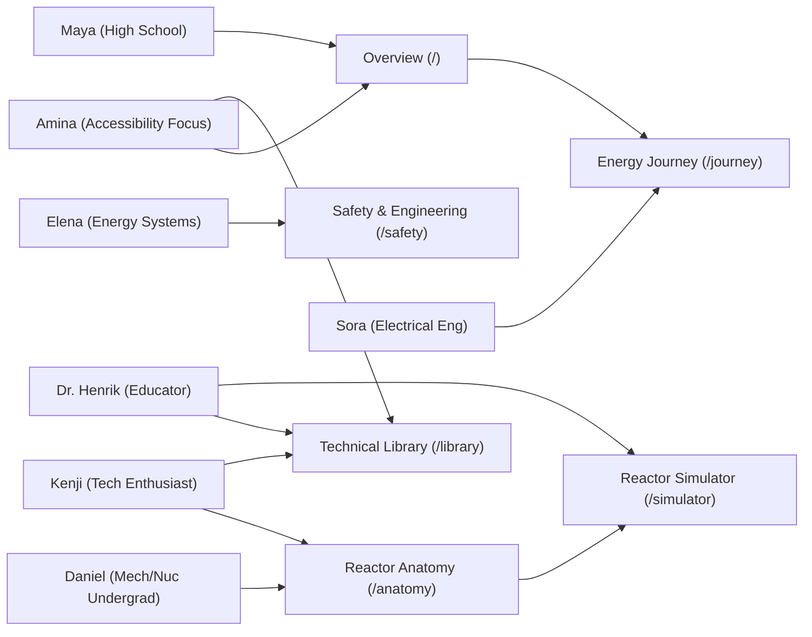

# Audience and Personas

| Field | Value |
|---|---|
| Doc ID | HAK-DOC-PERSONAS |
| Status | Draft |
| Owner stage | Stage 1 (Governance & Product Foundation) |
| Depends on | HAK-DOC-VISION, HAK-DOC-OBJECTIVES, HAK-DOC-SCOPE |
| Requirements | HAK-PRD-002, HAK-PRD-003, HAK-PRD-004, HAK-PRD-006, HAK-PRD-008, HAK-PRD-011, HAK-PRD-013, HAK-PRD-014, HAK-PRD-016, HAK-PRD-017 |

## 1. Purpose

This document defines HAKUREN's target audience segments and **seven concrete user personas** covering secondary students, university STEM learners, mechanical and electrical engineering students, energy systems/policy learners, educators, technical software/enthusiast audiences, and accessibility-dependent self-learners. Each persona specifies goals, prior knowledge, learning needs, and exact value derived from each of the six canonical modules.

## 2. Audience Segmentation

| Segment | Typical Background | Primary Entry Modules | Core Educational Need |
|---|---|---|---|
| **Secondary / Pre-University Students** | High-school physics/chemistry; basic energy conservation | `Overview` (`/`), `Energy Journey` (`/journey`) | Visual mental model linking atoms splitting (`HAK-SRC-004`) to boiling water and spinning turbines without intimidating math. |
| **University Nuclear & Mechanical Learners** | Undergraduate thermodynamics, fluid mechanics, heat transfer | `Reactor Anatomy` (`/anatomy`), `Reactor Simulator` (`/simulator`), `Technical Library` (`/library`) | Spatial clarity of RPV, SG U-tubes, pressurizer, and RCPs (`HAK-SRC-001`) paired with Rankine efficiency and transient sensitivity. |
| **Electrical & Power Engineering Learners** | Circuits, synchronous generators, grid frequency/load | `Energy Journey` (`/journey`), `Reactor Simulator` (`/simulator`) | Understanding turbine-generator mechanical-to-electrical coupling, thermal vs. electrical megawatts (`MWth` vs. `MWe`), and grid load interaction. |
| **Energy Systems & Policy Learners** | Sustainability, energy economics, grid decarbonization | `Overview` (`/`) , `Safety & Engineering` (`/safety`), `Technical Library` (`/library`) | Objective comparison of PWR, BWR, and SMR families (`HAK-SRC-002`, `HAK-SRC-003`), capacity/siting context, and defense-in-depth literacy (`HAK-SRC-005`). |
| **Educators & Lecturers** | University faculty, high-school AP teachers, STEM outreach leads | All 6 via direct links (`HAK-PRD-014`) | Reliable browser-based visual demos, clean projector legibility, SI unit consistency (`HAK-SRC-010`), and repeatable simulator scenarios (`HAK-PRD-009`). |
| **Technical Enthusiasts & Software Engineers** | Self-directed STEM professionals, 3D/simulation developers | `Reactor Anatomy` (`/anatomy`), `Reactor Simulator` (`/simulator`), `Technical Library` (`/library`) | Deep component detail, inspectable simulation equations and validity bounds (`HAK-PRD-010`), and open source-attributed reference tables. |
| **Accessibility-Dependent & Assistive-Tech Learners** | Keyboard-only, screen-reader, low-vision, or reduced-motion users | All 6 modules | Full keyboard reachability, non-3D structured equivalents for geometry metadata, WCAG 2.2 AA contrast (`HAK-SRC-008`), and motion controls (`HAK-PRD-017`). |

## 3. Non-Linear Persona Entry Flows

## 4. Concrete Personas and Six-Module Value Mapping

### Persona 1: Maya Lin — Curious High-School / AP Physics Student
- **Profile:** Age 17, secondary STEM track, comfortable with basic energy conservation ($E = mc^2$ conceptually, $Q = mc\Delta T$), zero prior nuclear engineering vocabulary.
- **Goals:** Understand what happens inside a nuclear power plant, why nuclear plants have cooling towers or condensers, and whether reactors work "like nuclear bombs" (a common misconception to dispel gently).
- **Prior Knowledge & Misconceptions:** Often confuses primary coolant with steam leaving cooling towers; assumes uranium fuel "burns" like coal.
- **Key Needs:** Plain-language definitions on hover, visual animation of closed primary vs. secondary loops (`HAK-SRC-001`), and a clear separation between civilian fission (`HAK-SRC-004`) and excluded topics.

| Module | How It Serves Maya |
|---|---|
| **Overview (`/`)** | Immediately distinguishes civilian power generation from misconceptions and guides her to *Discover* via Energy Journey or Reactor Anatomy (`HAK-PRD-003`). |
| **Reactor Anatomy (`/anatomy`)** | Uses *Plant* and *System* zoom levels with color-coded primary (cyan/amber) vs. secondary loops to show that reactor water never touches the turbine (`HAK-PRD-004`). |
| **Energy Journey (`/journey`)** | Walks step-by-step from fission heat in ceramic fuel pellets (`HAK-SRC-004`) to steam turbine rotation and condenser return (`HAK-PRD-006`). |
| **Reactor Simulator (`/simulator`)** | Uses a safe "Nominal Power" preset to slide control-rod position slightly and see thermal power rise and fall intuitively (`HAK-PRD-008`). |
| **Safety & Engineering (`/safety`)** | Visually explains the dome-shaped concrete containment (`HAK-SRC-006`) and nested barriers (`HAK-SRC-005`) in accessible, non-alarmist terms. |
| **Technical Library (`/library`)** | Supplies plain-English glossary popovers for terms like *moderator*, *pressurizer*, and *condenser* (`HAK-PRD-013`). |

---

### Persona 2: Daniel Okafor — Undergraduate Nuclear / Mechanical Engineering Student
- **Profile:** Age 20, third-year mechanical/nuclear engineering student studying thermodynamics (Rankine cycles) and heat transfer.
- **Goals:** Connect textbook Rankine T-s diagrams and U-tube heat exchangers to actual spatial reactor geometry and coupled primary-secondary transient behavior.
- **Prior Knowledge & Misconceptions:** Knows conservation of energy and heat exchanger $\Delta T$, but struggles to visualize how a pressurizer maintains subcooled primary water at high pressure (`HAK-SRC-001`).
- **Key Needs:** Section cuts of the RPV and steam generator, canonical SI units (`MPa`, `K`, `MW`, `kg/s`, `HAK-SRC-010`), and transparent governing equations behind the simulator.

| Module | How It Serves Daniel |
|---|---|
| **Overview (`/`)** | Quickly confirms HAKUREN Reference PWR baseline parameters and jumps directly to `/anatomy` or `/simulator` (`HAK-PRD-014`). |
| **Reactor Anatomy (`/anatomy`)** | Uses **Component** level, section cuts, and exploded views (`HAK-PRD-005`) to inspect fuel assembly lattices, CRDM housings, SG U-tube bundles, and pressurizer heaters/sprays. |
| **Energy Journey (`/journey`)** | Verifies thermal-to-electric energy balance (`HAK-PRD-007`), observing why roughly two-thirds of fission thermal power is rejected at the condenser (`[SIMP]` Rankine limit). |
| **Reactor Simulator (`/simulator`)** | Runs predefined load-change and cooling scenarios (`HAK-PRD-009`), inspecting time-series temperature/pressure trends and checking model equations (`HAK-PRD-010`). |
| **Safety & Engineering (`/safety`)** | Studies how passive natural circulation and redundant emergency cooling fulfill core heat removal concepts (`HAK-PRD-012`). |
| **Technical Library (`/library`)** | Uses the formula reference, SI unit conversion table, and verified NRC/DOE citations (`HAK-SRC-001`, `HAK-SRC-004`) for lab reports (`HAK-PRD-013`). |

---

### Persona 3: Sora Takahashi — Electrical & Power Systems Engineering Learner
- **Profile:** Age 23, electrical engineering master's student focusing on grid stability, synchronous machines, and baseload generation.
- **Goals:** Understand the thermal-mechanical boundary upstream of the synchronous generator and how reactor thermal output responds when electrical grid load changes.
- **Prior Knowledge & Misconceptions:** Strong on three-phase AC generation and grid inertia; treats the nuclear steam supply system as a black-box boiler.
- **Key Needs:** Clear linkage between steam turbine torque, generator electrical output (`MWe`), plant auxiliary power (e.g., RCP electrical demand, `HAK-SRC-001`), and thermal inertia.

| Module | How It Serves Sora |
|---|---|
| **Overview (`/`)** | Frames the nuclear station within the electrical power system context (`Discover`) and points to `/journey`. |
| **Reactor Anatomy (`/anatomy`)** | Inspects the turbine-generator hall at *Plant* and *System* levels alongside primary RCPs (`HAK-PRD-004`), clarifying where nuclear vs. conventional balance-of-plant equipment sits. |
| **Energy Journey (`/journey`)** | Focuses on Steps 4–6 (turbine expansion → synchronous electrical generation → condenser heat rejection, `HAK-PRD-006`, `HAK-PRD-007`). |
| **Reactor Simulator (`/simulator`)** | Experiments with secondary load demand scenarios (`HAK-PRD-008`, `HAK-PRD-009`) to see how thermal lag differs from fast electrical power electronics. |
| **Safety & Engineering (`/safety`)** | Learns why loss of offsite grid power matters for electrically driven coolant pumps and why backup onsite power and passive systems exist (`HAK-SRC-001`, `HAK-PRD-012`). |
| **Technical Library (`/library`)** | References canonical power terminology (`MWth` vs. `MWe`), generator efficiency definitions, and SI unit conventions (`HAK-SRC-010`). |

---

### Persona 4: Elena Novak — Energy Systems & Clean-Energy Policy Learner
- **Profile:** Age 29, energy systems analyst / graduate policy researcher comparing dispatchable low-carbon electricity sources.
- **Goals:** Build an objective engineering vocabulary to compare conventional gigawatt PWRs, BWRs, and emerging SMR concepts without relying on marketing hype.
- **Prior Knowledge & Misconceptions:** Understands levelized cost and grid capacity factors; sometimes assumes "SMR" refers to one single standardized reactor design rather than a broad technology family.
- **Key Needs:** Clear distinction between generic PWR architecture and vendor examples, structured PWR/BWR/SMR comparisons (`HAK-SRC-002`, `HAK-SRC-003`), and credible safety-barrier literacy (`HAK-SRC-005`).

| Module | How It Serves Elena |
|---|---|
| **Overview (`/`)** | Provides high-level orientation on civilian fission's physical workflow and links directly to `/safety` and `/library`. |
| **Reactor Anatomy (`/anatomy`)** | Gives tactile spatial appreciation for containment scale (`HAK-SRC-006`) and primary/secondary equipment complexity at the *Plant* level. |
| **Energy Journey (`/journey`)** | Explains why nuclear plants can supply either electricity or industrial process heat (`HAK-SRC-003`) via thermal steam extraction. |
| **Reactor Simulator (`/simulator`)** | Observes how thermal power, efficiency, and heat rejection scale conceptually without needing reactor physics coursework (`HAK-PRD-008`). |
| **Safety & Engineering (`/safety`)** | Directly delivers her core need: defense-in-depth layers (`HAK-SRC-005`), passive vs. active cooling, and structured PWR vs. BWR vs. SMR family comparisons (`HAK-PRD-016`). |
| **Technical Library (`/library`)** | Provides verifiable government/regulatory citations (`HAK-SRC-001`–`HAK-SRC-006`) and distinguishes peer/regulatory sources from vendor examples (`HAK-PRD-013`). |

---

### Persona 5: Dr. Henrik Lindqvist — University Engineering Educator / Lecturer
- **Profile:** Age 46, associate professor teaching introductory energy engineering and thermodynamics to 120 undergraduates.
- **Goals:** Project interactive 3D cutaways during live lectures, assign specific standalone modules as pre-lab homework, and trust that students will not encounter fabricated data or sloppy units.
- **Prior Knowledge & Misconceptions:** Expert in thermodynamics; cautious about web simulators that overstate accuracy or lack transparent equations.
- **Key Needs:** Zero-install browser reliability on campus Wi-Fi, direct deep-linkable routes (`HAK-PRD-002`, `HAK-PRD-014`), high-contrast projector readability, and explicit simulator validity disclosures (`HAK-PRD-010`).

| Module | How It Serves Dr. Lindqvist |
|---|---|
| **Overview (`/`)** | Serves as a clean Day-1 syllabus overview screen introducing all six learning themes. |
| **Reactor Anatomy (`/anatomy`)** | Replaces static 2D slides in lecture via live section cuts, component isolation, and clean Siemens-style callouts (`HAK-PRD-005`). |
| **Energy Journey (`/journey`)** | Assigns as a 15-minute pre-lecture primer before teaching Rankine power cycles (`HAK-PRD-006`, `HAK-PRD-007`). |
| **Reactor Simulator (`/simulator`)** | Uses curated scenarios (`HAK-PRD-009`) in tutorial sections while pointing students to documented equations and limitations (`HAK-PRD-010`). |
| **Safety & Engineering (`/safety`)** | Supports an engineering ethics and safety-principles seminar anchored in defense in depth (`HAK-SRC-005`) rather than operational manuals (`HAK-PRD-011`). |
| **Technical Library (`/library`)** | Functions as a vetted student reference hub with SI units (`HAK-SRC-010`) and traceable `HAK-SRC` entries (`HAK-PRD-013`). |

---

### Persona 6: Kenji Watanabe — Technical Enthusiast & 3D / Simulation Software Engineer
- **Profile:** Age 34, graphics/simulation software developer deeply curious about nuclear engineering and how complex physical systems are modeled in WebGL.
- **Goals:** Inspect high-detail reactor core 3D geometry, understand numerical compromises in real-time browser simulation, and verify every mathematical assumption.
- **Prior Knowledge & Misconceptions:** Expert in WebGL/glTF 2.0 (`HAK-SRC-009`) and numerical integration; novice in neutron physics and thermal-hydraulics.
- **Key Needs:** High-craft Omniverse-inspired visual fidelity on the reactor component level, inspectable equation cards, deterministic scenario behavior, and crisp responsive performance.

| Module | How It Serves Kenji |
|---|---|
| **Overview (`/`)** | Hooks him through industrial visual craft and immediate access to `/anatomy` and `/simulator`. |
| **Reactor Anatomy (`/anatomy`)** | Satisfies technical curiosity at the **Component** level (fuel rod pitch, control rod spider/CRDM assemblies, section-cut materials, `HAK-PRD-004`, `HAK-PRD-005`). |
| **Energy Journey (`/journey`)** | Clarifies the physical coupling equations between heat flux, enthalpy rise, and shaft power (`HAK-PRD-006`). |
| **Reactor Simulator (`/simulator`)** | Exposes numerical model metadata, assumptions, time-step bounds, and live multi-variable telemetry plots (`HAK-PRD-008`, `HAK-PRD-010`). |
| **Safety & Engineering (`/safety`)** | Engages his systems-reliability mindset via redundancy, diversity, and fail-safe architectural principles (`HAK-PRD-012`). |
| **Technical Library (`/library`)** | Provides complete formula derivations, SI conventions, and primary references (`HAK-PRD-013`, `HAK-PRD-015`). |

---

### Persona 7: Amina Al-Mansoor — Accessibility-Focused Interdisciplinary STEM Self-Learner
- **Profile:** Age 25, graduate environmental scientist with low vision and motor fatigue who relies on keyboard navigation, 200% browser zoom, screen-reader landmarks, and reduced motion.
- **Goals:** Explore nuclear power engineering and environmental safety independently without being locked out by mouse-only 3D canvases or flashing animations.
- **Prior Knowledge & Misconceptions:** Strong scientific literacy; limited exposure to mechanical plant layouts.
- **Key Needs:** WCAG 2.2 Level AA compliance (`HAK-SRC-008`), full keyboard presets for 3D camera viewpoints, structured accessible data tables mirroring visual diagrams, and controlled animation toggles (`HAK-PRD-017`).

| Module | How It Serves Amina |
|---|---|
| **Overview (`/`)** | Clean semantic heading hierarchy, high-contrast midnight-navy/ice-blue typography, and keyboard-accessible module cards (`HAK-PRD-017`). |
| **Reactor Anatomy (`/anatomy`)** | Offers keyboard camera presets (*Plant*, *System*, *Component*), tree-list component selection mirroring the 3D scene graph, and full text/table metadata alternatives (`HAK-PRD-004`, `HAK-PRD-005`). |
| **Energy Journey (`/journey`)** | Supports step-by-step keyboard navigation and tabular energy-balance readouts alongside reduced-motion flow visuals (`HAK-PRD-006`, `HAK-PRD-007`). |
| **Reactor Simulator (`/simulator`)** | Provides single-pointer/keyboard numeric steppers instead of drag-only sliders (aligning with WCAG 2.2 dragging alternatives, `HAK-SRC-008`) and accessible live telemetry tables (`HAK-PRD-008`). |
| **Safety & Engineering (`/safety`)** | Delivers structured, screen-reader-friendly barrier summaries and comparison tables (`HAK-PRD-011`, `HAK-PRD-016`). |
| **Technical Library (`/library`)** | Provides rapid keyboard search, skip links, and high-contrast formula/unit tables (`HAK-PRD-013`). |

## 5. Cross-Persona Module Priority Matrix

| Persona | Primary Segment | Overview (`/`) | Reactor Anatomy (`/anatomy`) | Energy Journey (`/journey`) | Reactor Simulator (`/simulator`) | Safety & Eng (`/safety`) | Technical Library (`/library`) |
|---|---|---|---|---|---|---|---|
| **Maya Lin** | Secondary Student | Primary Entry | High | Primary Core | Guided Preset | High | Support |
| **Daniel Okafor** | Mech/Nuclear Undergrad | Quick Entry | Primary Core | High | Primary Core | Medium-High | Primary Core |
| **Sora Takahashi** | Electrical Eng Learner | Quick Entry | Medium | Primary Core | High (Load) | Medium (Grid/Power) | Support |
| **Elena Novak** | Energy Systems / Policy | Primary Entry | Medium (Plant) | Medium | Exploratory | Primary Core | High (Citations) |
| **Dr. Henrik Lindqvist** | University Educator | Syllabus Hub | Lecture Visual | Homework | Tutorial Lab | Seminar | Reference Hub |
| **Kenji Watanabe** | Tech Enthusiast / Dev | Quick Entry | Primary Core | Medium | Primary Core | High | Primary Core |
| **Amina Al-Mansoor** | Accessibility Self-Learner | Primary Entry | Keyboard/Tree Alt | High (Tabular) | Keyboard/Stepper | High | High |

## 6. References

- `HAK-SRC-001`: U.S. NRC — *Pressurized Water Reactors*.
- `HAK-SRC-002`: U.S. NRC — *Boiling Water Reactors*.
- `HAK-SRC-003`: U.S. DOE Office of Nuclear Energy — *Advanced Small Modular Reactors (SMRs)*.
- `HAK-SRC-004`: U.S. DOE Office of Nuclear Energy — *NUCLEAR 101: How Does a Nuclear Reactor Work?*
- `HAK-SRC-005`: U.S. NRC — *Defense in depth*.
- `HAK-SRC-006`: U.S. NRC — *Containment structure*.
- `HAK-SRC-008`: W3C — *Web Content Accessibility Guidelines (WCAG) 2.2*.
- `HAK-SRC-009`: Khronos Group — *glTF 2.0 Specification*.
- `HAK-SRC-010`: NIST — *Special Publication 330: The International System of Units (SI)*.

## 7. Related Documents

- [Product Vision](product-vision.md)
- [Project Objectives](project-objectives.md)
- [Stakeholder Analysis](stakeholder-analysis.md)
- [Constraints Register](constraints-register.md)

## 8. Change History

Recorded centrally in [Changelog](../CHANGELOG.md).
