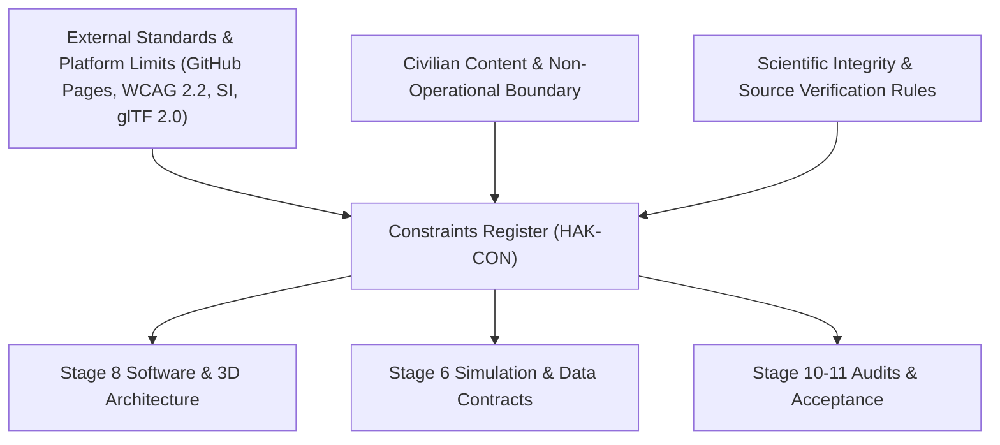

# Constraints Register

| Field | Value |
|---|---|
| Doc ID | HAK-DOC-CONSTRAINTS |
| Status | Draft |
| Owner stage | Stage 1 (Governance & Product Foundation) |
| Depends on | HAK-DOC-CHARTER, HAK-DOC-SCOPE, HAK-DOC-CONTRACT |
| Requirements | HAK-PRD-001, HAK-PRD-002, HAK-PRD-010, HAK-PRD-015, HAK-PRD-017, HAK-PRD-018, HAK-CON-001, HAK-CON-002, HAK-CON-003, HAK-CON-004, HAK-CON-005, HAK-CON-006, HAK-CON-007, HAK-CON-008, HAK-CON-009, HAK-CON-010, HAK-CON-011, HAK-CON-012, HAK-CON-013, HAK-CON-014, HAK-CON-015, HAK-CON-016, HAK-CON-017, HAK-CON-018 |

## 1. Purpose

This register defines the binding architectural, scientific, safety, legal, accessibility, and operational constraints (`HAK-CON-001` through `HAK-CON-018`) governing all Phase 0 specifications and Phase 1+ implementation work for **HAKUREN**. Unlike requirements (which express desired capabilities and outcomes), constraints represent non-negotiable boundaries imposed by the project mandate, hosting environment, physical standards, or safety policy.

## 2. Constraint Propagation Overview

## 3. Master Constraints Register (`HAK-CON`)

| ID | Category | Constraint | Source | Rationale | Downstream Impact & Verification | Status |
|---|---|---|---|---|---|---|
| HAK-CON-001 | Hosting & Deployment | The deployed HAKUREN web application shall operate within GitHub Pages static hosting limits: published site size strictly under `1 GB`, recommended source repository under `1 GB`, deployment build time under `10 minutes`, and awareness of the `100 GB/month` soft bandwidth ceiling. | `HAK-SRC-007` | `[FACT]` GitHub Pages enforces a hard 1 GB published-site limit and 10-minute deployment timeout (`HAK-SRC-007`). | Stage 4 asset budgets, Stage 8 build pipeline, and Stage 10 deployment checks must enforce strict bundle/asset caps well below 1 GB. | Draft |
| HAK-CON-002 | Architecture | The runtime platform shall require zero mandatory backend servers, databases, or server-side execution environments (`HTML`, `CSS`, client-side `JS`/`WASM`, and static `JSON`/3D assets only). | `HAK-SRC-007`; Master Prompt s1 | GitHub Pages serves static assets only; eliminating backend services removes operational hosting cost and server attack surface. | All simulation computation, routing fallback, search indexing, and library lookups execute client-side in the browser. | Draft |
| HAK-CON-003 | Browser & 3D Performance | Real-time 3D rendering shall target standard browser WebGL capabilities using open glTF 2.0 assets (`HAK-SRC-009`), with bounded polygon, texture, and draw-call budgets specified in Stage 4 so mid-range consumer laptops maintain interactive frame rates without discrete workstation GPUs. | `HAK-SRC-009`; Master Prompt s1 | Broad classroom and student access fails if scenes require high-end GPUs or multi-hundred-megabyte downloads. | Stage 4 (`docs/04-3d-experience/performance-budget.md`) defines quantitative LOD, memory, and target FPS thresholds verified in Stage 10. | Draft |
| HAK-CON-004 | Simulation Execution | Numerical simulation loops shall run off the main UI thread (e.g., via Web Workers); Rust/WebAssembly shall be introduced only if Stage 6/8 profiling demonstrates TypeScript worker performance is insufficient. | [Documentation Authoring Contract](documentation-authoring-contract.md) | Prevents UI jank or dropped 3D frames during transient updates while avoiding unnecessary build/toolchain complexity. | Stage 8 (`docs/10-software-architecture/worker-and-wasm-strategy.md`) must document worker messaging contracts and explicit WASM justification gates. | Draft |
| HAK-CON-005 | Offline Tooling Boundary | Python 3 tooling shall be restricted strictly to offline documentation auditing, schema validation, build-time data preparation, and offline numerical verification—never required at user runtime. | `decision-log.md`; [Documentation Authoring Contract](documentation-authoring-contract.md) | Preserves pure static browser deployment (`HAK-CON-002`) while enabling reproducible scientific checks offline. | Stage 6 verification scripts and `tools/` audit scripts remain development/CI-only dependencies. | Draft |
| HAK-CON-006 | Scientific Integrity | No numerical parameter, physical dimension, thermodynamic property, citation, DOI, or URL shall be invented; any value lacking a verified source (`HAK-SRC-nnn`) shall be logged as an open specification gap or assumption. | [Documentation Standard](../DOCUMENTATION_STANDARD.md); [Documentation Authoring Contract](documentation-authoring-contract.md) | Prevents hallucinated engineering data from undermining educational credibility. | Checked by Stage 11 scientific reference audit and source registry verification status (`Verified` vs. `UNV`). | Draft |
| HAK-CON-007 | Claim Transparency | Significant technical claims shall carry explicit epistemic tags (`FACT`, `REF`, `REP`, `ASM`, `SIMP`, `DER`, `ILL`, `UNV`), and illustrative/representative educational values shall never be presented as measured plant data. | [Documentation Authoring Contract](documentation-authoring-contract.md) | Ensures learners and reviewers can distinguish physical facts from pedagogical approximations. | Enforced across Stage 2–10 specs and surfaced in `/simulator` and `/library` UI disclosures (`HAK-PRD-015`). | Draft |
| HAK-CON-008 | Units & Coordinate Standards | All engineering quantities shall use canonical SI units and formatting rules (`HAK-SRC-010`, e.g., `MW`, `MPa`, `K` with explicit `°C` conversions where shown), and all 3D assets shall use glTF 2.0 right-handed SI meter coordinates (`+Y` up, `+Z` forward, `HAK-SRC-009`). | `HAK-SRC-010`; `HAK-SRC-009` | Eliminates unit-conversion ambiguity across physics equations, schemas, and 3D spatial scales. | Stage 6 unit catalog, Stage 9 JSON schemas, and Stage 4 3D asset pipeline validate SI unit fields and meter scaling. | Draft |
| HAK-CON-009 | Simulation Validity Boundary | Educational simulator models and UI views shall explicitly state they are non-safety-grade, non-operational, non-predictive outside documented validity ranges, and uncertified for engineering or licensing decisions. | [Documentation Authoring Contract](documentation-authoring-contract.md); [Scope and Boundaries](scope-and-boundaries.md) | Mitigates `HAK-RSK-001` (misinterpretation of an educational tool as an operational/safety-grade code). | Mandatory limitation banners (`HAK-PRD-010`) and documented validity envelopes in Stage 6 and Stage 10 tests. | Draft |
| HAK-CON-010 | Reference Plant Neutrality | The primary plant shall remain the generic **HAKUREN Reference PWR**; vendor-specific reactor designs (and specific SMR designs) may appear only as explicitly labeled comparative examples and never as the generic baseline. | [Documentation Authoring Contract](documentation-authoring-contract.md) | Avoids misattributing specific commercial plant dimensions or safety setpoints to all PWRs or all SMRs (`HAK-SRC-003`). | Stage 2, 3, and 4 inspections confirm generic Reference PWR labeling and explicit SMR family framing. | Draft |
| HAK-CON-011 | Civilian Content Boundary | All documentation, 3D models, simulator scenarios, and library content shall remain strictly within peaceful civilian nuclear energy education; military/weapons pathways, restricted fuel-cycle processing, and protection-system circumvention are strictly prohibited. | `decision-log.md`; [Scope and Boundaries](scope-and-boundaries.md) | Enforces non-proliferation and responsible public technical communication boundaries. | Screened by `tools/hakuren_audit.py safety` and manual Stage 7/11 safety boundary sign-off. | Draft |
| HAK-CON-012 | Non-Operational Safety Framing | Nuclear safety systems and protective functions shall be described strictly by engineering purpose, physical principle (`HAK-SRC-005`, `HAK-SRC-006`), and conceptual architecture—never as operator checklists, control-room actions, or setpoint guidance. | [Documentation Authoring Contract](documentation-authoring-contract.md) | Prevents educational materials from mimicking operational plant procedures or safety-critical manipulation guidance. | Stage 7 safety specs and Stage 11 content audits verify absence of procedural operator directives. | Draft |
| HAK-CON-013 | Documentation-First Phase Gate | Phase 0 shall produce complete, audited, implementation-ready specifications, JSON schemas, and traceability matrices before any Phase 1 production application code is written. | Master Prompt; [Project Charter](project-charter.md) | Eliminates uncoordinated coding, physics drift, and schema rework in Phase 1. | Verified via Phase 0 acceptance criteria ([Phase 0 Acceptance Criteria](phase-0-acceptance-criteria.md)) and Stage 11 sign-off. | Draft |
| HAK-CON-014 | Audit & Traceability Hygiene | Every documentation artifact shall maintain unique IDs within allocated blocks, single-row ID definitions, valid relative links, valid Draft 2020-12 JSON schemas, and synchronized RTM coverage checked by `tools/audit-documentation.py`. | [Documentation Authoring Contract](documentation-authoring-contract.md); [Tools README](../../tools/README.md) | Keeps a multi-author, 100+ document specification corpus mechanically consistent and verifiable. | Zero errors from `tools/audit-documentation.py` required at every stage gate and Phase 0 completion. | Draft |
| HAK-CON-015 | Web Accessibility Standard | UI navigation, controls, typography, and non-3D informational views shall target conformance with W3C WCAG 2.2 Level AA (`HAK-SRC-008`), including keyboard navigation, focus visibility, single-pointer alternatives to dragging, and reduced-motion respect. | `HAK-SRC-008` | Ensures equitable access for learners with visual, motor, or cognitive disabilities and improves general usability (`HAK-SRC-008`). | Stage 1/9 UX accessibility specs and Stage 10 accessibility test plan verify WCAG 2.2 AA criteria (`HAK-PRD-017`). | Draft |
| HAK-CON-016 | Licensing of Assets & Content | All third-party software libraries, 3D assets, textures, fonts, diagrams, and quoted educational materials bundled into the repository shall carry compatible permissive open-source or public-domain/CC licenses with attribution recorded; proprietary vendor CAD or restricted media shall not be bundled. | Master Prompt (governance constraints) | Protects public open-source distribution on GitHub Pages from copyright or proprietary-IP infringement. | Stage 8 asset-management and Stage 10 release checks require license metadata for every third-party dependency and asset. | Draft |
| HAK-CON-017 | Visual & Color Semantics | UI and 3D styling shall adhere to the locked palette (dark graphite/midnight navy backgrounds, cool cyan/ice blue structural accents, neutral/white text, controlled amber for thermal quantities), reserving red exclusively for true warnings or limit violations. | [Documentation Authoring Contract](documentation-authoring-contract.md) | Preserves industrial legibility and prevents alarm fatigue or ambiguous visual signaling. | Stage 9 design tokens and color system (`docs/09-ux-design/color-system.md`) enforce semantic token constraints. | Draft |
| HAK-CON-018 | Privacy & Zero-PII Client Model | The HAKUREN application shall collect no user accounts, passwords, or personally identifiable information (PII) in application state, consistent with static GitHub Pages limits (noting GitHub Pages logs visitor IPs at the hosting infrastructure layer for security, `HAK-SRC-007`). | `HAK-SRC-007` | Minimizes privacy compliance burden and enforces static-site security hygiene (`HAK-SRC-007` prohibits sensitive transactions). | Stage 8 security architecture confirms zero PII collection, zero auth flows, and optional local-only session preferences. | Draft |

## 4. Constraint-to-Stage Impact Summary

This secondary summary maps governance constraint categories to the downstream Phase 0 stages responsible for specifying and verifying compliance (note: Stage/Domain appears first so `HAK-CON` definitions remain uniquely in Section 3).

| Downstream Stage / Area | Primary Applicable Constraints | Concrete Deliverable Impact |
|---|---|---|
| **Stage 2: Domain Physics** | HAK-CON-006, HAK-CON-007, HAK-CON-008, HAK-CON-010, HAK-CON-011 | Verified physical constants, SI equations, generic Reference PWR vs. BWR/SMR framing |
| **Stage 3: System Engineering** | HAK-CON-008, HAK-CON-010, HAK-CON-012 | Canonical subsystem decomposition (`CMP`/`SUB`), non-operational functional descriptions |
| **Stage 4: 3D Experience** | HAK-CON-001, HAK-CON-003, HAK-CON-008, HAK-CON-016, HAK-CON-017 | glTF 2.0 SI-meter scenes, LOD/draw-call/bundle budgets, open-licensed textures/assets |
| **Stage 6: Simulation** | HAK-CON-004, HAK-CON-005, HAK-CON-006, HAK-CON-008, HAK-CON-009 | Worker-compatible ODE/balance specs, Python offline reference validation, validity bounds |
| **Stage 7: Safety & Library** | HAK-CON-006, HAK-CON-011, HAK-CON-012, HAK-CON-016 | Hard content boundary specification, verified source registry entries |
| **Stage 8–9: UX, Architecture & Schemas** | HAK-CON-001, HAK-CON-002, HAK-CON-004, HAK-CON-015, HAK-CON-017, HAK-CON-018 | Static Vite/R3F/Worker architecture, WCAG 2.2 AA controls, Draft 2020-12 JSON schemas |
| **Stage 10–11: QA, Traceability & Audit** | HAK-CON-005, HAK-CON-013, HAK-CON-014 | Full RTM coverage, `HAK-TC` verification cases, strict audit pass before Phase 1 |

## 5. References

- `HAK-SRC-003`: U.S. DOE Office of Nuclear Energy — *Advanced Small Modular Reactors (SMRs)*.
- `HAK-SRC-005`: U.S. NRC — *Defense in depth*.
- `HAK-SRC-006`: U.S. NRC — *Containment structure*.
- `HAK-SRC-007`: GitHub Docs — *GitHub Pages limits*.
- `HAK-SRC-008`: W3C — *Web Content Accessibility Guidelines (WCAG) 2.2*.
- `HAK-SRC-009`: Khronos Group — *glTF 2.0 Specification*.
- `HAK-SRC-010`: NIST — *Special Publication 330: The International System of Units (SI)*.

## 6. Related Documents

- [Project Charter](project-charter.md)
- [Scope and Boundaries](scope-and-boundaries.md)
- [Project Objectives](project-objectives.md)
- [Phase 0 Acceptance Criteria](phase-0-acceptance-criteria.md)
- [Risk Register](risk-register.md)
- [Assumptions Register](assumptions-register.md)

## 7. Change History

Recorded centrally in [Changelog](../CHANGELOG.md).
