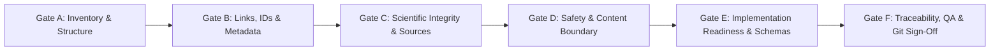

# Phase 0 Acceptance Criteria

| Field | Value |
|---|---|
| Doc ID | HAK-DOC-PHASE0-ACCEPTANCE |
| Status | Draft |
| Owner stage | Stage 1 (Governance & Product Foundation) |
| Depends on | HAK-DOC-CHARTER, HAK-DOC-OBJECTIVES, HAK-DOC-CONSTRAINTS, HAK-DOC-CONTRACT |
| Requirements | HAK-PRD-015, HAK-PRD-018, HAK-CON-006, HAK-CON-013, HAK-CON-014 |

## 1. Purpose

This document defines the explicit, checkable acceptance criteria required to declare **HAKUREN Phase 0** complete and authorize handoff to Phase 1 implementation (`HAK-PRD-018`, `HAK-CON-013`). Every criterion maps to concrete documentary evidence, automated audit checks (`tools/audit-documentation.py`), or Stage 11 review sign-off. Phase 0 is **not complete** until every applicable gate below passes with recorded evidence in `docs/15-audit/final-phase-0-signoff.md`.

## 2. Phase 0 Quality Gates (Gates A through F)

- **Gate A (Inventory & Structure):** All required files in `tools/required-documents.txt` exist, are substantive (never empty stubs), and contain no `TODO`/`TBD`/`PLACEHOLDER` text in `Validated`/`Complete` docs.
- **Gate B (Links, IDs & Metadata):** Zero broken relative links or anchors, unique `Doc ID`s, unique `HAK-*` definitions, and 100% resolved ID references.
- **Gate C (Scientific Integrity & Sources):** Every `FACT`, `REF`, and `REP` claim cites a registered `HAK-SRC-nnn` entry; zero unverified (`UNV`) sources form the sole basis of critical engineering parameters; SI units (`HAK-SRC-010`) are used consistently.
- **Gate D (Safety & Content Boundary):** Zero violations of [Scope and Boundaries](scope-and-boundaries.md); zero operational checklists or restricted topics; mandatory non-operational disclaimers specified.
- **Gate E (Implementation Readiness & Schemas):** An unfamiliar engineering team can build the React/Three.js/Worker application, JSON data pipelines, and simulator directly from the specs without inventing physics, UI flows, or data formats.
- **Gate F (Traceability, QA & Git Sign-Off):** Every requirement traces cleanly from `HAK-PRD` through domain/system/module specs to `HAK-TC` test cases, all strict audit checks exit `0`, and stage commits/pushes are verified.

## 3. Domain-by-Domain Checkable Acceptance Matrix

### 3.1 Governance & Product Foundation (`00-governance/`, `01-product/`)

| Check ID | Criterion | Verification Method | Pass Condition |
|---|---|---|---|
| **AC-PROD-01** | Governance baseline documents (`project-charter.md`, `product-vision.md`, `project-objectives.md`, `scope-and-boundaries.md`, `stakeholder-analysis.md`, `audience-and-personas.md`, `constraints-register.md`, `terminology-standard.md`, `phase-0-acceptance-criteria.md`) are complete and aligned. | Inspection + `audit-documentation.py` | All governance docs reach `Validated`/`Complete` in Stage 11 with zero conflicting module names, routes, or scope boundaries. |
| **AC-PROD-02** | `01-product/` specifications (PRD, `HAK-FR`, `HAK-NFR`, user journeys, information architecture, navigation, feature catalog, learning experience, content strategy, accessibility) trace cleanly to `HAK-PRD-001` through `HAK-PRD-018`. | `validate-requirements.py` + Inspection | Every `HAK-FR` and `HAK-NFR` row has a valid parent, measurable acceptance criterion, verification method, and zero orphaned `HAK-PRD` objectives. |
| **AC-PROD-03** | All six canonical modules (`Overview` `/`, `Reactor Anatomy` `/anatomy`, `Energy Journey` `/journey`, `Reactor Simulator` `/simulator`, `Safety & Engineering` `/safety`, `Technical Library` `/library`) and WCAG 2.2 AA accessibility targets (`HAK-SRC-008`) are fully specified. | Inspection | Navigation, user journeys, and accessibility requirements cover standalone entry (`HAK-PRD-014`) and non-3D keyboard/screen-reader parity (`HAK-PRD-017`). |

### 3.2 Domain Physics & Nuclear Engineering (`02-domain/`)

| Check ID | Criterion | Verification Method | Pass Condition |
|---|---|---|---|
| **AC-DOM-01** | All 22 domain files in `02-domain/` cover fission, neutron physics, radioactive decay, radiation/shielding, PWR/BWR/SMR architectures, comparison, thermal-hydraulics, heat transfer, thermodynamics, Rankine cycle, electrical generation, materials, instrumentation, protection concepts, safety principles, and reliability. | `check_inventory` + Inspection | All files exist, contain substantive domain derivations/explanations, and cite verified `HAK-SRC-nnn` entries (`HAK-SRC-001`–`HAK-SRC-006`, etc.). |
| **AC-DOM-02** | Generic **HAKUREN Reference PWR** values are strictly separated from clearly labeled vendor examples, and SMRs are treated strictly as a diverse reactor family (`HAK-SRC-003`, `HAK-CON-010`). | Scientific Reference Audit | Zero unattributed vendor numbers; any unresolved parameters are logged in [Open Issues Register](open-issues-register.md). |
| **AC-DOM-03** | Canonical SI units (`HAK-SRC-010`) and explicit claim classifications (`FACT`, `REF`, `REP`, `ASM`, `SIMP`, `DER`, `ILL`, `UNV`) are applied consistently across all equations and representative values. | Inspection + Python Calculation Check | Worked examples and unit conversions are algebraically reproducible and free of unmarked illustrative numbers. |

### 3.3 System Engineering (`03-system-engineering/`)

| Check ID | Criterion | Verification Method | Pass Condition |
|---|---|---|---|
| **AC-SYS-01** | Plant decomposition, system context/boundary, interaction map, RCS, PZR, SG, secondary circuit, turbine-generator, condenser, feedwater, cooling water, containment, auxiliary overview, fuel assembly, CRDM, instrumentation, and safety system overview are fully specified. | `check_inventory` + `check_ids` | Every `HAK-SUB` and `HAK-CMP` ID in `component-catalog.md` is uniquely defined, uses canonical vocabulary, and maps cleanly to 3D and data contracts. |
| **AC-SYS-02** | System interfaces (thermal, mass flow, pressure, mechanical shaft, electrical, and instrumentation signals) form a closed, consistent architecture without disconnected subsystems. | Inspection | `system-interaction-map.md` accounts for all subsystems defined in `plant-decomposition.md` with consistent interface directions and units. |

### 3.4 3D Experience & Energy Journey (`04-3d-experience/`, `05-energy-journey/`)

| Check ID | Criterion | Verification Method | Pass Condition |
|---|---|---|---|
| **AC-3D-01** | Three-level spatial hierarchy (*Plant*, *System*, *Component*), component hierarchy/registry/metadata contracts, geometry/LOD rules, PBR materials, camera system, selection, exploded view, section cut, isolation, layers, animation, scientific visualization, asset pipeline, and performance budget are specified. | Inspection + Cross-check with `03-system-engineering/` | Every interactive component in `/anatomy` traces to `HAK-CMP` IDs, uses glTF 2.0 SI-meter coordinates (`HAK-SRC-009`, `HAK-CON-008`), and fits within defined GPU/asset budgets (`HAK-CON-001`, `HAK-CON-003`). |
| **AC-3D-02** | Energy Journey (`05-energy-journey/`) specifies all six causal stages from fission heat to electrical output and condenser return, plus energy-flow visualization and a balanced quantitative energy specification (`HAK-PRD-006`, `HAK-PRD-007`). | Analysis + Inspection | Energy balance equations conserve energy ($\dot{Q}_{\text{in}} = P_{\text{elec}} + \dot{Q}_{\text{rejected}} + \dot{Q}_{\text{loss}}$) with documented representative parameters. |

### 3.5 Educational Simulation (`06-simulation/`)

| Check ID | Criterion | Verification Method | Pass Condition |
|---|---|---|---|
| **AC-SIM-01** | All mathematical models (`HAK-MOD`), parameters (`HAK-PAR`), scenarios (`HAK-SCN`), state machine, numerical methods, I/O contracts, charts, error handling, verification plan, validation plan, and model limitations are completely specified. | Inspection + Offline Python Prototype Check | Every equation specifies variables, SI units, validity range, discretization/solver method, and boundary behavior; numerical reference values are verified by Python scripts (`HAK-CON-005`). |
| **AC-SIM-02** | Simulation scope, UI specs, and limitation documents explicitly enforce non-operational, non-safety-grade disclosures (`HAK-CON-009`, `HAK-PRD-010`) and bounded input envelopes. | Inspection | No claim describes the model as certified, qualified, or predictive outside its documented educational envelope. |

### 3.6 Safety Concepts & Technical Library (`07-safety/`, `08-technical-library/`)

| Check ID | Criterion | Verification Method | Pass Condition |
|---|---|---|---|
| **AC-SAFE-01** | `07-safety/` specifies defense in depth, containment barriers, cooling/heat removal, passive vs. active concepts, protection concepts, instrumentation/alarming, redundancy/diversity, reliability concepts, and `safety-content-boundaries.md`. | `hakuren_audit.py safety` + Manual Review | Zero boundary violations across the entire repository (`HAK-CON-011`, `HAK-CON-012`); every safety system is explained by principle and purpose rather than operator procedure. |
| **AC-LIB-01** | `08-technical-library/` delivers library architecture, canonical glossary, formula reference, engineering units, learning resources, diagram catalog, and a complete `source-registry.md`. | `hakuren_audit.py sources` + Inspection | Every `HAK-SRC-nnn` cited anywhere in `docs/` resolves to a 12-column row in `source-registry.md` with honest verification status (`Verified`, `Partially verified`, or `UNV`). |

### 3.7 UX Design, Software Architecture & Data Contracts (`09-ux-design/`, `10-software-architecture/`, `11-data-contracts/`)

| Check ID | Criterion | Verification Method | Pass Condition |
|---|---|---|---|
| **AC-SW-01** | UX design (`09-ux-design/`) defines dark-graphite/midnight-navy design tokens, semantic thermal-amber and warning-red color rules (`HAK-CON-017`), typography, responsive layout, motion rules, and accessibility design (`HAK-CON-015`). | Inspection | Visual tokens and interaction rules cover all 6 modules and support WCAG 2.2 AA (`HAK-SRC-008`). |
| **AC-SW-02** | Software architecture (`10-software-architecture/`) specifies React/TypeScript/Vite/R3F/Zustand/Web Worker architecture, WASM decision criteria (`HAK-CON-004`), asset management, security/zero-PII (`HAK-CON-018`), and static GitHub Pages deployment (`HAK-CON-001`, `HAK-CON-002`). | Inspection | Architecture decisions (`architecture-decisions.md`) justify complexity and provide clear module interfaces and build/deploy pipelines. |
| **AC-SW-03** | Data contracts (`11-data-contracts/` and `schemas/`) define Draft 2020-12 JSON Schemas with `$id`, `title`, and `x-schema-version` for all 7 core data entities (`component`, `subsystem`, `simulation-parameter`, `simulation-result`, `energy-flow`, `scenario`, `technical-reference`). | `validate-schemas.py` | Every schema validates cleanly under `Draft202012Validator`, and every `.valid*.json` passes while every `.invalid*.json` fails as expected. |

### 3.8 QA & Traceability (`12-quality-assurance/`, `14-traceability/`)

| Check ID | Criterion | Verification Method | Pass Condition |
|---|---|---|---|
| **AC-QA-01** | `12-quality-assurance/` defines QA strategy, requirement verification, documentation testing, scientific verification, mathematical test cases (`HAK-TC`), 3D acceptance tests, interaction tests, performance/accessibility/security/integration plans, and release criteria. | `validate-requirements.py` + Inspection | Every `Must`/`Should` requirement across `docs/` is verified by at least one `HAK-TC-nnn` row (zero uncovered requirements under `--strict`). |
| **AC-QA-02** | `14-traceability/` maintains a freshly generated `requirement-traceability-matrix.md` (`tools/generate_rtm.py`) plus document, source-claim, component, simulator, and test-coverage matrices. | `hakuren_audit.py requirements` | Zero stale or missing RTM rows; 100% alignment between requirement tables and `14-traceability/`. |

### 3.9 Documentation Quality & Automated Audits (`15-audit/`, `tools/`)

| Check ID | Criterion | Verification Method | Pass Condition |
|---|---|---|---|
| **AC-AUD-01** | Full strict audit suite (`.venv/bin/python tools/audit-documentation.py --strict` plus `validate-links.py`, `validate-requirements.py`, `validate-schemas.py`) passes cleanly. | Automated CLI Execution | Exit code `0` with `0 error(s)` and `0 unresolved warning(s)` (or documented, approved safety-exemptions per `tools/README.md`). |
| **AC-AUD-02** | Stage 11 audit reports (`documentation-audit-report.md`, `consistency-audit.md`, `scientific-reference-audit.md`, `schema-validation-report.md`, `link-validation-report.md`, `final-phase-0-signoff.md`) contain verbatim tool outputs and zero critical open issues in `open-issues-register.md`. | Inspection | Every required file in `tools/required-documents.txt` is present, non-empty, free of `TODO`/`TBD`/`PLACEHOLDER`, and promoted to `Validated` or `Complete` only after evidence is recorded. |

### 3.10 Git, Repository Hygiene & Delivery (`13-project-management/`, `PROJECT_STATUS.md`, `CHANGELOG.md`)

| Check ID | Criterion | Verification Method | Pass Condition |
|---|---|---|---|
| **AC-GIT-01** | Stage 10–11 project management artifacts (`implementation-roadmap.md`, WBS, dependency map, priorities, `implementation-agent-handoff.md`, `phase-0-completion-report.md`) provide an actionable Phase 1 execution blueprint. | Inspection | Handoff document maps directly to validated specs, schemas, and `12-quality-assurance/` acceptance suites. |
| **AC-GIT-02** | Repository hygiene and staged Git delivery: zero unintended application code in Phase 0, `PROJECT_STATUS.md` and `CHANGELOG.md` updated at every stage, one clean commit per validated stage, and verified push to `origin/main`. | Repository & Remote Verification | Working tree clean at Stage 11 exit, remote `origin/main` synchronized with local `HEAD`, and `PROJECT_STATUS.md` marks `Phase 0 overall: Complete` only after all 9 domains above pass. |

## 4. Phase 0 Sign-Off Protocol

1. **No Self-Certification Shortcuts:** Status promotion from `Draft` to `Validated` or `Complete` occurs only during Stage 11 after automated and manual audit checks pass (`HAK-DOC-CONTRACT`).
2. **Critical Open-Issue Blocking:** Any `Open` item in [Open Issues Register](open-issues-register.md) marked critical (e.g., an unverified core physical equation or broken schema contract) blocks Phase 0 sign-off until resolved or explicitly `Deferred` by user decision.
3. **Verbatim Evidence Rule:** The Stage 11 sign-off report must cite actual executed command outputs from `.venv/bin/python tools/audit-documentation.py --strict`.

## 5. References

- `HAK-SRC-001`: U.S. NRC — *Pressurized Water Reactors*.
- `HAK-SRC-003`: U.S. DOE Office of Nuclear Energy — *Advanced Small Modular Reactors (SMRs)*.
- `HAK-SRC-007`: GitHub Docs — *GitHub Pages limits*.
- `HAK-SRC-008`: W3C — *Web Content Accessibility Guidelines (WCAG) 2.2*.
- `HAK-SRC-009`: Khronos Group — *glTF 2.0 Specification*.
- `HAK-SRC-010`: NIST — *Special Publication 330: The International System of Units (SI)*.

## 6. Related Documents

- [Project Charter](project-charter.md)
- [Project Objectives](project-objectives.md)
- [Scope and Boundaries](scope-and-boundaries.md)
- [Constraints Register](constraints-register.md)
- [Documentation Authoring Contract](documentation-authoring-contract.md)
- [Tools README](../../tools/README.md)
- [Project Status](../PROJECT_STATUS.md)

## 7. Change History

Recorded centrally in [Changelog](../CHANGELOG.md).
