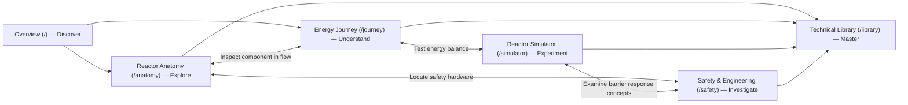

# Product Vision

| Field | Value |
|---|---|
| Doc ID | HAK-DOC-VISION |
| Status | Draft |
| Owner stage | Stage 1 (Governance & Product Foundation) |
| Depends on | HAK-DOC-CHARTER, HAK-DOC-CONTRACT |
| Requirements | HAK-PRD-001, HAK-PRD-002, HAK-PRD-003, HAK-PRD-004, HAK-PRD-006, HAK-PRD-008, HAK-PRD-011, HAK-PRD-013, HAK-PRD-014 |

## 1. Vision Statement

**HAKUREN** (*Nuclear Energy & Reactor Engineering Explorer* — *"Understand the Atom. Explore the Energy."*) envisions an open, scientifically transparent, browser-native learning environment where anyone can inspect the inner engineering of a civilian nuclear power station, trace energy from nuclear fission to electrical grid output, test simplified reactor physics interactively, and understand how multi-layered safety systems protect people and the environment—all without installing specialized software or confronting opaque jargon.

## 2. Core Value Proposition

Conventional nuclear learning resources split spatial intuition, thermodynamic causation, mathematical modeling, and safety engineering into disconnected textbooks and static schematics. HAKUREN unifies these perspectives around a single, consistent engineering subject—the **HAKUREN Reference PWR**—supported by clearly framed **BWR** and **SMR** comparisons (`HAK-SRC-001`, `HAK-SRC-002`, `HAK-SRC-003`):

1. **Spatial Clarity Before Abstraction:** Learners inspect a coherent 3D nuclear power station across *Plant*, *System*, and *Component* zoom levels, understanding how the reactor pressure vessel, steam generators, pressurizer, reactor coolant pumps, containment, and turbine-generator physically connect (`HAK-SRC-001`).
2. **Causal Continuity:** Rather than treating physics, thermodynamics, and electricity separately, HAKUREN traces a continuous conservation-governed energy chain from ceramic uranium fuel pellets (`HAK-SRC-004`) to turbine shaft work and electrical generation.
3. **Honest Quantitative Experimentation:** Learners explore cause-and-effect in an interactive educational simulator where every equation, unit (`HAK-SRC-010`), simplification, and validity boundary is openly inspected rather than hidden in a black box.
4. **Safety Literacy Grounded in Architecture:** Safety engineering is taught through physical containment barriers (`HAK-SRC-006`) and defense-in-depth principles (`HAK-SRC-005`)—explaining *why* systems exist and *how* they provide redundancy—while respecting strict non-operational boundaries.

## 3. The Six Product Modules and Non-Linear Learning Architecture

HAKUREN is structured around six standalone yet deeply cross-linked modules. Learners may enter at any point depending on prior background, or follow a natural six-stage pedagogical progression: **Discover → Explore → Understand → Experiment → Investigate → Master**.

| Canonical Module | Route | Pedagogical Stage | Core Experience & Educational Role |
|---|---|---|---|
| **Overview** | `/` | *Discover* | High-impact orientation to civilian nuclear energy, the HAKUREN Reference PWR concept, module entry cards, quick conceptual overview, and transparent educational scope framing. |
| **Reactor Anatomy** | `/anatomy` | *Explore* | Interactive 3D station and reactor explorer across *Plant*, *System*, and *Component* levels, featuring exploded views, section cuts, component isolation, and structured engineering metadata. |
| **Energy Journey** | `/journey` | *Understand* | Guided, step-by-step causal walkthrough from fission heat release in fuel rods (`HAK-SRC-004`) through primary coolant heat transfer, steam generation, Rankine turbine expansion, electrical generation, and condenser return (`HAK-SRC-001`). |
| **Reactor Simulator** | `/simulator` | *Experiment* | Real-time, client-side educational thermal-hydraulic and reactivity sandbox with bounded scenarios, live energy-balance telemetry, time-series plots, and explicit model-limitation banners. |
| **Safety & Engineering** | `/safety` | *Investigate* | Conceptual exploration of defense in depth (`HAK-SRC-005`), physical fission-product barriers (`HAK-SRC-006`), passive vs. active cooling concepts, redundancy, and reactor comparison (PWR vs. BWR vs. SMR family). |
| **Technical Library** | `/library` | *Master* | Searchable engineering reference containing canonical glossary definitions, SI unit conventions (`HAK-SRC-010`), documented equations, conceptual diagrams, and the verified public source registry. |

Every module must function cleanly as a direct entry point (deep-linkable static route) so an educator can assign `/simulator` or `/safety` directly without forcing students through prior pages (`HAK-PRD-014`).

## 4. 3D Experience Vision: Three Levels of Detail

The 3D experience centers on progressive disclosure so visual complexity supports comprehension rather than overwhelming the learner:

- **Plant Level:** Site-scale spatial context showing the containment structure (`HAK-SRC-006`), turbine building, condenser cooling interface, and switchyard/electrical output boundary, establishing how nuclear heat generation sits inside a conventional thermal power plant.
- **System Level:** Inside-plant architectural clarity highlighting the Reactor Coolant System (RCS / primary circuit), steam generators, pressurizer, reactor coolant pumps, and secondary steam/feedwater loops (`HAK-SRC-001`), using consistent layer toggling and flow cues.
- **Component Level:** Highest geometric and educational detail reserved for the reactor pressure vessel (RPV), fuel assemblies (`HAK-SRC-004`), fuel rods, control rods and control rod drive mechanisms (CRDMs), and steam generator tube bundles, supporting section cuts, isolation, and inspection callouts.

## 5. Aesthetic and Interaction Direction

HAKUREN combines **NVIDIA Omniverse-inspired cinematic 3D clarity** (physically plausible lighting, crisp metallic/ceramic surface differentiation, clean cutaway silhouettes) with **Siemens-inspired industrial engineering legibility** (structured typography, high-contrast telemetry, unambiguous hierarchy):

- **Palette & Surface Semantics:** Dark graphite and midnight navy surfaces establish calm technical focus without visual fatigue; cool cyan and ice blue accents guide interactive selection and primary structural cues; white and neutral grey typography prioritizes readability; **controlled amber** is reserved for thermal quantities and heat-transfer states; **red** is strictly reserved for true warning thresholds or boundary alerts (`HAK-CON-017`).
- **Anti-Pattern Prohibition:** HAKUREN explicitly rejects generic "neon hacker" or sci-fi glowing green/magenta aesthetics. Radioactive or fission phenomena are represented through disciplined scientific visualization rather than Hollywood tropes.

## 6. What HAKUREN Is — and What It Is Not

| HAKUREN Is | HAKUREN Is Not |
|---|---|
| An interactive civilian nuclear energy and reactor engineering explorer grounded in public references (`HAK-SRC-001`, `HAK-SRC-004`, `HAK-SRC-005`). | A real-world plant control interface, operator training simulator, or emergency operating procedure manual. |
| A transparent educational model with explicitly stated assumptions, SI units (`HAK-SRC-010`), and validity limits. | A safety-grade, licensing-grade, or predictive nuclear engineering analysis code. |
| Centered on a generic, representative **HAKUREN Reference PWR**, with **BWR** and **SMR family** comparisons (`HAK-SRC-002`, `HAK-SRC-003`). | A digital twin of any specific commercial plant or an exhaustive catalog of every proprietary vendor design. |
| Strictly static-hosted (`HAK-SRC-007`) and accessible via modern desktop and tablet browsers without accounts or server dependencies. | A multi-user cloud platform requiring user authentication, server-side computation, or restricted data handling. |

For authoritative scope boundaries and excluded topics, see [Scope and Boundaries](scope-and-boundaries.md).

## 7. Long-Term Evolution Beyond Core Release

Once the Phase 0 baseline and core PWR-centered Phase 1 application are delivered and verified, the architecture anticipates:

1. **Interactive BWR and SMR Family Modules:** Extending interactive 3D comparisons and simplified simulator presets for boiling-water direct cycles (`HAK-SRC-002`) and representative integral-PWR SMR concepts (`HAK-SRC-003`).
2. **Future Fusion Educational Track:** A cleanly separated post-core module contrasting magnetic/inertial fusion concepts with civilian fission (`HAK-DOC-CONTRACT`).
3. **Classroom & Educator Export Aids:** Static-compatible shareable simulator scenario URLs and printable reference sheets generated from the validated JSON data contracts.

## 8. References

- `HAK-SRC-001`: U.S. NRC — *Pressurized Water Reactors*.
- `HAK-SRC-002`: U.S. NRC — *Boiling Water Reactors*.
- `HAK-SRC-003`: U.S. DOE Office of Nuclear Energy — *Advanced Small Modular Reactors (SMRs)*.
- `HAK-SRC-004`: U.S. DOE Office of Nuclear Energy — *NUCLEAR 101: How Does a Nuclear Reactor Work?*
- `HAK-SRC-005`: U.S. NRC — *Defense in depth*.
- `HAK-SRC-006`: U.S. NRC — *Containment structure*.
- `HAK-SRC-007`: GitHub Docs — *GitHub Pages limits*.
- `HAK-SRC-009`: Khronos Group — *glTF 2.0 Specification*.
- `HAK-SRC-010`: NIST — *Special Publication 330: The International System of Units (SI)*.

## 9. Related Documents

- [Project Charter](project-charter.md)
- [Project Objectives](project-objectives.md)
- [Scope and Boundaries](scope-and-boundaries.md)
- [Audience and Personas](audience-and-personas.md)
- [Constraints Register](constraints-register.md)

## 10. Change History

Recorded centrally in [Changelog](../CHANGELOG.md).
