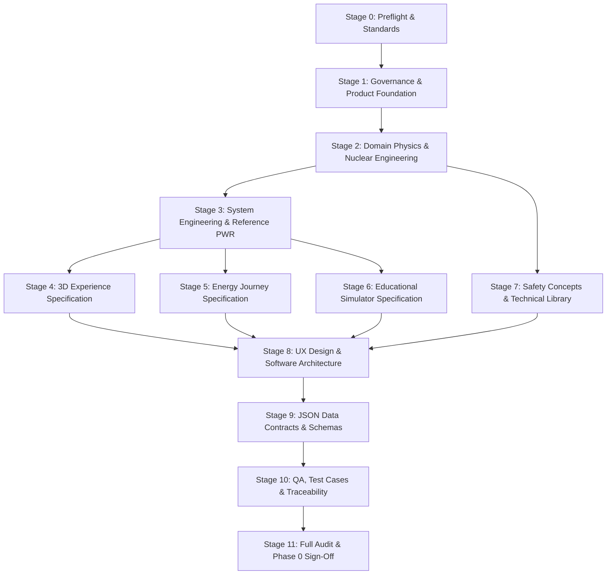

# Project Charter

| Field | Value |
|---|---|
| Doc ID | HAK-DOC-CHARTER |
| Status | Draft |
| Owner stage | Stage 1 (Governance & Product Foundation) |
| Depends on | HAK-DOC-STANDARD, HAK-DOC-CONTRACT, HAK-DOC-PLAN |
| Requirements | HAK-PRD-001, HAK-PRD-015, HAK-PRD-017, HAK-PRD-018, HAK-CON-001, HAK-CON-006, HAK-CON-011, HAK-CON-013 |

## 1. Purpose and Mandate

This charter authorizes and governs Phase 0 specification work—and establishes the baseline product mandate for subsequent implementation phases—for **HAKUREN**, full title **Nuclear Energy & Reactor Engineering Explorer**, carrying the tagline *"Understand the Atom. Explore the Energy."* [Master Prompt; HAK-DOC-CONTRACT].

HAKUREN is chartered as a public, browser-based, static-hosted educational engineering platform designed to help students, university learners, educators, engineers, and technically curious members of the public build accurate mental models of civilian nuclear fission power plants, reactor thermal-hydraulics, energy conversion, and nuclear safety engineering.

Phase 0 is strictly **documentation-first** (`HAK-CON-013`). No production frontend application, 3D scene implementation, or operational simulator code is built during Phase 0. Instead, Phase 0 delivers an implementation-ready, internally consistent, scientifically attributed, and auditable engineering baseline across product, domain physics, system engineering, 3D visualization, energy journey, educational simulation, safety education, technical library, UX design, software architecture, data contracts, quality assurance, and project management.

## 2. Background and Problem Statement

Public and introductory technical understanding of nuclear power frequently suffers from two opposing gaps:

1. **Oversimplified media diagrams** obscure the engineering reality of pressurized primary coolant circuits, steam generators, secondary Rankine power cycles, and multi-barrier defense-in-depth safety architectures.
2. **Dense regulatory and textbook literature** assumes advanced familiarity with neutron transport, two-phase thermal-hydraulics, and plant instrumentation, creating a steep barrier for interdisciplinary engineers, university undergraduates, and self-directed learners.

Interactive web-based 3D visualization combined with a transparent, bounded educational simulator bridges this gap—provided the underlying domain physics, component decompositions, and safety narratives remain strictly accurate, explicitly bounded as non-operational, and grounded in verifiable public engineering references (`HAK-SRC-001`, `HAK-SRC-004`, `HAK-SRC-005`).

## 3. Project Identity and Reference Baseline

| Attribute | Locked Specification | Governance Reference |
|---|---|---|
| Platform Name | **HAKUREN** | `decision-log.md` ("HAKUREN is the locked project name") |
| Full Title & Tagline | *Nuclear Energy & Reactor Engineering Explorer* — *Understand the Atom. Explore the Energy.* | [Documentation Authoring Contract](documentation-authoring-contract.md) |
| Primary Reference Plant | **HAKUREN Reference PWR** (generic, representative educational pressurized water reactor; not any commercial vendor plant) | [Documentation Authoring Contract](documentation-authoring-contract.md) |
| Comparison Technologies | Boiling Water Reactor (**BWR**) and Small Modular Reactor (**SMR**, explicitly treated as a reactor family rather than a single vendor design) | `decision-log.md` ("PWR is primary reference reactor; BWR and SMR are comparison technologies") |
| Six Core Modules | **Overview** (`/`), **Reactor Anatomy** (`/anatomy`), **Energy Journey** (`/journey`), **Reactor Simulator** (`/simulator`), **Safety & Engineering** (`/safety`), **Technical Library** (`/library`) | [Documentation Authoring Contract](documentation-authoring-contract.md) |
| Learning Progression | Non-linear standalone modules mapped across *Discover, Explore, Understand, Experiment, Investigate, Master* | [Product Vision](product-vision.md) |
| 3D Spatial Hierarchy | Three levels: **Plant**, **System**, **Component** (highest geometric and interactive detail on the reactor) | [Documentation Authoring Contract](documentation-authoring-contract.md) |

`[FACT]` In commercial civilian light-water reactors, pressurized water reactors keep primary coolant under high pressure so it remains liquid while transferring core fission heat through a steam generator to a separate secondary steam loop, whereas boiling water reactors generate steam directly inside the reactor vessel (`HAK-SRC-001`, `HAK-SRC-002`). `[FACT]` Small modular reactors represent a diverse family of designs ranging from tens to hundreds of megawatts electric per module, spanning light-water and non-light-water coolants (`HAK-SRC-003`).

## 4. Scope Summary and Hard Boundaries

The complete, authoritative scope matrix and boundary statement are defined in [Scope and Boundaries](scope-and-boundaries.md). In summary:

- **In Scope:** Civilian fission power education, the HAKUREN Reference PWR primary and secondary systems, nuclear physics fundamentals, educational thermal-hydraulic and Rankine power conversion modeling, conceptual safety engineering (defense in depth, physical barriers, passive and active safety concepts), and an integrated technical library.
- **Planned Expansion (Documented Comparison Scope):** Comparative educational coverage of BWRs (`HAK-SRC-002`) and the SMR family (`HAK-SRC-003`) as clearly bounded comparisons against the Reference PWR.
- **Future Expansion (Post-Core Roadmap):** Introductory civilian nuclear fusion concepts, explicitly isolated from Phase 0 core fission delivery.
- **Out of Scope (Prohibited Everywhere):** Nuclear weapon design or weapons-grade material pathways, acquisition or processing of restricted nuclear materials, real reactor operating or control procedures, safety-grade or licensing-grade simulation, and instructions or analyses for defeating reactor protection systems.

## 5. Governance Model and Stage-Gate Lifecycle

Phase 0 executes as a sequence of twelve disciplined stages (Stages 0 through 11) governed by [Documentation Standard](../DOCUMENTATION_STANDARD.md), [Documentation Authoring Contract](documentation-authoring-contract.md), and [Documentation Plan](documentation-plan.md).

### 5.1 Decision Authority and Change Control

1. **Locked Product Facts:** Core identity, module routes, PWR primary reference status, and excluded domains are locked by user-approved entries in [Decision Log](decision-log.md). Changing a locked fact requires explicit user approval and a new decision-log entry.
2. **Integration-Managed Registers:** The [Decision Log](decision-log.md), [Assumptions Register](assumptions-register.md), [Risk Register](risk-register.md), [Open Issues Register](open-issues-register.md), [Source Registry](../08-technical-library/source-registry.md), [Changelog](../CHANGELOG.md), [Project Status](../PROJECT_STATUS.md), and generated Requirement Traceability Matrix (`docs/14-traceability/requirement-traceability-matrix.md`) are maintained centrally during stage integration to preserve ID uniqueness and cross-document consistency.
3. **Specification Gaps Over Invention:** Whenever an engineering parameter, regulatory limit, or design detail cannot be backed by an inspected, verified public source (`HAK-SRC-nnn`), authors must record an open issue or assumption rather than inventing numbers (`HAK-CON-006`, `HAK-CON-007`).

## 6. Proposed Technology and Hosting Direction

Subject to architectural justification in Stage 8 (`docs/10-software-architecture/architecture-overview.md`), the baseline technical direction uses:

- **Frontend & 3D Rendering:** React, TypeScript, Vite, Three.js with React Three Fiber, and Zustand state management, consuming glTF 2.0 assets (`HAK-SRC-009`) rendered over browser WebGL.
- **Simulation Execution:** Client-side Web Workers for non-blocking numerical integration, with Rust/WebAssembly permitted only where profiling or numerical stability justifies the added build complexity (`HAK-CON-004`).
- **Hosting & Backend Policy:** Static deployment on GitHub Pages (`HAK-SRC-007`), with zero mandatory backend services (`HAK-CON-001`, `HAK-CON-002`).
- **Offline Tooling:** Python 3 solely for Phase 0 documentation auditing, schema validation, offline physical equation verification, and build-time data preparation (`HAK-CON-005`).

## 7. Quality Gates and Phase 0 Exit Criteria

Phase 0 cannot be declared `Complete` until all acceptance criteria in [Phase 0 Acceptance Criteria](phase-0-acceptance-criteria.md) are satisfied with recorded evidence, including zero errors across the automated checks in `tools/audit-documentation.py` (inventory, relative links, ID resolution, requirement/RTM sync, source verification, metadata, status hygiene, Mermaid screening, safety keyword review, and Draft 2020-12 JSON Schema validation).

## 8. References

- `HAK-SRC-001`: U.S. NRC — *Pressurized Water Reactors* (PWR primary/secondary loop architecture).
- `HAK-SRC-002`: U.S. NRC — *Boiling Water Reactors* (BWR comparison cycle).
- `HAK-SRC-003`: U.S. DOE Office of Nuclear Energy — *Advanced Small Modular Reactors (SMRs)* (SMR family definition).
- `HAK-SRC-004`: U.S. DOE Office of Nuclear Energy — *NUCLEAR 101: How Does a Nuclear Reactor Work?* (fission, fuel assemblies, coolant/moderator, control rods).
- `HAK-SRC-005`: U.S. NRC — *Defense in depth* (layered safety principles).
- `HAK-SRC-007`: GitHub Docs — *GitHub Pages limits* (static hosting size and operational limits).
- `HAK-SRC-009`: Khronos Group — *glTF 2.0 Specification* (3D asset format and SI coordinate conventions).

## 9. Related Documents

- [Documentation Standard](../DOCUMENTATION_STANDARD.md)
- [Documentation Authoring Contract](documentation-authoring-contract.md)
- [Product Vision](product-vision.md)
- [Project Objectives](project-objectives.md)
- [Scope and Boundaries](scope-and-boundaries.md)
- [Stakeholder Analysis](stakeholder-analysis.md)
- [Constraints Register](constraints-register.md)
- [Phase 0 Acceptance Criteria](phase-0-acceptance-criteria.md)
- [Decision Log](decision-log.md)
- [Risk Register](risk-register.md)

## 10. Change History

Recorded centrally in [Changelog](../CHANGELOG.md).
