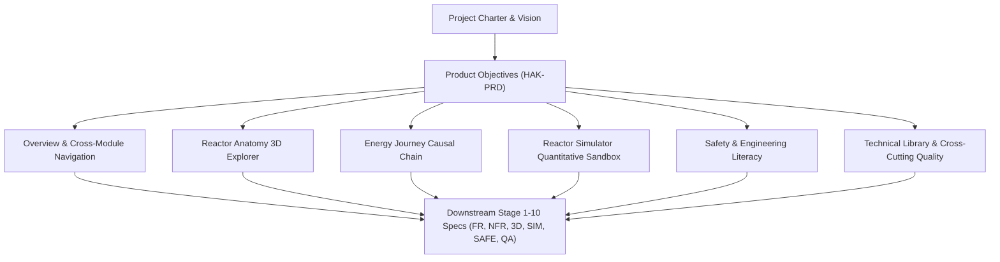

# Project Objectives

| Field | Value |
|---|---|
| Doc ID | HAK-DOC-OBJECTIVES |
| Status | Draft |
| Owner stage | Stage 1 (Governance & Product Foundation) |
| Depends on | HAK-DOC-CHARTER, HAK-DOC-VISION, HAK-DOC-SCOPE |
| Requirements | HAK-PRD-001, HAK-PRD-002, HAK-PRD-003, HAK-PRD-004, HAK-PRD-005, HAK-PRD-006, HAK-PRD-007, HAK-PRD-008, HAK-PRD-009, HAK-PRD-010, HAK-PRD-011, HAK-PRD-012, HAK-PRD-013, HAK-PRD-014, HAK-PRD-015, HAK-PRD-016, HAK-PRD-017, HAK-PRD-018 |

## 1. Purpose

This document translates HAKUREN's [Project Charter](project-charter.md) and [Product Vision](product-vision.md) into concrete, measurable product-level objectives and learning outcomes (`HAK-PRD-001` through `HAK-PRD-018`). Per governance rules, **product-level objective requirements (`HAK-PRD`) are defined exclusively in this document**, serving as parent requirements for downstream functional (`HAK-FR`), non-functional (`HAK-NFR`), domain (`HAK-DOM`), 3D (`HAK-3D`), simulation (`HAK-SIM`), safety (`HAK-SAFE`), and quality assurance (`HAK-QA`) specifications.

## 2. Measurable Outcome Principles

Every product objective is framed around an observable capability or learner outcome rather than an abstract aspiration:

1. **Structural Completeness:** All six canonical modules (`Overview`, `Reactor Anatomy`, `Energy Journey`, `Reactor Simulator`, `Safety & Engineering`, `Technical Library`) deliver standalone educational value while sharing canonical terminology and data contracts.
2. **Provisional Quantitative Targets:** Quantitative usability or comprehension thresholds (such as task-completion rates or post-module check accuracy) that are not yet backed by empirical user-testing baselines are explicitly tagged `Provisional-Must` or `Provisional-Should` in accordance with [Documentation Authoring Contract](documentation-authoring-contract.md), and must be validated during Stage 10 QA planning and post-build evaluation.
3. **Scientific and Boundary Fidelity:** Objectives for educational simulation and safety literacy incorporate mandatory disclosure of simplifications, validity ranges, and non-operational status.

## 3. Product-Level Objectives (`HAK-PRD`)

The table below is the single authoritative definition of all `HAK-PRD` requirements (`HAK-PRD-001` to `HAK-PRD-018`).

| ID | Name | Requirement | Priority | Rationale | Source | Parent | Verification | Acceptance | Status |
|---|---|---|---|---|---|---|---|---|---|
| HAK-PRD-001 | Platform Educational Identity | The platform shall present civilian nuclear power generation and reactor engineering using the canonical HAKUREN Reference PWR baseline and clearly labeled BWR/SMR comparisons within a unified web application. | Must | Establishes consistent domain framing and avoids mixing generic architecture with unlabelled vendor designs. | Master Prompt s1 | - | Inspection | Every module header, introductory copy, and diagram uses canonical vocabulary and explicitly identifies the HAKUREN Reference PWR as generic. | Draft |
| HAK-PRD-002 | Six Canonical Module Routes | The platform shall expose all six canonical modules at their exact routes: Overview (`/`), Reactor Anatomy (`/anatomy`), Energy Journey (`/journey`), Reactor Simulator (`/simulator`), Safety & Engineering (`/safety`), and Technical Library (`/library`). | Must | Guarantees predictable information architecture, bookmarkability, and educator deep-linking across modules. | Master Prompt s1 | - | Test+Inspection | Automated route tests resolve all six canonical paths with HTTP 200 static fallback and render the corresponding module without cross-route errors. | Draft |
| HAK-PRD-003 | Overview Orientation Outcome | The Overview (`/`) module shall orient first-time learners to civilian fission power, the primary-vs-secondary PWR circuit concept, and all six learning modules within a single guided landing flow. | Provisional-Must | Enables rapid orientation ("Discover") so learners choose an appropriate entry module without confusion. | HAK-SRC-001 | - | Demonstration+Test | In usability walkthroughs, first-time learners identify the difference between primary and secondary loops and navigate to a target module in under 60 seconds. | Draft |
| HAK-PRD-004 | Three-Level 3D Spatial Exploration | The Reactor Anatomy (`/anatomy`) module shall enable users to inspect the HAKUREN Reference PWR across three discrete spatial levels—Plant, System, and Component—with highest geometric detail on the reactor core and vessel. | Must | Builds accurate spatial mental models from site context down to fuel assemblies and control rods. | Master Prompt s1 | - | Demonstration+Test | Users switch cleanly between Plant, System, and Component views and inspect at least reactor vessel, fuel assembly, control rod/CRDM, steam generator, pressurizer, RCP, and containment. | Draft |
| HAK-PRD-005 | Anatomy Dissection & Metadata Inspection | The Reactor Anatomy (`/anatomy`) module shall support interactive section cuts, exploded views, component isolation, and synchronized engineering metadata inspection linking components to their functional role. | Must | Allows learners to examine internal geometry (e.g., steam generator U-tubes or RPV internals) without visual occlusion. | Master Prompt s1 | - | Test+Demonstration | Activating section-cut, explode, and isolate controls reveals internal subcomponents while displaying matching component metadata and units from the component schema. | Draft |
| HAK-PRD-006 | End-to-End Energy Journey Walkthrough | The Energy Journey (`/journey`) module shall guide learners step-by-step from nuclear fission in uranium fuel pellets through primary coolant heat transfer, steam generation, turbine expansion, electrical generation, and condenser return. | Must | Connects nuclear physics to conventional Rankine thermodynamics and electrical generation as one continuous causal chain. | HAK-SRC-001 | - | Inspection+Demonstration | All six energy-conversion stages are traversable in forward and reverse order with synchronized energy-flow visuals and canonical terminology. | Draft |
| HAK-PRD-007 | Quantitative Energy Balance Literacy | The Energy Journey (`/journey`) module shall display a physically consistent, SI-unit energy balance illustrating thermal power, gross electrical output, and condenser heat rejection at representative PWR efficiency. | Must | Reinforces First and Second Law thermodynamic realities rather than implying 100% thermal-to-electric conversion. | HAK-SRC-010 | - | Analysis+Test | Displayed thermal input equals the sum of electrical output and rejected/loss thermal power within documented rounding tolerance, using explicit SI units. | Draft |
| HAK-PRD-008 | Interactive Educational Reactor Simulation | The Reactor Simulator (`/simulator`) module shall provide an interactive, client-side educational model allowing learners to vary bounded input parameters (such as reactivity/control-rod position and coolant/feedwater conditions) and observe real-time thermodynamic and power responses. | Must | Moves learners from passive observation ("Understand") to active hypothesis testing ("Experiment"). | Master Prompt s1 | - | Test+Analysis | Adjusting any exposed simulator input updates output state variables and time-series charts smoothly without blocking the UI thread. | Draft |
| HAK-PRD-009 | Predefined Pedagogical Simulator Scenarios | The Reactor Simulator (`/simulator`) module shall ship with curated educational scenarios (including steady-state nominal operation, power maneuvering, and conceptual cooling-mismatch response) with guided learning prompts. | Should | Scaffolds self-directed experimentation for students and classroom demonstrations for educators. | Master Prompt s1 | - | Test+Inspection | Each scenario loads cleanly from schema-validated scenario data, displays learning objectives, and produces repeatable trajectories matching offline reference runs. | Draft |
| HAK-PRD-010 | Simulator Transparency & Validity Disclosure | The Reactor Simulator (`/simulator`) module shall display persistent non-operational disclaimers, underlying governing equations, model simplifications, and parameter validity bounds alongside simulation controls. | Must | Prevents misinterpretation of educational approximations as predictive or safety-grade plant simulations. | Master Prompt s2 | - | Inspection+Test | A visible non-operational notice and link to model assumptions/validity limits remain accessible on `/simulator` across all viewport sizes. | Draft |
| HAK-PRD-011 | Defense-in-Depth & Barrier Education | The Safety & Engineering (`/safety`) module shall explain civilian nuclear safety through multi-layer defense-in-depth principles and sequential physical barriers confining fission products from fuel matrix to containment. | Must | Builds accurate conceptual safety literacy grounded in regulatory principles rather than procedural operation. | HAK-SRC-005 | - | Inspection | Module content explicitly covers fuel cladding, RCS pressure boundary, and containment structure as independent layers while omitting operational defeat or procedural details. | Draft |
| HAK-PRD-012 | Passive vs. Active Safety & Reliability Concepts | The Safety & Engineering (`/safety`) module shall contrast passive safety mechanisms (gravity, natural circulation, stored energy) with active engineered systems and explain redundancy and diversity concepts. | Should | Enables learners to evaluate how conventional PWRs and modern SMR concepts achieve core cooling and confinement reliability. | HAK-SRC-003 | - | Inspection+Demonstration | Interactive or structured comparisons clearly distinguish active powered systems from passive physical mechanisms and illustrate redundancy/diversity without operator procedures. | Draft |
| HAK-PRD-013 | Searchable Technical Library & Reference Integrity | The Technical Library (`/library`) module shall provide searchable access to canonical glossary definitions, governing formulas, SI unit tables, conceptual diagrams, and the verified external source registry. | Must | Supports deep inquiry ("Master") and ensures every technical claim across the platform traces back to verifiable sources. | HAK-DOC-STANDARD | - | Test+Inspection | Search and category filters return matching glossary, formula, unit, and source records with clickable cross-references and source verification status. | Draft |
| HAK-PRD-014 | Non-Linear Standalone Module Continuity | Each of the six modules shall operate standalone upon direct URL entry while offering contextual cross-links to related components, equations, scenarios, and glossary entries in sibling modules. | Must | Supports diverse entry points across students, educators, and technical visitors without enforcing a rigid linear lockstep. | Master Prompt s1 | - | Test | Direct navigation to any of the six module routes renders complete standalone context and functioning cross-module links without prior session state. | Draft |
| HAK-PRD-015 | Scientific Claim & Unit Consistency | All platform content, UI labels, diagrams, and simulator outputs shall enforce canonical SI units and distinguish verified engineering references from educational simplifications and illustrative values. | Must | Upholds scientific integrity across every user-facing artifact and prevents illustrative graphics from masquerading as measured data. | HAK-SRC-010 | - | Inspection+Test | Audit inspection confirms canonical SI units across all displayed parameters and explicit labeling of representative vs. illustrative figures. | Draft |
| HAK-PRD-016 | Comparative PWR, BWR, and SMR Literacy | The platform shall enable learners to compare the Reference PWR against Boiling Water Reactor direct-cycle architecture and the Small Modular Reactor family across loop topology, steam generation, and safety philosophy. | Should | Broadens nuclear systems literacy beyond a single reactor type while preserving the SMR family distinction. | HAK-SRC-002 | - | Inspection+Demonstration | Comparison views accurately contrast PWR two-loop indirect steam generation, BWR single-loop direct boiling with moisture separation, and SMR family diversity. | Draft |
| HAK-PRD-017 | Accessible Static Browser Delivery | The platform shall deploy as a self-contained static web application hosted on GitHub Pages with keyboard-navigable controls and conformance targets aligned with WCAG 2.2 Level AA for UI and non-3D controls. | Provisional-Must | Ensures broad global access for classrooms, students, and self-learners without installation, login, or backend cost. | HAK-SRC-007 | - | Test+Inspection | Static build artifact deploys under GitHub Pages size limits and automated plus manual accessibility audits pass Level AA criteria on core navigation and controls. | Draft |
| HAK-PRD-018 | Phase 0 Implementation Readiness | Phase 0 governance and technical documentation shall provide complete, traceable, schema-validated, and audit-verified specifications enabling an engineering team to implement Phase 1 without inventing domain physics or product scope. | Must | Satisfies Gate E implementation readiness and eliminates costly architectural or scientific ambiguity before coding begins. | HAK-DOC-CONTRACT | - | Inspection+Test | Phase 0 completes with zero errors from `tools/audit-documentation.py`, verified RTM coverage, and signed-off acceptance criteria. | Draft |

## 4. Module-to-Objective Traceability Summary

This secondary mapping table summarizes how each canonical module and cross-cutting layer realizes the objectives defined in Section 3 (note: module names appear in the first column so requirement definitions remain uniquely in Section 3).

| Module / Layer | Route | Pedagogical Stage | Realized Objective IDs | Primary Verification Focus |
|---|---|---|---|---|
| **Overview** | `/` | Discover | HAK-PRD-001, HAK-PRD-002, HAK-PRD-003, HAK-PRD-014 | Orientation clarity, canonical identity, route integrity |
| **Reactor Anatomy** | `/anatomy` | Explore | HAK-PRD-004, HAK-PRD-005, HAK-PRD-014, HAK-PRD-016 | 3-level 3D hierarchy, section cut, explode, component metadata |
| **Energy Journey** | `/journey` | Understand | HAK-PRD-006, HAK-PRD-007, HAK-PRD-015 | Causal six-step conversion chain, Rankine energy balance |
| **Reactor Simulator** | `/simulator` | Experiment | HAK-PRD-008, HAK-PRD-009, HAK-PRD-010, HAK-PRD-015 | Bounded dynamic responses, curated scenarios, non-operational disclaimers |
| **Safety & Engineering** | `/safety` | Investigate | HAK-PRD-011, HAK-PRD-012, HAK-PRD-016 | Defense in depth, barriers, passive/active comparison, content boundary |
| **Technical Library** | `/library` | Master | HAK-PRD-013, HAK-PRD-015 | Searchable glossary, formulas, SI units, source registry |
| **Platform & Phase 0 Foundation** | Cross-cutting | All | HAK-PRD-001, HAK-PRD-002, HAK-PRD-014, HAK-PRD-017, HAK-PRD-018 | Static GitHub Pages hosting, WCAG 2.2 AA, Phase 0 audit readiness |

## 5. References

- `HAK-SRC-001`: U.S. NRC — *Pressurized Water Reactors*.
- `HAK-SRC-002`: U.S. NRC — *Boiling Water Reactors*.
- `HAK-SRC-003`: U.S. DOE Office of Nuclear Energy — *Advanced Small Modular Reactors (SMRs)*.
- `HAK-SRC-005`: U.S. NRC — *Defense in depth*.
- `HAK-SRC-007`: GitHub Docs — *GitHub Pages limits*.
- `HAK-SRC-008`: W3C — *Web Content Accessibility Guidelines (WCAG) 2.2*.
- `HAK-SRC-010`: NIST — *Special Publication 330: The International System of Units (SI)*.

## 6. Related Documents

- [Project Charter](project-charter.md)
- [Product Vision](product-vision.md)
- [Scope and Boundaries](scope-and-boundaries.md)
- [Audience and Personas](audience-and-personas.md)
- [Constraints Register](constraints-register.md)
- [Phase 0 Acceptance Criteria](phase-0-acceptance-criteria.md)

## 7. Change History

Recorded centrally in [Changelog](../CHANGELOG.md).
