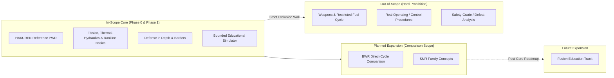

# Scope and Boundaries

| Field | Value |
|---|---|
| Doc ID | HAK-DOC-SCOPE |
| Status | Draft |
| Owner stage | Stage 1 (Governance & Product Foundation) |
| Depends on | HAK-DOC-CHARTER, HAK-DOC-CONTRACT |
| Requirements | HAK-PRD-001, HAK-PRD-010, HAK-PRD-011, HAK-PRD-016, HAK-CON-009, HAK-CON-010, HAK-CON-011, HAK-CON-012 |

## 1. Purpose

This document defines the **authoritative scope and boundary statement** used everywhere across HAKUREN Phase 0 specifications and Phase 1+ implementation artifacts. Every downstream domain, system engineering, 3D, simulation, safety, UX, and QA specification must conform strictly to these boundaries.

## 2. Authoritative Boundary Statement

> **HAKUREN Canonical Boundary Statement:** HAKUREN is a strictly civilian, non-operational, educational nuclear energy and reactor engineering exploration platform centered on a generic, representative pressurized water reactor (**HAKUREN Reference PWR**), with Boiling Water Reactors (**BWR**) and the Small Modular Reactor (**SMR**) family documented as structured conceptual comparisons. Nuclear fusion is reserved for future post-core expansion. Nuclear weapons design or pathways, restricted material acquisition or processing, real-world reactor operating or control procedures, protection-system defeat or exploitation analyses, and safety-grade or licensing-grade simulation are permanently out of scope.

## 3. Four-Tier Scope Matrix

| Scope Tier | Domain / Capability | Detailed Inclusion & Boundary Definition | Primary Governance / Source Basis |
|---|---|---|---|
| **In-Scope (Core Phase 0 & Phase 1 Release)** | Civilian Nuclear Fission Power | Peaceful electricity and thermal energy generation from controlled nuclear fission in light-water reactors (`HAK-SRC-004`). | `decision-log.md` (locked scope); `HAK-SRC-004` |
| **In-Scope (Core Phase 0 & Phase 1 Release)** | HAKUREN Reference PWR (Primary Reference) | Generic, representative educational PWR spanning primary Reactor Coolant System (RPV, fuel assemblies/rods, control rods/CRDMs, RCPs, PZR, SGs), containment, and secondary Rankine circuit (`HAK-SRC-001`). Vendor designs appear only as explicitly labeled examples. | [Documentation Authoring Contract](documentation-authoring-contract.md); `HAK-SRC-001` |
| **In-Scope (Core Phase 0 & Phase 1 Release)** | Nuclear Physics Education | Qualitative and introductory quantitative explanations of fission, neutron moderation, delayed vs. prompt neutron concepts (conceptual), reactivity feedback concepts, radioactive decay, decay heat, and radiation shielding basics (`HAK-SRC-004`). | `HAK-SRC-004`; Master Prompt s1 |
| **In-Scope (Core Phase 0 & Phase 1 Release)** | Thermal-Hydraulic Educational Model | Lumped-parameter or simplified educational models of core heat generation, primary coolant heat transport, steam generator heat exchange, and bounded transient trends—explicitly non-safety-grade (`HAK-CON-009`). | `HAK-CON-009`; Master Prompt s1 |
| **In-Scope (Core Phase 0 & Phase 1 Release)** | Turbine & Power Generation | Secondary steam loop, Rankine cycle thermodynamics, steam turbine expansion, electrical generator coupling, condenser heat rejection, and feedwater return (`HAK-SRC-001`). | `HAK-SRC-001`; Master Prompt s1 |
| **In-Scope (Core Phase 0 & Phase 1 Release)** | Nuclear Safety Principles | Conceptual defense in depth (`HAK-SRC-005`), physical fission-product barriers (`HAK-SRC-006`), passive vs. active cooling principles, redundancy, diversity, and instrumentation/protection concepts without operational procedures. | `HAK-SRC-005`; `HAK-SRC-006` |
| **In-Scope (Core Phase 0 & Phase 1 Release)** | Six Modules & 3-Level 3D + Static Hosting | `Overview` (`/`), `Reactor Anatomy` (`/anatomy`), `Energy Journey` (`/journey`), `Reactor Simulator` (`/simulator`), `Safety & Engineering` (`/safety`), `Technical Library` (`/library`); *Plant*, *System*, and *Component* 3D levels; static GitHub Pages delivery (`HAK-SRC-007`). | [Product Vision](product-vision.md); `HAK-SRC-007` |
| **Planned Expansion (Documented Comparison Scope)** | BWR Comparison Architecture | Structured architectural and cycle comparison contrasting BWR single-loop direct boiling, two-stage moisture separation, and recirculation/fuel-array differences (`HAK-SRC-002`) against the HAKUREN Reference PWR. Phase 0 specifies comparison domain content and comparison UI contracts; full independent BWR 3D plant/simulator parity is deferred post-core unless explicitly promoted. | `decision-log.md`; `HAK-SRC-002` |
| **Planned Expansion (Documented Comparison Scope)** | SMR Family Comparison | Conceptual comparison explaining SMRs as a diverse *family* of designs (typically up to ~300 MWe per module, factory fabrication, light-water integral-PWR and non-light-water coolants, passive cooling emphasis) (`HAK-SRC-003`). Never collapses SMRs into a single commercial design. | [Documentation Authoring Contract](documentation-authoring-contract.md); `HAK-SRC-003` |
| **Future Expansion (Post-Core Roadmap)** | Civilian Nuclear Fusion Education | Introductory educational comparison of nuclear fusion vs. fission (`HAK-DOC-CONTRACT`) and conceptual fusion energy pathways, scheduled strictly after the core fission platform is validated and released. | `decision-log.md` (future expansion) |
| **Future Expansion (Post-Core Roadmap)** | Localization & Offline Packaging | Multi-language translations and optional offline progressive web app (PWA) classroom bundles, deferred beyond core English baseline. | Master Prompt s8 |
| **Out-of-Scope (Permanently Excluded)** | Nuclear Weapons & Restricted Pathways | Any content describing nuclear weapon design, nuclear explosive engineering, weapons-grade material production, or acquisition/enrichment/reprocessing procedures for restricted materials (`HAK-CON-011`). | `decision-log.md`; `HAK-DOC-CONTRACT` |
| **Out-of-Scope (Permanently Excluded)** | Real Reactor Operation & Control | Plant-specific operating procedures, emergency operating procedures (EOPs), startup/shutdown checklists, control-room ergonomics for licensed operators, or protection setpoints presented as operational guidance (`HAK-CON-012`). | `decision-log.md`; `HAK-DOC-CONTRACT` |
| **Out-of-Scope (Permanently Excluded)** | Safety-Grade / Licensing Simulation | Safety-analysis, best-estimate-plus-uncertainty (BEPU), PRA/PSA licensing calculations, or predictive claims outside documented educational model validity (`HAK-CON-009`). | `decision-log.md`; `HAK-DOC-CONTRACT` |
| **Out-of-Scope (Permanently Excluded)** | Protection Defeat & Exploitation | Instructions, scenarios, or analyses showing how to bypass, defeat, or exploit reactor protection systems, trip logic, or physical security controls. | [Documentation Authoring Contract](documentation-authoring-contract.md) |
| **Out-of-Scope (Permanently Excluded)** | Mandatory Backend & User Accounts | Server-side simulation engines, user authentication databases, PII storage, or proprietary vendor CAD ingestion pipelines (`HAK-CON-002`, `HAK-CON-018`). | `HAK-CON-002`; `HAK-CON-018` |

## 4. Boundary Flow Across Phase 0 and Product Modules

## 5. Content Boundary Operationalization (`HAK-SAFE` Baseline)

Until Stage 7 produces the detailed boundary specification (`docs/07-safety/safety-content-boundaries.md`), all Phase 0 authors must enforce these operational rules:

1. **Purpose & Principle Over Procedure:** Describe every safety system (e.g., emergency core cooling, containment spray, reactor trip) by *functional purpose*, *physical principle*, and *high-level architecture*—never by step-by-step operator actions or setpoint manipulation guidance.
2. **Conceptual Accident Framing:** Discuss off-normal or accident concepts solely to illustrate why physical barriers (`HAK-SRC-006`) and defense-in-depth layers (`HAK-SRC-005`) exist—never as defeat pathways or severe-accident exploitation scenarios.
3. **Generic vs. Vendor Attribution:** Whenever a vendor-specific example (such as an integral PWR SMR or a 4-loop PWR) is mentioned for contrast, label it explicitly as a *vendor example* and cite its source rather than blending it into the generic **HAKUREN Reference PWR** baseline.
4. **Automated & Manual Boundary Review:** Every markdown document outside explicitly exempted boundary/charter files is screened by `tools/hakuren_audit.py safety` and human Stage 7/11 review.

## 6. Simulation Validity Boundary

All simulation specifications (`docs/06-simulation/*`) and UI views (`/simulator`) inherit the following scope lock:

- `[ASM]` The educational simulator models qualitative and first-order quantitative trends over a bounded steady-state and gentle-transient educational envelope.
- Outputs must never be presented as plant-predictive, certified, qualified, or safety-grade.
- Any input pushed toward edge conditions triggers bounded educational responses and explicit validity warnings rather than extrapolating unverified physics.

## 7. References

- `HAK-SRC-001`: U.S. NRC — *Pressurized Water Reactors*.
- `HAK-SRC-002`: U.S. NRC — *Boiling Water Reactors*.
- `HAK-SRC-003`: U.S. DOE Office of Nuclear Energy — *Advanced Small Modular Reactors (SMRs)*.
- `HAK-SRC-004`: U.S. DOE Office of Nuclear Energy — *NUCLEAR 101: How Does a Nuclear Reactor Work?*
- `HAK-SRC-005`: U.S. NRC — *Defense in depth*.
- `HAK-SRC-006`: U.S. NRC — *Containment structure*.
- `HAK-SRC-007`: GitHub Docs — *GitHub Pages limits*.

## 8. Related Documents

- [Project Charter](project-charter.md)
- [Product Vision](product-vision.md)
- [Project Objectives](project-objectives.md)
- [Constraints Register](constraints-register.md)
- [Phase 0 Acceptance Criteria](phase-0-acceptance-criteria.md)
- `docs/07-safety/safety-content-boundaries.md` (to be authored in Stage 7)
- `docs/06-simulation/simulation-scope-and-boundaries.md` (to be authored in Stage 6)

## 9. Change History

Recorded centrally in [Changelog](../CHANGELOG.md).
