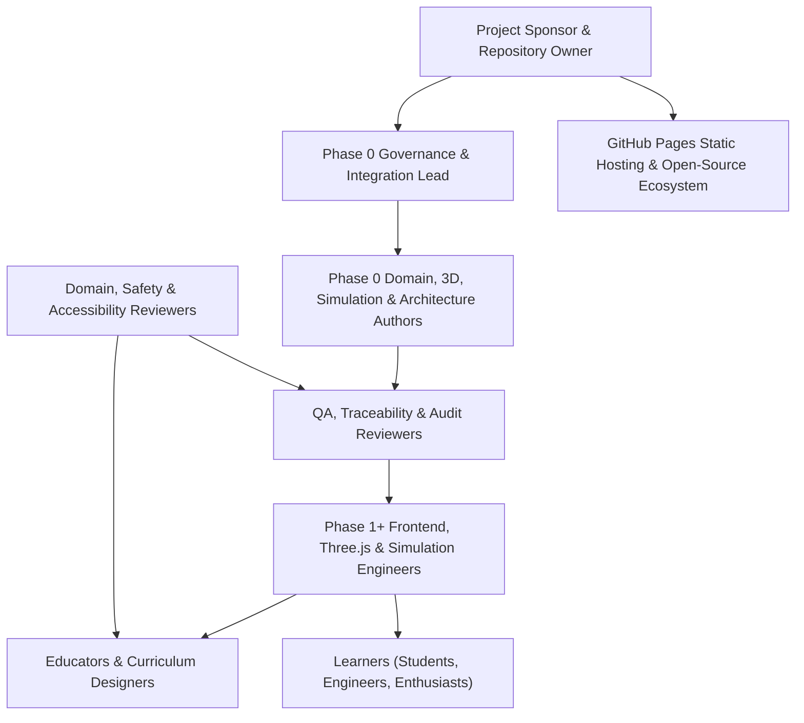

# Stakeholder Analysis

| Field | Value |
|---|---|
| Doc ID | HAK-DOC-STAKEHOLDERS |
| Status | Draft |
| Owner stage | Stage 1 (Governance & Product Foundation) |
| Depends on | HAK-DOC-CHARTER, HAK-DOC-SCOPE, HAK-DOC-OBJECTIVES |
| Requirements | HAK-PRD-001, HAK-PRD-010, HAK-PRD-013, HAK-PRD-015, HAK-PRD-017, HAK-PRD-018, HAK-CON-006, HAK-CON-011, HAK-CON-013, HAK-CON-015 |

## 1. Purpose

This document identifies all internal and external stakeholders of the **HAKUREN** platform across Phase 0 (specification and validation) and Phase 1+ (implementation, deployment, and educational adoption), evaluates their influence, expectations, and success criteria, and defines governance engagement touchpoints.

## 2. Stakeholder Ecosystem Overview

## 3. Stakeholder Register and Impact Assessment

| Stakeholder Group | Role & Category | Power / Influence | Interest Level | Core Needs & Expectations | Primary HAKUREN Value & Risk Exposure |
|---|---|---|---|---|---|
| **Project Sponsor / Repository Owner** | Internal Decision Authority (`Orls967`) | High | High | Strict adherence to locked scope, zero fabricated facts, staged audit discipline, clean handoff to Phase 1 implementation, static deployability on GitHub Pages (`HAK-SRC-007`). | Expects Gate A–F rigor (`HAK-PRD-018`); exposed to reputational or safety-boundary risk if unverified claims ship. |
| **Phase 0 Governance & Integration Lead** | Internal Process & Integration | High | High | Cross-document consistency, single-definition ID discipline, up-to-date RTM, zero broken links, strict separation of integration-managed registers. | Relies on [Scope and Boundaries](scope-and-boundaries.md) and [Constraints Register](constraints-register.md) to enforce uniform standards across all 12 stages. |
| **Phase 0 Specification Authors** | Internal Domain, System, 3D, Sim, UX & Arch Authors | Medium-High | High | Unambiguous parent `HAK-PRD` objectives, clear scope locks, verified `HAK-SRC-nnn` source baselines, and explicit open-issue handling when values are unavailable. | Needs actionable governance contracts so Stage 2–10 authors never duplicate definitions or guess engineering parameters. |
| **Phase 1+ Implementation Engineers** | Internal / Downstream Delivery (React, R3F, Workers, Schemas) | Medium-High | High | Implementation-ready specs (`HAK-PRD-018`), deterministic math contracts, JSON schemas with valid/invalid examples, performance budgets, and zero ambiguous prose. | Directly impacted by Gate E readiness; incomplete data contracts or vague simulator bounds block Phase 1 velocity. |
| **Nuclear Domain & Safety Reviewers** | External / Advisory Technical Reviewers | Medium-High | Medium-High | Accurate PWR/BWR/SMR framing (`HAK-SRC-001`, `HAK-SRC-002`, `HAK-SRC-003`), strict defense-in-depth conceptual fidelity (`HAK-SRC-005`), explicit non-operational disclaimers (`HAK-PRD-010`), and civilian-only content compliance (`HAK-CON-011`). | High sensitivity to misstatements of reactor physics or blurring generic Reference PWR parameters with proprietary designs. |
| **Educators & University Instructors** | External Adopters & Assigners | Medium | High | Standalone deep-linkable module URLs (`HAK-PRD-014`), SI-unit discipline (`HAK-SRC-010`), curated simulator scenarios (`HAK-PRD-009`), and verifiable source citations for classroom use. | Require reliable, repeatable browser behavior in campus labs and accurate conceptual scaffolding across `/journey`, `/simulator`, and `/library`. |
| **Target Learners (Students, Engineers, Enthusiasts)** | Primary End Users (see [Audience and Personas](audience-and-personas.md)) | Low-Medium (aggregated via adoption) | High | Intuitive 3D spatial clarity across *Plant*, *System*, and *Component* levels (`HAK-PRD-004`), smooth responsive UI, intelligible visuals, and clear explanations without gatekeeping jargon. | Drop off quickly if 3D scenes stall on typical laptops, terminology is inconsistent, or causal links between fission and electricity are obscured. |
| **Accessibility & Usability Reviewers** | Quality & Compliance Advocates | Medium | Medium-High | Keyboard navigation, readable contrast in dark-graphite themes, reduced-motion options, screen-reader landmarks, and WCAG 2.2 Level AA conformance (`HAK-SRC-008`, `HAK-PRD-017`). | Highlight tension between rich WebGL 3D canvases and assistive technology parity; require structured non-3D fallback metadata and controls. |
| **QA, Audit & Traceability Leads** | Internal Verification Authority | High (Gatekeeper) | High | 100% requirement-to-test traceability (`HAK-TC`), reproducible scientific verification scripts, passing `tools/audit-documentation.py --strict`, and clean `15-audit/` sign-off. | Cannot approve Stage 11 exit if any `Draft` gap, missing test case, or `UNV` citation underpins a critical numerical claim. |
| **Static Hosting & Web Platform Ecosystem** | External Infrastructure (`GitHub Pages`, Browser Vendors) | Low (fixed constraints) | Low | Compliance with GitHub Pages 1 GB site limit, 100 GB/month soft bandwidth limit, static HTML/CSS/JS delivery (`HAK-SRC-007`), and standard WebGL / glTF 2.0 browser APIs (`HAK-SRC-009`). | Exceeding bundle/asset limits or requiring server runtime breaks deployment feasibility (`HAK-CON-001`, `HAK-CON-002`). |

## 4. Influence-Interest Engagement Strategy

Rather than treating all stakeholders identically, HAKUREN maps engagement cadence to influence and technical dependency:

| Engagement Strategy | Stakeholder Groups | Phase 0 Cadence & Artifacts | Phase 1+ Cadence & Artifacts |
|---|---|---|---|
| **Manage Closely (High Influence, High Interest)** | Project Sponsor, Integration Lead, QA/Audit Gatekeepers | Stage-end validation summaries, `PROJECT_STATUS.md`, `decision-log.md`, `open-issues-register.md`, Gate A–F audit reports. | Milestone demos per module, automated CI schema/unit/E2E gates, GitHub Pages deployment checks. |
| **Collaborate & Unblock (Medium-High Influence, High Interest)** | Specification Authors, Phase 1+ Engineers, Domain/Safety Reviewers | Authoring contract adherence, cross-stage handoff reviews (Stage 2→3→4/5/6, Stage 8→9→10), safety boundary sign-off in Stage 7. | Architecture decision reviews, simulator numerical verification against Python reference baselines, asset pipeline checks. |
| **Engage & Validate (Medium Influence, High Interest)** | Educators, Accessibility Reviewers | Persona validation (`audience-and-personas.md`), UX accessibility specification review (`09-ux-design`), scenario pedagogy review (`06-simulation`). | Classroom pilot feedback, WCAG 2.2 Level AA keyboard/screen-reader testing (`HAK-SRC-008`), educator quick-link validation. |
| **Inform & Serve Well (User Base & Fixed Constraints)** | Target Learners, Hosting Infrastructure | Persona-driven requirements (`HAK-PRD-001`..`017`), asset budget limits (`HAK-CON-001`, `HAK-CON-003`). | Public release notes, clear on-screen disclaimers, bundle-size monitoring under GitHub Pages limits. |

## 5. Key Stakeholder Tension Points and Resolutions

1. **Pedagogical Simplicity vs. Engineering Rigor:**
   - *Tension:* High-school learners want immediate intuition while engineering learners want governing equations and SI units (`HAK-SRC-010`).
   - *Resolution:* Progressive disclosure across modules (`Overview` and `Energy Journey` foreground causal clarity; `Reactor Simulator` and `Technical Library` expose equations, units, and model assumptions) plus strict claim tagging (`[SIMP]` vs `[REF]`).
2. **Cinematic 3D Richness vs. Browser & Static Hosting Budgets:**
   - *Tension:* Detailed reactor core geometry conflicts with GitHub Pages bandwidth/size constraints (`HAK-SRC-007`) and mid-range laptop GPU budgets (`HAK-CON-003`).
   - *Resolution:* Concentrate geometric detail at the **Component** level on the reactor core (`HAK-PRD-004`), standardize on compressed glTF 2.0 (`HAK-SRC-009`) with level-of-detail (LOD) budgets specified in Stage 4 (`docs/04-3d-experience/performance-budget.md`).
3. **Interactive Reactor Control vs. Non-Operational Safety Boundary:**
   - *Tension:* Learners expect "controls" in `/simulator`, yet HAKUREN must never present real plant operating procedures or protection defeat concepts (`HAK-CON-011`, `HAK-CON-012`).
   - *Resolution:* Expose high-level pedagogical inputs (e.g., conceptual reactivity adjustment, primary flow factor, secondary load demand) with bounded educational responses, persistent non-operational banners (`HAK-PRD-010`), and conceptual safety explanations (`HAK-PRD-011`).

## 6. References

- `HAK-SRC-001`: U.S. NRC — *Pressurized Water Reactors*.
- `HAK-SRC-002`: U.S. NRC — *Boiling Water Reactors*.
- `HAK-SRC-003`: U.S. DOE Office of Nuclear Energy — *Advanced Small Modular Reactors (SMRs)*.
- `HAK-SRC-005`: U.S. NRC — *Defense in depth*.
- `HAK-SRC-007`: GitHub Docs — *GitHub Pages limits*.
- `HAK-SRC-008`: W3C — *Web Content Accessibility Guidelines (WCAG) 2.2*.
- `HAK-SRC-009`: Khronos Group — *glTF 2.0 Specification*.
- `HAK-SRC-010`: NIST — *Special Publication 330: The International System of Units (SI)*.

## 7. Related Documents

- [Project Charter](project-charter.md)
- [Product Vision](product-vision.md)
- [Project Objectives](project-objectives.md)
- [Scope and Boundaries](scope-and-boundaries.md)
- [Audience and Personas](audience-and-personas.md)
- [Constraints Register](constraints-register.md)

## 8. Change History

Recorded centrally in [Changelog](../CHANGELOG.md).
