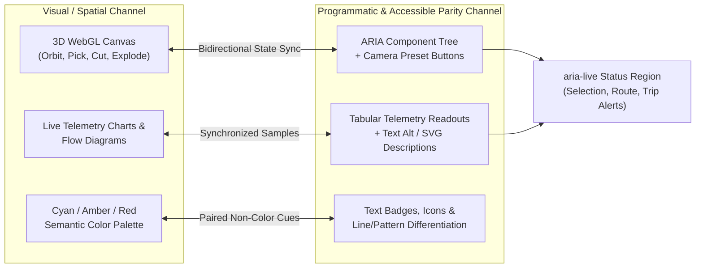

# Accessibility Requirements

| Field | Value |
|---|---|
| Doc ID | HAK-DOC-ACCESSIBILITY |
| Status | Draft |
| Owner stage | 1 |
| Depends on | HAK-DOC-CONSTRAINTS, HAK-DOC-PRD, HAK-DOC-FR, HAK-DOC-NFR |
| Requirements | HAK-PRD-073, HAK-PRD-074, HAK-PRD-075, HAK-PRD-076, HAK-FR-077, HAK-FR-078, HAK-FR-079, HAK-FR-080, HAK-FR-081, HAK-FR-082, HAK-FR-083, HAK-FR-084, HAK-FR-085, HAK-FR-086, HAK-FR-087, HAK-FR-088, HAK-PRD-031, HAK-CON-015, HAK-NFR-027, HAK-NFR-028, HAK-NFR-029, HAK-NFR-030, HAK-NFR-031, HAK-NFR-032 |

## 1. Purpose and Scope

This document defines the product and functional **Accessibility Requirements** (`HAK-PRD-073` through `HAK-PRD-076`, and `HAK-FR-077` through `HAK-FR-088`) for **HAKUREN**, complementing the system-level non-functional baseline (`HAK-NFR-027` through `HAK-NFR-032`) in [Non-Functional Requirements](non-functional-requirements.md). It translates **W3C Web Content Accessibility Guidelines (WCAG) 2.2 Level AA** (`HAK-SRC-026`) and **WAI-ARIA Authoring Practices Guide (APG)** patterns (`HAK-SRC-027`, `HAK-SRC-028`, `HAK-SRC-029`) into testable product behaviors covering keyboard operability, screen-reader parity for 3D WebGL scenes, color-independent encoding, reduced-motion support, text alternatives for diagrams/charts/formulas, focus management, single-pointer alternatives to dragging, minimum pointer target sizes, responsive reflow, and assistive status announcements.

## 2. Accessibility Architecture and Conformance Scope

A WebGL 3D nuclear power plant canvas cannot expose raw polygon geometry directly to assistive technologies. HAKUREN resolves this structural barrier through **Equivalent Dual-Channel Representation**: every spatial, thermodynamic, and dynamic visual state is mirrored concurrently in semantic DOM structures (`tree` / `treeitem`, structured metadata panels, tabular telemetry, and accessible equation descriptions) (`HAK-SRC-026`, `HAK-SRC-027`).

### 2.1 Conformance Target and Standards Basis

- **Target Standard:** W3C WCAG 2.2 Level A and Level AA (`HAK-SRC-026`, W3C Recommendation `2024-12-12`), plus WCAG 2.2 SC `2.3.3` (*Animation from Interactions*, Level AAA) adopted proactively for motion sensitivity (`HAK-CON-015`, `HAK-SRC-032`).
- **Widget Pattern Authority:** WAI-ARIA Authoring Practices Guide (`HAK-SRC-027` Tree View Pattern, `HAK-SRC-028` Keyboard Interface guidance, `HAK-SRC-029` Breadcrumb Pattern).
- **Language Declaration Authority:** W3C Internationalization HTML `lang` specification (`HAK-SRC-033`).

## 3. Product-Level Accessibility Requirements (`HAK-PRD`)

| ID | Name | Requirement | Priority | Rationale | Source | Parent | Verification | Acceptance | Status |
|---|---|---|---|---|---|---|---|---|---|
| HAK-PRD-073 | Full Keyboard and Non-Pointer Educational Parity | Every educational task across all six HAKUREN modules—including inspecting 3D components, traversing Energy Journey stages, running Reactor Simulator scenarios, exploring Safety barriers, and searching Technical Library entries—shall be completable using only a keyboard or single-pointer tap/click without dragging. | Must | Ensures motor-impaired and keyboard-only learners (`Persona 7: Amina`) are never blocked by 3D canvas gestures or drag-only sliders (`WCAG 2.2 SC 2.1.1, 2.5.7`, `HAK-SRC-026`). | HAK-SRC-026 | HAK-PRD-031 | Test+Demonstration | Automated and manual keyboard-only and single-click walkthroughs complete every primary learner task across all 6 routes with zero pointer-drag-only barriers. | Draft |
| HAK-PRD-074 | Non-Visual Semantic Parity for 3D and Quantitative Visuals | Every piece of educational information conveyed visually by the 3D plant/reactor scene, Energy Journey flow animation, technical diagrams, or simulator plots shall have a synchronized, screen-reader-accessible semantic equivalent (ARIA Component Tree, structured Info Panel, tabular metrics, and descriptive text alternatives). | Must | WebGL pixels and unlabeled vector curves are opaque to screen readers (`WCAG 2.2 SC 1.1.1, 1.3.1, 4.1.2`, `HAK-SRC-026`). | HAK-SRC-026 | HAK-PRD-031 | Inspection+Test | Screen-reader walkthrough (VoiceOver or NVDA) accesses all component hierarchies, metadata, stage transformations, diagram meanings, and simulator KPIs without relying on visual 3D inspection. | Draft |
| HAK-PRD-075 | Sensory, Color, and Motion Safety Across All Modules | Visual hierarchy, thermal/warning semantics, contrast, and motion behavior shall never rely solely on color (`SC 1.4.1`) or force continuous motion (`SC 2.2.2`, `SC 2.3.3`), maintaining WCAG 2.2 Level AA contrast (`SC 1.4.3`, `SC 1.4.11`) across dark graphite and midnight navy surfaces. | Must | Protects color-vision-deficient, low-vision, and motion-sensitive learners while enforcing industrial safety-signal clarity (`HAK-PRD-034`, `HAK-SRC-026`, `HAK-SRC-032`). | HAK-SRC-026 | HAK-PRD-031 | Inspection+Test | Contrast checks confirm `>= 4.5:1` text and `>= 3:1` UI/graphics ratios; greyscale inspection verifies icons/labels distinguish states; reduced-motion disables continuous animations. | Draft |
| HAK-PRD-076 | Predictable Focus, Target Sizing, and Layout Reflow | Across desktop, tablet, mobile, and `320 CSS px` zoomed viewports, interactive controls shall maintain visible unobscured focus (`SC 2.4.7`, `SC 2.4.11`), compliant minimum pointer targets (`SC 2.5.8`), and clean vertical reflow (`SC 1.4.10`). | Must | Prevents lost focus behind sticky panels, accidental mis-taps on touchscreens, and broken zoomed layouts (`HAK-SRC-026`). | HAK-SRC-026 | HAK-PRD-031 | Test+Inspection | Verification at `1440x900`, `390x844`, and `320 px` (`400%` zoom) shows visible unobscured focus rings, `>= 24x24` CSS px hit targets or compliant spacing, and zero 2D prose scroll. | Draft |

## 4. Functional Accessibility Requirements (`HAK-FR`)

| ID | Name | Requirement | Priority | Rationale | Source | Parent | Verification | Acceptance | Status |
|---|---|---|---|---|---|---|---|---|---|
| HAK-FR-077 | Global Keyboard Operability and Zero Keyboard Traps | All interactive UI controls across `/`, `/anatomy`, `/journey`, `/simulator`, `/safety`, and `/library` shall be reachable and operable via standard keyboard keys (`Tab`, `Shift+Tab`, `Enter`, `Space`, `Escape`, and widget-appropriate `Arrow` keys) with zero keyboard traps (`WCAG 2.2 SC 2.1.1, 2.1.2`); if a focused WebGL canvas captures arrow keys for camera orbit, `Tab` and `Escape` shall always exit the canvas immediately with visible exit guidance. | Must | Guarantees keyboard users never get stuck inside a 3D viewport or custom composite widget (`HAK-SRC-026`, `HAK-SRC-028`). | HAK-SRC-026 | HAK-PRD-073 | Test+Demonstration | Full keyboard traversal enters and exits every interactive region—including the 3D canvas, modal drawers, sliders, and tree views—without getting trapped. | Draft |
| HAK-FR-078 | Keyboard Camera Controls and Accessible Viewpoint Presets | In `/anatomy` and `/safety`, learners shall be able to orbit, zoom, pan, reset the view, and select every named engineering camera preset (*Plant*, *Containment*, *RCS*, *RPV*, *Core*, *SG*) using discrete keyboard-focusable buttons and bounded keyboard shortcuts rather than pointer dragging alone. | Must | Provides direct spatial viewpoint switching for keyboard-only and switch/single-pointer users (`WCAG 2.2 SC 2.1.1, 2.5.7`, `HAK-SRC-026`). | HAK-SRC-026 | HAK-PRD-073 | Test+Demonstration | Keyboard activation of camera preset buttons and canvas arrow/zoom keys repositions the 3D camera cleanly and updates the active viewpoint label. | Draft |
| HAK-FR-079 | Screen Reader Alternatives for 3D Scenes | The `/anatomy` and `/safety` modules shall pair every 3D scene with a programmatically synchronized ARIA Tree View (`role="tree"`, `role="treeitem"`, `aria-expanded`, `aria-selected` per `HAK-SRC-027`), a structured Component Information Panel using semantic headings and definition lists/tables, and an `aria-label`/`aria-describedby` summary on the canvas container describing the active 3D view level and selected entity. | Must | Gives blind and low-vision learners full structural and engineering access to Plant/System/Component hierarchies (`WCAG 2.2 SC 1.1.1, 4.1.2`, `HAK-SRC-027`). | HAK-SRC-027 | HAK-PRD-074 | Inspection+Test | Automated ARIA checks and screen-reader navigation traverse the Component Tree, expand subsystems, select components, and read all Section 3.1 metadata fields. | Draft |
| HAK-FR-080 | Color-Independent Encoding and Contrast Compliance | Color signals—including primary vs. secondary coolant differentiation, thermal amber cues, warning/trip red indicators (`HAK-PRD-034`), and multi-series simulator plots—shall always pair color with redundant non-color cues (text labels, distinct line dash patterns, geometric icons, or boundary tags per `SC 1.4.1`), while maintaining `>= 4.5:1` text contrast (`SC 1.4.3`) and `>= 3:1` UI/graphical object contrast (`SC 1.4.11`). | Must | Prevents red-green/blue-yellow color blindness or low-contrast dark mode rendering from hiding critical safety or loop distinctions (`HAK-SRC-026`). | HAK-SRC-026 | HAK-PRD-075 | Inspection+Test | Inspecting all charts, flow legends, and warning badges in greyscale/color-blindness simulation confirms every state remains distinguishable, and contrast tooling reports `>= 4.5:1` / `>= 3:1`. | Draft |
| HAK-FR-081 | Reduced Motion Detection and In-App Animation Control | The application shall honor OS/browser `prefers-reduced-motion: reduce` (`HAK-SRC-032`) automatically on load and provide a persistent in-app **Reduced Motion** toggle in the global shell (`SC 2.2.2, 2.3.3`) that pauses ambient 3D rotation, replaces smooth camera fly-to transitions with instant cuts, and switches animated `/journey` flow particles to static directional vector arrows. | Must | Prevents vestibular discomfort and motion-triggered distraction while keeping causal flow direction legible (`HAK-SRC-026`, `HAK-SRC-032`). | HAK-SRC-032 | HAK-PRD-075 | Test+Demonstration | Toggling OS `prefers-reduced-motion` or the in-app control halts continuous 3D/SVG motion immediately and renders static directional indicators on `/journey`. | Draft |
| HAK-FR-082 | Text Alternatives for Diagrams, Charts, and Rendered Math | Every engineering diagram (`dia-*`), flow schematic, simulator time-series chart, and rendered mathematical formula shall expose an accessible text alternative (`SC 1.1.1`, `1.3.1`): meaningful `<title>`/`<desc>` or expandable text description for diagrams, synchronized tabular KPI/sample readouts alongside charts, and semantic MathML or plain-text equation readouts for rendered formulas. | Must | Ensures schematic diagrams, dynamic plots, and LaTeX math remain intelligible to screen readers (`HAK-SRC-026`). | HAK-SRC-026 | HAK-PRD-074 | Inspection+Test | Screen-reader and DOM inspection confirms every non-decorative diagram has a descriptive text alternative, every simulator chart has a synchronized data table, and every formula provides accessible math/text output. | Draft |
| HAK-FR-083 | Focus Management Across Routes, Drawers, and Panels | The application shall manage keyboard focus deterministically (`SC 2.4.3, 2.4.7, 2.4.11`): (a) route transitions move focus to the new view's `#main-content` or `<h1>`; (b) opening a modal drawer or formula/assumption dialog moves focus inside and traps Tab within it until dismissed via `Escape`/Close, then returns focus to the triggering button; (c) sticky headers/sidebars never completely obscure the currently focused element (`SC 2.4.11`). | Must | Eliminates lost focus after SPA transitions and prevents sticky dark-mode bars from hiding keyboard focus rings (`HAK-SRC-026`). | HAK-SRC-026 | HAK-PRD-076 | Test+Demonstration | Tabbing through every route, modal drawer, and scrollable container keeps focus rings visible (`>= 3:1` contrast), unobscured, and cleanly restored on dialog close. | Draft |
| HAK-FR-084 | Single-Pointer Alternatives to Dragging Operations | Every operation that supports pointer dragging—including 3D camera orbit/pan, Exploded View separation (`0%`–`100%`), Section Cut axis position, Enclosure Transparency, and Simulator parameter sliders—shall provide single-pointer click/tap alternatives (increment/decrement stepper buttons, preset chips, or direct numeric input per `WCAG 2.2 SC 2.5.7`). | Must | Satisfies WCAG 2.2 Level AA `Dragging Movements` so users unable to perform sustained press-and-drag gestures retain complete control (`HAK-SRC-026`). | HAK-SRC-026 | HAK-PRD-073 | Test+Demonstration | Every slider, cutaway control, and 3D camera action can be adjusted end-to-end using only single taps/clicks on stepper or preset buttons without dragging. | Draft |
| HAK-FR-085 | Minimum Interactive Target Size and Spacing | All interactive pointer targets—including navigation links, mobile menu triggers, layer checkboxes, tree expand/collapse buttons, slider steppers, camera presets, and 3D hotspot pins—shall have a minimum bounding box of `24x24` CSS pixels (targeting `44x44` CSS pixels for primary mobile touch controls) or maintain non-intersecting `24 CSS px` spacing circles per `WCAG 2.2 SC 2.5.8`. | Must | Reduces mis-taps on touch tablets, phones, and assistive pointers (`HAK-SRC-026`). | HAK-SRC-026 | HAK-PRD-076 | Inspection+Test | Automated DOM bounding-box audit across `1440x900` and `390x844` viewports verifies zero non-exempt interactive targets violate WCAG 2.2 SC `2.5.8` size or spacing rules. | Draft |
| HAK-FR-086 | Responsive Reflow and Text-Zoom Resilience | Prose, forms, Component Info Panels, Energy Journey stage cards, Simulator telemetry tables, and Library articles shall reflow cleanly down to `320` CSS pixel width (`SC 1.4.10`) and scale cleanly up to `200%` text size (`SC 1.4.4`) without text truncation, overlapping controls, or two-dimensional page scrolling (preserving local scroll containers only for inherently 2D tables or interactive viewports). | Must | Ensures low-vision learners using browser zoom or small mobile screens read all content cleanly (`HAK-SRC-026`). | HAK-SRC-026 | HAK-PRD-076 | Test+Inspection | Testing all six routes at `1280px` with `400%` zoom (`320 CSS px` effective width) and `200%` text resize produces zero clipped controls or horizontal page overflow. | Draft |
| HAK-FR-087 | Dynamic Status and Telemetry Announcements | Non-focused state changes—including route transitions, 3D component selection, simulator state changes (`WarningBound`, `EducationalTrip`), scenario step completion, and Library search result counts—shall update dedicated `aria-live` status regions (`polite` for informational updates, `assertive` or `role="alert"` strictly for `EducationalTrip`) without stealing keyboard focus (`WCAG 2.2 SC 4.1.3`). | Must | Keeps screen-reader users informed of live simulation events and selection updates without disrupting their reading cursor (`HAK-SRC-026`). | HAK-SRC-026 | HAK-PRD-074 | Test+Inspection | Triggering component picks, search queries, and simulator trips announces accurate status messages via `aria-live` regions while keeping keyboard focus unchanged. | Draft |
| HAK-FR-088 | Skip Links, Semantic Landmarks, and BCP 47 Language Tagging | Every view shall expose a keyboard-visible **Skip to main content** link (`SC 2.4.1`), unambiguous HTML5 landmarks (`header`, `nav`, `main`, `aside`, `footer`) with single `<h1>` heading hierarchy, and valid BCP 47 `lang` attributes on `<html>` (and inline foreign terms where applicable per `SC 3.1.1, 3.1.2` and `HAK-SRC-033`). | Must | Enables rapid landmark jumping for assistive tech and ensures accurate screen-reader pronunciation across `en` MVP and future `id` localization (`HAK-NFR-038`, `HAK-SRC-033`). | HAK-SRC-033 | HAK-PRD-074 | Inspection+Test | HTML/DOM audit confirms skip link jumps to `#main-content`, `<html lang="en">` is present, heading levels do not skip hierarchy, and landmarks are uniquely labeled. | Draft |

## 5. WCAG 2.2 Level AA Coverage Matrix

This mapping table links WCAG 2.2 success criteria verified in `HAK-SRC-026` to HAKUREN's accessibility requirements (criterion names appear in column 1 to keep requirement definitions uniquely in Sections 3–4).

| WCAG 2.2 Criterion | Level | HAKUREN Requirement Coverage | Primary Module Verification Focus |
|---|---|---|---|
| **1.1.1 Non-text Content** | A | `HAK-PRD-074`, `HAK-FR-079`, `HAK-FR-082` | 3D canvas summary + tree parity, diagrams, chart data tables |
| **1.3.1 Info and Relationships** | A | `HAK-FR-079`, `HAK-FR-082`, `HAK-FR-088` | Semantic landmarks, headings, tables, ARIA tree/tab relationships |
| **1.4.1 Use of Color** | A | `HAK-PRD-075`, `HAK-FR-080` | Primary/secondary legend patterns, thermal/warning badges + icons |
| **1.4.3 Contrast (Minimum)** | AA | `HAK-PRD-075`, `HAK-FR-080`, `HAK-NFR-028` | Dark graphite / midnight navy text `>= 4.5:1` (`>= 3:1` large) |
| **1.4.4 Resize Text / 1.4.10 Reflow** | AA | `HAK-PRD-076`, `HAK-FR-086`, `HAK-NFR-030` | `200%` text zoom and `320 CSS px` reflow across all 6 routes |
| **1.4.11 Non-text Contrast** | AA | `HAK-PRD-075`, `HAK-FR-080`, `HAK-NFR-028` | Focus rings, input borders, chart series, and boundary icons `>= 3:1` |
| **2.1.1 Keyboard / 2.1.2 No Keyboard Trap** | A | `HAK-PRD-073`, `HAK-FR-077`, `HAK-FR-078` | Full keyboard operability and clean exit from 3D canvas/drawers |
| **2.2.2 Pause, Stop, Hide / 2.3.3 Animation** | A / AAA | `HAK-PRD-075`, `HAK-FR-081`, `HAK-NFR-032` | `prefers-reduced-motion` + global Reduced Motion & Pause controls |
| **2.4.1 Bypass Blocks / 2.4.3 Focus Order** | A | `HAK-FR-083`, `HAK-FR-088`, `HAK-FR-096` | Skip link to `#main-content` and deterministic SPA focus transfer |
| **2.4.7 Focus Visible / 2.4.11 Focus Not Obscured** | AA | `HAK-PRD-076`, `HAK-FR-083`, `HAK-NFR-029` | High-contrast focus rings never hidden behind sticky nav/panels |
| **2.5.7 Dragging Movements** | AA | `HAK-PRD-073`, `HAK-FR-078`, `HAK-FR-084` | Single-pointer steppers/presets for sliders, cutaway, and 3D orbit |
| **2.5.8 Target Size (Minimum)** | AA | `HAK-PRD-076`, `HAK-FR-085`, `HAK-NFR-030` | `>= 24x24` CSS px pointer hit boxes or compliant spacing |
| **3.1.1 Language of Page** | A | `HAK-FR-088`, `HAK-NFR-038` | Dynamic BCP 47 `<html lang="en">` (and future `id`) declaration |
| **4.1.2 Name, Role, Value / 4.1.3 Status Messages** | A / AA | `HAK-FR-079`, `HAK-FR-087`, `HAK-NFR-031` | APG Tree/Tab/Slider semantics and non-focus-stealing `aria-live` |

## 6. References

- `HAK-SRC-026`: W3C — *Web Content Accessibility Guidelines (WCAG) 2.2*.
- `HAK-SRC-027`: W3C WAI — *ARIA Authoring Practices Guide (APG): Tree View Pattern*.
- `HAK-SRC-028`: W3C WAI — *ARIA Authoring Practices Guide (APG): Developing a Keyboard Interface*.
- `HAK-SRC-029`: W3C WAI — *ARIA Authoring Practices Guide (APG): Breadcrumb Pattern*.
- `HAK-SRC-032`: MDN Web Docs — *prefers-reduced-motion CSS media feature*.
- `HAK-SRC-033`: W3C Internationalization — *Declaring language in HTML*.

## 7. Related Documents

- [Constraints Register](../00-governance/constraints-register.md)
- [Audience and Personas](../00-governance/audience-and-personas.md)
- [Product Requirements Document](product-requirements-document.md)
- [Functional Requirements](functional-requirements.md)
- [Non-Functional Requirements](non-functional-requirements.md)
- [Navigation Specification](navigation-specification.md)
- [User Journeys](user-journeys.md)
- `docs/09-ux-design/design-accessibility.md` (planned Stage 9)
- `docs/12-quality-assurance/accessibility-test-plan.md` (planned Stage 12)

## 8. Change History

Recorded centrally in [Changelog](../CHANGELOG.md).
