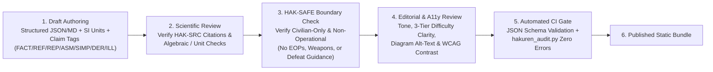

# Content Strategy

| Field | Value |
|---|---|
| Doc ID | HAK-DOC-CONTENT-STRATEGY |
| Status | Draft |
| Owner stage | 1 |
| Depends on | HAK-DOC-CONTRACT, HAK-DOC-STANDARD, HAK-DOC-SCOPE, HAK-DOC-CONSTRAINTS, HAK-DOC-IA, HAK-DOC-NFR |
| Requirements | HAK-FR-107, HAK-FR-108, HAK-PRD-001, HAK-PRD-015, HAK-PRD-025, HAK-PRD-026, HAK-PRD-027, HAK-SAFE-021, HAK-SAFE-022, HAK-SAFE-023, HAK-SAFE-024, HAK-NFR-037, HAK-NFR-038, HAK-NFR-039 |

## 1. Purpose and Scope

This document governs how **HAKUREN** plans, authors, classifies, verifies, attributes, updates, and localizes educational content across all six modules. It operationalizes the scientific integrity rules (`HAK-CON-006`, `HAK-CON-007`), civilian non-operational safety boundaries (`HAK-CON-011`, `HAK-CON-012`), Reference PWR neutrality (`HAK-CON-010`), and the English-first (`en`) / Indonesian-next (`id`) localization strategy (`HAK-NFR-038`) into an actionable content governance workflow.

## 2. Canonical Content Types and Ownership

All user-facing copy and quantitative datasets live in schema-validated static JSON/Markdown repositories (`HAK-NFR-037`) decoupled from React/Three.js presentation components:

| Content Type | Primary Modules | Format & Schema Target | Authoring Focus & Depth |
|---|---|---|---|
| **Module Intros & Concept Primers** | `/` (`Overview`) | Structured JSON / i18n resource bundle | Plain-language orientation, civilian scope framing, Reference PWR introduction (`HAK-FR-019`, `HAK-FR-020`, `HAK-FR-023`). |
| **3D Component Metadata Cards** | `/anatomy`, `/library` | Component metadata JSON (`component-schema`) | Role, operating principle, radiological/circuit context, SI parameters with claim tags, BWR/SMR comparison note (`HAK-FR-035`). |
| **Energy Journey Stage Narratives** | `/journey` | Energy flow JSON (`energy-flow-schema`) | Seven ordered energy transformations, primary/secondary isolation legends, SI balance values (`HAK-FR-036`–`HAK-FR-039`). |
| **Simulator Parameters, Formulas & Scenarios** | `/simulator` | Parameter, scenario & reference JSON | Bounded ranges, SI units, simplified governing equations, `ASM`/`SIMP` validity disclosures, 5-phase guided inquiry prompts (`HAK-FR-044`–`HAK-FR-047`). |
| **Safety Principles & Architecture Comparisons** | `/safety` | Structured conceptual guide JSON/MD | Defense-in-depth layers, 4 fission-product barriers, decay-heat concepts, active vs. passive comparison, PWR/BWR/SMR tables (`HAK-FR-048`–`HAK-FR-052`). |
| **Technical Library Articles & Glossary** | `/library` | Classified Markdown + JSON index | Deep technical articles, canonical glossary definitions, rendered formulas + text alternatives, diagram captions, `HAK-SRC` source registry (`HAK-FR-053`–`HAK-FR-056`). |

## 3. Content Classification Tags and Source Attribution Rules

### 3.1 Mandatory Epistemic Claim Classification

Per `HAK-DOC-CONTRACT` Section 2 and `HAK-PRD-026`, every significant factual statement, physical parameter, and model output is tagged with one of the following epistemic classes:

| Claim Tag | Meaning | Attribution & Disclosure Requirement | UI Provenance Badge |
|---|---|---|---|
| `FACT` | Verifiable physical law or established institutional fact | Must cite a `Verified` (or reviewed `Partially verified`) `HAK-SRC-nnn` entry. | `Reference` |
| `REF` | Published engineering parameter or standards specification | Must cite `HAK-SRC-nnn` with explicit canonical SI unit and scope context. | `Reference` |
| `REP` | Generic representative parameter for **HAKUREN Reference PWR** | Must cite `HAK-SRC-nnn` supporting typical PWR range; never attributed to a specific commercial unit unless labeled as an example. | `Reference` |
| `DER` | Calculated algebraically or numerically from tagged inputs | Must show reproducible formula/steps and cite source inputs (`HAK-DOC-CONTRACT` s2.3). | `Computed` |
| `ASM` | Explicit modeling assumption bounding a simplified calculation | Must be documented in simulator/library assumption records (`HAK-FR-045`). | `Simulated` |
| `SIMP` | Deliberate pedagogical simplification (e.g., lumped core node) | Must disclose omitted physical effects and valid operating envelope (`HAK-SAFE-024`). | `Simulated` |
| `ILL` | Illustrative schematic or qualitative scale value | Never presented as measured plant data; clearly flagged schematic/educational. | `Illustrative` |

> **Zero-`UNV` Production Gate:** Unverified (`UNV`) claims or sources may exist temporarily during `Draft` research, logged as open issues, but build-time CI checks (`HAK-NFR-039`) block any `UNV` numeric claim from shipping in the Tier 1 production bundle.

### 3.2 Source Attribution & Reference Neutrality Rules

1. **Registry-Only Citations:** Content authors cite external sources solely by `HAK-SRC-nnn` identifiers resolved against [Source Registry](../08-technical-library/source-registry.md). Bibliographic metadata is stored once in the registry and rendered dynamically in `/library/sources` (`HAK-FR-056`).
2. **Primary Authority Hierarchy:** Prefer IAEA, U.S. NRC, U.S. DOE (`HAK-SRC-034`, `HAK-SRC-035`), national laboratories, W3C/NIST standards (`HAK-SRC-026`, `HAK-SRC-010`), and peer-reviewed textbooks. Vendor publications are permitted solely for clearly labeled vendor examples (`HAK-CON-010`).
3. **Generic vs. Example Separation:** Every Reference PWR metric uses generic representative framing (`HAKUREN Reference PWR`); any vendor-specific number (e.g., a particular integral SMR concept) must carry an explicit *"Vendor Example — not generic baseline"* label (`HAK-PRD-025`).
4. **SMR Family Discipline:** Content must consistently refer to SMRs as a multi-design **family** (`HAK-SRC-003`), never collapsing light-water integral PWRs and non-light-water designs into one entity.

## 4. Authoring, Verification, and Review Workflow

No educational content moves into the production static bundle without passing five sequential review gates:

### 4.1 Hard `HAK-SAFE` Content Boundary Rules During Authoring

Authors and reviewers enforce `HAK-SAFE-020` through `HAK-SAFE-023` on every draft:
- **Allowed:** Civilian fission physics, heat transfer, Rankine thermodynamics, conceptual defense-in-depth (`HAK-SRC-005`), physical barriers (`HAK-SRC-006`), passive vs. active cooling concepts, reliability/redundancy principles, and radiation shielding basics.
- **Prohibited:** Military nuclear applications or explosive assemblies, fissile-material enrichment or spent-fuel chemical separation workflows, real-plant operating checklists or emergency operating procedures (EOPs), actionable protection setpoints presented as control guidance, and any instruction for circumventing or overriding safety interlocks (`HAK-CON-011`, `HAK-CON-012`).

## 5. Tone, Voice, and Pedagogical Style

HAKUREN's editorial voice mirrors its visual identity (Siemens industrial clarity + Omniverse visual precision):

- **Calm, Objective, and Mechanistic:** Explain *how* physical systems work using active, unambiguous verbs (*"Pressurized water transfers thermal energy across steam generator tube walls"* rather than vague marketing adjectives).
- **Respectful of All Difficulty Levels:** Never patronize `Beginner` learners or hide simplifications from `Advanced` learners. Use clear plain-English topic sentences followed by precise technical detail.
- **Anti-Hype & Anti-Alarmist:** Avoid both nuclear-industry promotional superlatives ("limitless magic energy") and Hollywood radioactive-glow clichés. Reserve strong alert language strictly for genuine simulator boundary warnings (`WarningBound`, `EducationalTrip`).
- **Canonical Vocabulary & Units:** Use exact canonical names (`RCS`, `RPV`, `SG`, `PZR`, `RCP`, `CRDM`, `cladding`, `containment`, `HAK-DOC-CONTRACT` s1) and canonical SI units (`MW`, `MPa`, `K` with optional `°C` helper conversions) everywhere.

## 6. Content Update and Maintenance Procedures

Because HAKUREN runs as a static repository (`HAK-CON-002`) without a runtime CMS database, content updates follow version-controlled engineering hygiene:

1. **Entity Immutability:** Published `cmp-*`, `art-*`, `gls-*`, `frm-*`, `scn-*`, and `HAK-SRC-nnn` IDs are never renumbered or reused (`HAK-CON-014`). Deprecated articles redirect internally or display a clear superseded banner pointing to the replacement slug.
2. **Schema & Provenance Gate (`HAK-NFR-039`):** Any pull request modifying JSON/Markdown content runs automated JSON Schema validation, link checks, `HAK-SRC` resolution checks, and `safety` keyword screening before merge.
3. **Source Re-Verification Cadence:** External regulatory/educational URLs in `source-registry.md` carry `Accessed` dates (`YYYY-MM-DD`); periodic maintenance checks flag broken upstream URLs and re-verify source passages before promoting any `Partially verified` or `UNV` entry.

## 7. Localization Strategy (`en` First, `id` Planned)

Consistent with the product decision recorded in [Non-Functional Requirements](non-functional-requirements.md) Section 7.1 (`HAK-NFR-038`):

- **MVP Active Language — English (`en`):** Launch Release 1.0 exclusively in English (`<html lang="en">`, `HAK-SRC-033`) to maintain exact alignment with primary nuclear engineering literature (`NRC`, `DOE`, `NIST`, `W3C`) while Phase 0–1 physics and UI stabilize.
- **First Planned Target Locale — Indonesian (`id`):** Release 1.1+ targets Indonesian localization (`lang="id"`) using externalized typed i18n resource bundles scaffolded from Day 1 (`HAK-NFR-038`).
- **Localization Engineering Rules:**
  1. **Invariant Identifiers & SI Symbols:** Canonical entity IDs, URL slugs (`/anatomy`, `/simulator`), and SI unit symbols (`MW`, `MPa`, `K`, `kg/s`) never translate.
  2. **Acronym Bridging:** When translating prose into Indonesian (`id`), retain standard English engineering acronyms (`PWR`, `BWR`, `SMR`, `RCS`, `RPV`, `SG`) alongside localized Indonesian expansions on first mention so learners remain fluent in international literature.
  3. **BCP 47 Markup:** Root `<html lang="...">` updates dynamically with active locale, and untranslated technical quotations or foreign terms carry inline `lang` attributes per W3C Internationalization guidance (`HAK-SRC-033`, `WCAG 2.2 SC 3.1.1, 3.1.2`).

## 8. Content Strategy Requirements

| ID | Name | Requirement | Priority | Rationale | Source | Parent | Verification | Acceptance | Status |
|---|---|---|---|---|---|---|---|---|---|
| HAK-FR-107 | Mandatory Claim Tagging and Source Attribution Enforcement | Every content item containing technical facts, engineering parameters, derived calculations, or simulation assumptions shall declare an explicit epistemic tag (`FACT`, `REF`, `REP`, `ASM`, `SIMP`, `DER`, `ILL`), cite a registered `HAK-SRC-nnn` for `FACT`/`REF`/`REP`, and pass automated `HAK-SAFE` boundary screening prior to publication. | Must | Operationalizes scientific integrity and civilian boundary governance across all runtime content assets (`HAK-CON-006`, `HAK-CON-007`, `HAK-CON-011`). | Master Prompt s2 | HAK-PRD-026 | Inspection+Test | Build validation fails if any published `FACT`/`REF`/`REP` entry lacks a valid `HAK-SRC` reference, lacks SI units, carries `UNV` status, or triggers unreviewed boundary violations. | Draft |
| HAK-FR-108 | English-First Content Externalization and Indonesian Localization Workflow | All UI labels, module narratives, glossary definitions, and scenario texts shall be stored in externalized `en` locale bundles with invariant SI unit symbols and BCP 47 `lang` tagging (`HAK-SRC-033`), enabling Release 1.1 Indonesian (`id`) localization without modifying application logic. | Must | Enforces the `en`-first, `id`-next localization decision (`HAK-NFR-038`) cleanly and prevents hardcoded copy debt. | HAK-SRC-033 | HAK-PRD-029 | Inspection+Test | Code/data inspection confirms zero hardcoded UI prose in React/Three.js modules, valid `<html lang="en">` output, and clean fallback/rendering when loading a test `id` locale resource bundle. | Draft |

## 9. References

- `HAK-SRC-003`: U.S. DOE Office of Nuclear Energy — *Advanced Small Modular Reactors (SMRs)*.
- `HAK-SRC-005`: U.S. NRC — *Defense in depth*.
- `HAK-SRC-006`: U.S. NRC — *Containment structure*.
- `HAK-SRC-010`: NIST — *Special Publication 330: The International System of Units (SI)*.
- `HAK-SRC-011`: U.S. NRC — *Pressurized Water Reactors overview*.
- `HAK-SRC-026`: W3C — *Web Content Accessibility Guidelines (WCAG) 2.2*.
- `HAK-SRC-033`: W3C Internationalization — *Declaring language in HTML*.
- `HAK-SRC-034`: U.S. DOE Office of Nuclear Energy — *NUCLEAR 101: How Does a Nuclear Reactor Work?*
- `HAK-SRC-035`: U.S. DOE Office of Nuclear Energy — *Fission and Fusion: What is the Difference?*

## 10. Related Documents

- [Documentation Authoring Contract](../00-governance/documentation-authoring-contract.md)
- [Documentation Standard](../DOCUMENTATION_STANDARD.md)
- [Scope and Boundaries](../00-governance/scope-and-boundaries.md)
- [Constraints Register](../00-governance/constraints-register.md)
- [Non-Functional Requirements](non-functional-requirements.md)
- [Information Architecture](information-architecture.md)
- [Learning Experience](learning-experience.md)
- [Source Registry](../08-technical-library/source-registry.md)

## 11. Change History

Recorded centrally in [Changelog](../CHANGELOG.md).
