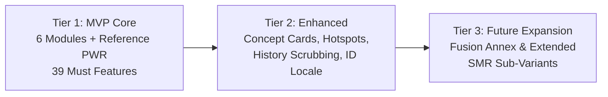

# Feature Catalog

| Field | Value |
|---|---|
| Doc ID | HAK-DOC-FEATURE-CATALOG |
| Status | Draft |
| Owner stage | 1 |
| Depends on | HAK-DOC-PRD, HAK-DOC-FR |
| Requirements | HAK-FR-019, HAK-FR-020, HAK-FR-021, HAK-FR-022, HAK-FR-023, HAK-FR-024, HAK-FR-025, HAK-FR-026, HAK-FR-027, HAK-FR-028, HAK-FR-029, HAK-FR-030, HAK-FR-031, HAK-FR-032, HAK-FR-033, HAK-FR-034, HAK-FR-035, HAK-FR-036, HAK-FR-037, HAK-FR-038, HAK-FR-039, HAK-FR-040, HAK-FR-041, HAK-FR-042, HAK-FR-043, HAK-FR-044, HAK-FR-045, HAK-FR-046, HAK-FR-047, HAK-FR-048, HAK-FR-049, HAK-FR-050, HAK-FR-051, HAK-FR-052, HAK-FR-053, HAK-FR-054, HAK-FR-055, HAK-FR-056, HAK-FR-057, HAK-FR-058, HAK-FR-059, HAK-FR-060 |

## 1. Purpose and Scope

This Feature Catalog maps every functional requirement defined in [functional-requirements.md](functional-requirements.md) to concrete product features, canonical HAKUREN modules, learning modes, and release scope tiers. Per Phase 0 identifier rules, this catalog **references** existing `HAK-FR` and `HAK-PRD` identifiers rather than redefining them; no table places a `HAK-*` identifier in its first column.

## 2. Release Scope and Priority Tiers

HAKUREN organizes delivery into three release tiers so implementation teams can ship a complete, scientifically grounded educational MVP first before layering enhanced exploratory depth and future reactor expansions:

| Release Tier | Scope Definition | Target Milestone | Inclusion Criteria |
|---|---|---|---|
| Tier 1 (MVP Core) | Core educational loop across all six canonical modules for HAKUREN Reference PWR plus foundational BWR/SMR comparisons | Release 1.0 | All `Must`-priority requirements needed for standalone non-linear exploration, 3D inspection, 7-stage Energy Journey, bounded Reactor Simulator with guided scenarios, conceptual Safety & Engineering, and searchable Technical Library (`en` locale). |
| Tier 2 (Enhanced Exploration) | Secondary depth, richer historical trend inspection, hotspot annotations, and first localization rollout (`id`) | Release 1.1 | `Should`-priority enhancements (`HAK-FR-023`, `HAK-FR-034`, `HAK-FR-042`) plus Indonesian (`id`) translation bundle activation built atop the Tier 1 schema and `i18n` foundation. |
| Tier 3 (Future Expansion) | Long-term post-1.1 architectural expansions outside Phase 0 MVP baseline | Post-1.1 / Deferred | Nuclear fusion educational module, downloadable offline PWA bundle, and extended SMR sub-family interactive geometries (explicitly out of current MVP scope per `HAK-DOC-CONTRACT`). |

## 3. Module-Level Feature Distribution

| Module | Canonical Route | Learning Mode | Tier 1 Features | Tier 2 Features | Total Mapped Features | Primary Parent PRD |
|---|---|---|---|---|---|---|
| Overview | `/` | Discover | 6 | 1 | 7 | `HAK-PRD-019` |
| Reactor Anatomy | `/anatomy` | Explore | 9 | 1 | 10 | `HAK-PRD-020` |
| Energy Journey | `/journey` | Understand | 4 | 0 | 4 | `HAK-PRD-021` |
| Reactor Simulator | `/simulator` | Experiment | 7 | 1 | 8 | `HAK-PRD-022` |
| Safety & Engineering | `/safety` | Investigate | 5 | 0 | 5 | `HAK-PRD-023` |
| Technical Library | `/library` | Master | 5 | 0 | 5 | `HAK-PRD-024` |
| Cross-Cutting Platform | All routes | All modes | 3 | 0 | 3 | `HAK-PRD-026`, `HAK-PRD-033`, `HAK-PRD-025` |

## 4. Complete Feature Catalog by Module

### 4.1 Overview Module (`/`)

| Feature | Module | Route | FR ID | Parent PRD | Release Tier | Priority | Learning Mode | Scope Summary |
|---|---|---|---|---|---|---|---|---|
| Landing Hero & Identity Header | Overview | `/` | `HAK-FR-019` | `HAK-PRD-019` | Tier 1 (MVP Core) | Must | Discover | Displays HAKUREN title, tagline (*Understand the Atom. Explore the Energy.*), value proposition, and quick-launch calls to action. |
| Reference PWR Introduction & Framing | Overview | `/` | `HAK-FR-020` | `HAK-PRD-019` | Tier 1 (MVP Core) | Must | Discover | Explains generic HAKUREN Reference PWR scope, notes BWR/SMR comparisons, and presents educational framing. |
| Interactive Plant-Level 3D Preview | Overview | `/` | `HAK-FR-021` | `HAK-PRD-019` | Tier 1 (MVP Core) | Must | Discover | Embedded plant-level 3D viewport (containment, turbine hall, heat sink) with orbit controls and deep-link to `/anatomy`. |
| System-Level Energy Flow Summary | Overview | `/` | `HAK-FR-022` | `HAK-PRD-019` | Tier 1 (MVP Core) | Must | Discover | High-level schematic showing primary loop, steam generator isolation boundary, turbine-generator, and condenser return. |
| Key Nuclear Concepts Primer Cards | Overview | `/` | `HAK-FR-023` | `HAK-PRD-019` | Tier 2 (Enhanced) | Should | Discover | Bite-sized educational cards introducing fission, pressurized non-boiling coolant, circuit isolation, and defense in depth. |
| Non-Linear Module Navigation Hub | Overview | `/` | `HAK-FR-024` | `HAK-PRD-033` | Tier 1 (MVP Core) | Must | Discover | Six standalone entry cards (Discover, Explore, Understand, Experiment, Investigate, Master) with direct un-gated route links. |
| Nominal Status Panel & Responsive Grid | Overview | `/` | `HAK-FR-025` | `HAK-PRD-030` | Tier 1 (MVP Core) | Must | Discover | At-a-glance nominal plant KPI summary with SI units and `Reference`/`Illustrative` badges across desktop, tablet, and mobile layouts. |

### 4.2 Reactor Anatomy Module (`/anatomy`)

| Feature | Module | Route | FR ID | Parent PRD | Release Tier | Priority | Learning Mode | Scope Summary |
|---|---|---|---|---|---|---|---|---|
| Three-Level 3D Hierarchy (Plant / System / Component) | Reactor Anatomy | `/anatomy` | `HAK-FR-026` | `HAK-PRD-020` | Tier 1 (MVP Core) | Must | Explore | Progressive detail levels with highest geometric and semantic fidelity on RPV, core fuel assemblies, CRDMs, and RCS. |
| Bounded Camera Orbit, Zoom, and Pan | Reactor Anatomy | `/anatomy` | `HAK-FR-027` | `HAK-PRD-020` | Tier 1 (MVP Core) | Must | Explore | Constrained mouse, touch, and keyboard camera navigation preventing underground clipping or camera loss. |
| Named Camera Presets & One-Click Reset | Reactor Anatomy | `/anatomy` | `HAK-FR-028` | `HAK-PRD-020` | Tier 1 (MVP Core) | Must | Explore | Curated engineering viewpoints (Plant, Containment, RCS, RPV, Core, SG) plus Reset View restoring initial framing and offsets. |
| 3D Selection & Cyan Highlight Feedback | Reactor Anatomy | `/anatomy` | `HAK-FR-029` | `HAK-PRD-020` | Tier 1 (MVP Core) | Must | Explore | Pointer/keyboard picking with hover labels, cool-cyan selection highlight, and optional focus framing. |
| Component Isolation & Visibility Layers | Reactor Anatomy | `/anatomy` | `HAK-FR-030` | `HAK-PRD-020` | Tier 1 (MVP Core) | Must | Explore | Isolate selected subsystem/component, Restore All, and toggle Containment, Primary, Secondary, Internals, and Structural layers. |
| Progressive Exploded View Slider | Reactor Anatomy | `/anatomy` | `HAK-FR-031` | `HAK-PRD-020` | Tier 1 (MVP Core) | Must | Explore | `0%`–`100%` disassembly separation along calibrated engineering axes for containment, vessel head, internals, and SG shells. |
| Section Cut & Enclosure Transparency | Reactor Anatomy | `/anatomy` | `HAK-FR-032` | `HAK-PRD-020` | Tier 1 (MVP Core) | Must | Explore | Interactive clipping plane (`X`/`Y`/`Z` cut) and adjustable shell opacity (`0%`–`100%`) revealing internal coolant paths and U-tubes. |
| Synchronized ARIA Component Tree | Reactor Anatomy | `/anatomy` | `HAK-FR-033` | `HAK-PRD-020` | Tier 1 (MVP Core) | Must | Explore | Expandable/searchable Plant -> System -> Component tree with ARIA tree keyboard navigation synchronized bidirectionally with 3D selection. |
| Toggleable 3D Annotation Hotspots | Reactor Anatomy | `/anatomy` | `HAK-FR-034` | `HAK-PRD-020` | Tier 2 (Enhanced) | Should | Explore | Screen-projected spatial pins marking key subsystems with occlusion handling, global toggle, and keyboard activation. |
| Structured Component Info Panel & Cross-Links | Reactor Anatomy | `/anatomy` | `HAK-FR-035` | `HAK-PRD-020` | Tier 1 (MVP Core) | Must | Explore | Displays all mandatory metadata fields (role, principle, circuit/barrier context, SI parameters with provenance, BWR/SMR note) and module links. |

### 4.3 Energy Journey Module (`/journey`)

| Feature | Module | Route | FR ID | Parent PRD | Release Tier | Priority | Learning Mode | Scope Summary |
|---|---|---|---|---|---|---|---|---|
| Seven-Stage Conversion Walkthrough | Energy Journey | `/journey` | `HAK-FR-036` | `HAK-PRD-021` | Tier 1 (MVP Core) | Must | Understand | Interactive sequential and direct navigation across all 7 stages from fission in fuel pellets to condenser and feedwater return. |
| Synced Animated Flow & Reduced-Motion Mode | Energy Journey | `/journey` | `HAK-FR-037` | `HAK-PRD-021` | Tier 1 (MVP Core) | Must | Understand | Animated directional stream/particle cues synced to active stage with Play/Pause and static vector fallback under reduced motion. |
| Stage Energy Transformation & Metrics Panel | Energy Journey | `/journey` | `HAK-FR-038` | `HAK-PRD-021` | Tier 1 (MVP Core) | Must | Understand | Explains physical mechanism, energy-form transitions, SI values with provenance badges, and links to Simulator and Library. |
| Thermal, Fluid & Radiological Boundary Legend | Energy Journey | `/journey` | `HAK-FR-039` | `HAK-PRD-021` | Tier 1 (MVP Core) | Must | Understand | Distinguishes Primary Radioactive Coolant, Clean Secondary Steam/Feedwater, Tertiary Cooling Sink, and optional BWR single-loop note. |

### 4.4 Reactor Simulator Module (`/simulator`)

| Feature | Module | Route | FR ID | Parent PRD | Release Tier | Priority | Learning Mode | Scope Summary |
|---|---|---|---|---|---|---|---|---|
| Bounded Educational Input Controls | Reactor Simulator | `/simulator` | `HAK-FR-040` | `HAK-PRD-022` | Tier 1 (MVP Core) | Must | Experiment | Accessible sliders and numeric steppers for reactivity/rod position, primary flow, steam demand, and sink temperature in SI units. |
| Live Multi-Channel Telemetry & Charts | Reactor Simulator | `/simulator` | `HAK-FR-041` | `HAK-PRD-022` | Tier 1 (MVP Core) | Must | Experiment | Tabular KPI readouts and live time-series plots for thermal/electrical power, temperatures, pressure, and flow using amber/red semantic tokens. |
| Rolling Historical Trend Buffer & Inspection | Reactor Simulator | `/simulator` | `HAK-FR-042` | `HAK-PRD-022` | Tier 2 (Enhanced) | Should | Experiment | In-session rolling time-series buffer allowing hover/keyboard scrubbing across past transient samples to read exact values. |
| Deterministic Simulation State Machine | Reactor Simulator | `/simulator` | `HAK-FR-043` | `HAK-PRD-022` | Tier 1 (MVP Core) | Must | Experiment | Explicit `Ready`, `Running`, `Paused`, `WarningBound`, and `EducationalTrip` states with Play/Pause/Step/Speed/Scram-Demo controls. |
| Parameter Explanation & Formula Drawer | Reactor Simulator | `/simulator` | `HAK-FR-044` | `HAK-PRD-026` | Tier 1 (MVP Core) | Must | Experiment | Inspectable variable meanings, rendered governing equations, SI units, and `Simulated`/`ASM`/`SIMP` tags inside the simulator UI. |
| Model Assumptions & Validity Bounds Disclosure | Reactor Simulator | `/simulator` | `HAK-FR-045` | `HAK-PRD-026` | Tier 1 (MVP Core) | Must | Experiment | Always-accessible panel listing point-kinetics and lumped-parameter assumptions, valid operating bounds, and non-safety-grade limits. |
| Operating Presets & Instant Reset | Reactor Simulator | `/simulator` | `HAK-FR-046` | `HAK-PRD-022` | Tier 1 (MVP Core) | Must | Experiment | Curated presets (Nominal Full Power, Part-Load, Hot Zero Power) plus one-click Reset restoring baseline state cleanly. |
| Scenario-Based Guided Learning Engine | Reactor Simulator | `/simulator` | `HAK-FR-047` | `HAK-PRD-032` | Tier 1 (MVP Core) | Must | Experiment | Guided exercises bundling learning goals, initial parameters, step instructions, expected results, and post-simulation physical explanations. |

### 4.5 Safety & Engineering Module (`/safety`)

| Feature | Module | Route | FR ID | Parent PRD | Release Tier | Priority | Learning Mode | Scope Summary |
|---|---|---|---|---|---|---|---|---|
| Interactive Defense-in-Depth Explorer | Safety & Engineering | `/safety` | `HAK-FR-048` | `HAK-PRD-023` | Tier 1 (MVP Core) | Must | Investigate | Conceptual exploration of layered defense-in-depth philosophy (prevention, control, design-basis mitigation, containment, emergency response). |
| 3D-Linked Fission-Product Barrier Explorer | Safety & Engineering | `/safety` | `HAK-FR-049` | `HAK-PRD-023` | Tier 1 (MVP Core) | Must | Investigate | Highlights and isolates fuel matrix, fuel cladding, RCS pressure boundary, and containment building on a linked 3D view. |
| Decay Heat & Core Cooling Concepts | Safety & Engineering | `/safety` | `HAK-FR-050` | `HAK-PRD-023` | Tier 1 (MVP Core) | Must | Investigate | Conceptual explanation of post-shutdown fission-product decay heat and high-level normal vs. emergency heat-removal paths. |
| Active vs. Passive Safety Comparison | Safety & Engineering | `/safety` | `HAK-FR-051` | `HAK-PRD-023` | Tier 1 (MVP Core) | Must | Investigate | Contrasts powered/actuated safety systems with passive physics-driven concepts (gravity, natural circulation), including PWR vs. SMR notes. |
| Redundancy, Diversity & Protection Concepts | Safety & Engineering | `/safety` | `HAK-FR-052` | `HAK-PRD-023` | Tier 1 (MVP Core) | Must | Investigate | Explains N+1 redundancy, functional diversity, instrumentation roles, and automatic protection concepts strictly without procedural or circumvention content. |

### 4.6 Technical Library Module (`/library`)

| Feature | Module | Route | FR ID | Parent PRD | Release Tier | Priority | Learning Mode | Scope Summary |
|---|---|---|---|---|---|---|---|---|
| Classified Technical Articles | Technical Library | `/library` | `HAK-FR-053` | `HAK-PRD-024` | Tier 1 (MVP Core) | Must | Master | Categorized engineering articles across physics, reactor types, thermal-hydraulics, safety, and simulation with `HAK-SRC` citations. |
| Interactive Formula Reference & Units Guide | Technical Library | `/library` | `HAK-FR-054` | `HAK-PRD-024` | Tier 1 (MVP Core) | Must | Master | Searchable math reference with rendered equations, symbol tables, canonical SI units, conversions, and validity bounds. |
| Canonical Glossary & Component Docs | Technical Library | `/library` | `HAK-FR-055` | `HAK-PRD-024` | Tier 1 (MVP Core) | Must | Master | Alphabetical/filterable glossary aligned to canonical terminology and structured component specification sheets linked to `/anatomy`. |
| Technical Diagram Catalog & Source Registry View | Technical Library | `/library` | `HAK-FR-056` | `HAK-PRD-024` | Tier 1 (MVP Core) | Must | Master | Categorized engineering diagrams with legends plus full inspectable attribution table showing `HAK-SRC` verification status and limitations. |
| Client-Side Search, Facets & Cross-Linking | Technical Library | `/library` | `HAK-FR-057` | `HAK-PRD-024` | Tier 1 (MVP Core) | Must | Master | Sub-100 ms client-side full-text/tag filtering with deep links jumping directly into Anatomy, Journey, Simulator, and Safety. |

### 4.7 Cross-Cutting Platform Features

| Feature | Module | Route | FR ID | Parent PRD | Release Tier | Priority | Learning Mode | Scope Summary |
|---|---|---|---|---|---|---|---|---|
| Global Value Provenance Badge System | Cross-Cutting | All routes | `HAK-FR-058` | `HAK-PRD-026` | Tier 1 (MVP Core) | Must | All modes | Standardized UI badges (`Computed`, `Reference`, `Illustrative`, `Simulated`) with explanatory tooltips and source/assumption links. |
| Persistent Global Navigation & Mode Shell | Cross-Cutting | All routes | `HAK-FR-059` | `HAK-PRD-033` | Tier 1 (MVP Core) | Must | All modes | Keyboard-accessible top/drawer navigation across all 6 canonical routes indicating active page and non-linear learning mode. |
| Reactor Comparison Switcher Context | Cross-Cutting | `/`, `/anatomy`, `/journey`, `/safety`, `/library` | `HAK-FR-060` | `HAK-PRD-025` | Tier 1 (MVP Core) | Must | All modes | Consistent architectural contrast separating generic HAKUREN Reference PWR from BWR single-loop and SMR multi-concept family traits. |

## 5. References

- `HAK-SRC-011` — NRC Pressurized Water Reactors overview
- `HAK-SRC-012` — NRC Boiling Water Reactors overview
- `HAK-SRC-013` — NRC Advanced Reactors / Small Modular Reactors overview
- `HAK-SRC-014` — DOE Advanced Small Modular Reactors (SMRs)
- `HAK-SRC-021` — W3C Web Content Accessibility Guidelines (WCAG) 2.2

## 6. Related Documents

- [Product Requirements Document (PRD)](product-requirements-document.md)
- [Functional Requirements Specification](functional-requirements.md)
- [Non-Functional Requirements Specification](non-functional-requirements.md)
- [Documentation Authoring Contract](../00-governance/documentation-authoring-contract.md)
- `docs/13-project-management/implementation-roadmap.md` (planned Stage 13)
