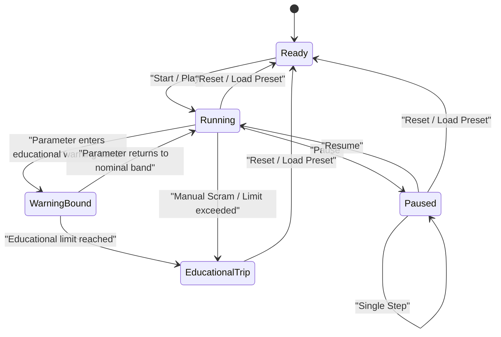

# Functional Requirements Specification

| Field | Value |
|---|---|
| Doc ID | HAK-DOC-FR |
| Status | Draft |
| Owner stage | 1 |
| Depends on | HAK-DOC-PRD |
| Requirements | HAK-FR-019, HAK-FR-020, HAK-FR-021, HAK-FR-022, HAK-FR-023, HAK-FR-024, HAK-FR-025, HAK-FR-026, HAK-FR-027, HAK-FR-028, HAK-FR-029, HAK-FR-030, HAK-FR-031, HAK-FR-032, HAK-FR-033, HAK-FR-034, HAK-FR-035, HAK-FR-036, HAK-FR-037, HAK-FR-038, HAK-FR-039, HAK-FR-040, HAK-FR-041, HAK-FR-042, HAK-FR-043, HAK-FR-044, HAK-FR-045, HAK-FR-046, HAK-FR-047, HAK-FR-048, HAK-FR-049, HAK-FR-050, HAK-FR-051, HAK-FR-052, HAK-FR-053, HAK-FR-054, HAK-FR-055, HAK-FR-056, HAK-FR-057, HAK-FR-058, HAK-FR-059, HAK-FR-060 |

## 1. Purpose and Scope

This specification defines the atomic functional requirements (`HAK-FR` entries) across all six HAKUREN modules—**Overview** (`/`), **Reactor Anatomy** (`/anatomy`), **Energy Journey** (`/journey`), **Reactor Simulator** (`/simulator`), **Safety & Engineering** (`/safety`), and **Technical Library** (`/library`)—plus cross-cutting functional behaviors. Every requirement traces directly to a parent `HAK-PRD` capability in [product-requirements-document.md](product-requirements-document.md) and feeds downstream system, 3D, simulation, UX, data contract, and QA specifications.

## 2. Overview Module Functional Requirements (`/`)

The Overview module serves the **Discover** learning mode. It orientates learners immediately to the HAKUREN Reference PWR (`HAK-SRC-011`, `HAK-SRC-015`), visualizes plant-level architecture and energy conversion at a glance, and provides frictionless non-linear launch points into every module.

| ID | Name | Requirement | Priority | Rationale | Source | Parent | Verification | Acceptance | Status |
|---|---|---|---|---|---|---|---|---|---|
| HAK-FR-019 | Landing Hero and Identity Presentation | The Overview module (`/`) shall render a landing hero displaying the HAKUREN name, full title (*Nuclear Energy & Reactor Engineering Explorer*), tagline (*Understand the Atom. Explore the Energy.*), primary value proposition, and immediate primary action links into the interactive modules. | Must | Establishes immediate product identity and educational purpose without marketing clutter. | Master Prompt s3 | HAK-PRD-019 | Inspection+Demonstration | Loading `/` displays the product title, tagline, concise educational summary, and interactive launch actions visible above the fold on desktop (`1440x900`) and cleanly stacked on mobile (`390x844`). | Draft |
| HAK-FR-020 | Reference Plant Introduction and Scope Framing | The Overview module shall present an architectural introduction to the **HAKUREN Reference PWR** as a generic dual-loop educational Pressurized Water Reactor, alongside summary comparison callouts for BWR and SMR reactor families and an educational-scope notice. | Must | Clarifies early that HAKUREN models a generic reference PWR rather than a single commercial vendor unit (`HAK-SRC-011`, `HAK-SRC-013`). | HAK-SRC-011 | HAK-PRD-019 | Inspection | The plant introduction section on `/` explicitly names the HAKUREN Reference PWR, contrasts dual-loop PWR with single-loop BWR and the SMR family, and displays its educational scope notice. | Draft |
| HAK-FR-021 | Plant-Level 3D Overview Viewport | The Overview module shall embed an interactive plant-level 3D overview scene showing major site structures (containment building, turbine hall, cooling water sink/towers, switchyard boundary) with gentle pointer/touch orbit and a direct transition button to full inspection in Reactor Anatomy (`/anatomy`). | Must | Gives learners immediate spatial intuition of how nuclear island and balance-of-plant buildings relate before diving into sub-components. | Master Prompt s8 | HAK-PRD-019 | Test+Demonstration | On `/`, the plant-level 3D viewport renders containment, turbine hall, and heat sink structures, responds to drag/touch orbit (or displays a static/2D fallback when WebGL is unavailable or reduced motion is active), and links directly to `/anatomy`. | Draft |
| HAK-FR-022 | System-Level Energy Flow Summary | The Overview module shall display a concise system-level energy flow schematic summarizing the progression from nuclear fission heat in the primary circuit (`RCS`) through the steam generator (`SG`) to the secondary circuit turbine-generator and condenser return. | Must | Visualizes the physical separation between radioactive primary coolant and secondary steam (`HAK-SRC-011`, `HAK-SRC-015`). | HAK-SRC-011 | HAK-PRD-019 | Inspection | The overview schematic on `/` clearly labels primary loop, steam generator boundary, secondary steam loop, turbine-generator, and condenser return, and links directly to `/journey`. | Draft |
| HAK-FR-023 | Key Nuclear Concepts Primer Cards | The Overview module shall provide concise interactive primer cards explaining core foundational concepts: nuclear fission (`HAK-SRC-016`), pressurized coolant non-boiling (`HAK-SRC-015`), primary/secondary loop isolation (`HAK-SRC-011`), and defense-in-depth barriers (`HAK-SRC-017`). | Should | Builds shared conceptual vocabulary before learners enter quantitative simulation or component inspection. | HAK-SRC-015 | HAK-PRD-019 | Inspection | All four primer cards render on `/` with plain-language definitions, canonical terminology, and contextual links to corresponding Library or Safety sections. | Draft |
| HAK-FR-024 | Learning Entry Points and Module Navigation Hub | The Overview module shall present dedicated entry cards for all six learning modes and canonical routes—Discover (`/`), Explore (`/anatomy`), Understand (`/journey`), Experiment (`/simulator`), Investigate (`/safety`), and Master (`/library`)—usable in any order. | Must | Operationalizes HAKUREN's non-linear learning path so learners choose their preferred entry point immediately. | Master Prompt s7 | HAK-PRD-033 | Test+Demonstration | Clicking any module entry card on `/` navigates cleanly to the corresponding route with zero prerequisite locks or sequential gating. | Draft |
| HAK-FR-025 | High-Level Status Visualization and Responsive Overview | The Overview module shall display a high-level nominal reference plant status panel (thermal power, electrical output, primary pressure, core temperatures) tagged with `Reference` or `Illustrative` provenance badges and adapt its multi-column overview grid cleanly across desktop, tablet, and mobile viewports. | Must | Grounds the landing experience in real quantitative engineering context while ensuring usability on smaller screens. | Master Prompt s8 | HAK-PRD-030 | Test+Inspection | All nominal status values on `/` display SI units and `Reference`/`Illustrative` provenance badges, and the Overview layout reflows cleanly at `1440px`, `768px`, and `390px` widths without horizontal overflow. | Draft |

## 3. Reactor Anatomy Functional Requirements (`/anatomy`)

The Reactor Anatomy module serves the **Explore** learning mode. It delivers progressive three-level 3D exploration (**Plant**, **System**, **Component**) with highest geometric and engineering detail inside the **Reactor Pressure Vessel (`RPV`)**, core internals, and **Reactor Coolant System (`RCS`)** (`HAK-SRC-011`, `HAK-SRC-020`).

| ID | Name | Requirement | Priority | Rationale | Source | Parent | Verification | Acceptance | Status |
|---|---|---|---|---|---|---|---|---|---|
| HAK-FR-026 | Three-Level 3D Hierarchy Navigation | The Reactor Anatomy module (`/anatomy`) shall organize 3D exploration into three explicit architectural levels—**Plant**, **System**, and **Component**—with highest mesh, cutaway, and metadata detail concentrated on the reactor vessel, core assemblies, control rods, and primary loop. | Must | Mirrors real nuclear plant decomposition from site layout down to fuel rod and CRDM assemblies without overwhelming initial view. | Master Prompt s8 | HAK-PRD-020 | Test+Demonstration | Users can switch explicitly between Plant, System, and Component levels via UI controls or drill-down selection, with reactor internals revealing finer sub-assemblies at Component level. | Draft |
| HAK-FR-027 | 3D Camera Orbit, Zoom, and Pan Controls | The Reactor Anatomy viewport shall support smooth, bounded camera orbit, zoom, and pan via mouse, trackpad, touch gestures (pinch/drag), and accessible keyboard camera controls with minimum/maximum distance and polar constraints preventing clipping inside solid floor planes. | Must | Ensures effortless spatial inspection without losing the model off-screen or clipping into empty geometry. | Master Prompt s8 | HAK-PRD-020 | Test+Demonstration | Pointer drag, wheel/pinch zoom, right-drag/two-finger pan, and keyboard arrow/zoom controls smoothly reposition the camera within defined bounds without underground clipping. | Draft |
| HAK-FR-028 | Camera Presets and Reset View | The Reactor Anatomy module shall provide named camera presets (e.g., *Plant Overview*, *Containment & Nuclear Island*, *Primary RCS Loop*, *Reactor Pressure Vessel*, *Core & Control Rods*, *Steam Generator*) plus a one-action **Reset View** control that restores default camera framing, clears active isolation, and resets exploded/cutaway offsets on request. | Must | Prevents disorientation during deep 3D inspection and lets learners jump directly to canonical engineering viewpoints. | Master Prompt s8 | HAK-PRD-020 | Test+Demonstration | Selecting any preset animates (or snaps under reduced motion) the camera to frame the named structure cleanly; clicking Reset View restores the initial state of the active level. | Draft |
| HAK-FR-029 | Component Selection and Visual Highlighting | Selecting any 3D mesh or component entry in `/anatomy` shall highlight the selected component with a cool-cyan/ice-blue selection emphasis, smoothly focus or frame it if requested, and display subtle hover feedback with component name before click. | Must | Provides unmistakable visual feedback linking 3D geometry to engineering identity. | Master Prompt s8 | HAK-PRD-020 | Test+Demonstration | Clicking a 3D part or tree item visually highlights the target mesh, removes prior selection highlights, and announces the selected component name in the info panel and accessibility live region. | Draft |
| HAK-FR-030 | Component Isolation and Layer Visibility | The Reactor Anatomy module shall allow learners to **Isolate** a selected component or subsystem (hiding or ghosting surrounding geometry), **Restore All**, and independently toggle major structural visibility layers (e.g., Containment Shell, Primary Circuit, Secondary Circuit, Reactor Vessel Internals, Structural Buildings). | Must | Internal components like fuel assemblies and SG U-tubes are enclosed inside steel pressure boundaries and cannot be inspected without isolation and layer hiding (`HAK-SRC-018`, `HAK-SRC-020`). | HAK-SRC-018 | HAK-PRD-020 | Test+Demonstration | Activating Isolate hides/ghosts non-selected parts so only the target remains opaque; toggling each layer hides/shows all member meshes deterministically; Restore All restores full visibility. | Draft |
| HAK-FR-031 | Exploded View Control | The Reactor Anatomy module shall provide an **Exploded View** toggle and continuous separation slider (`0%` to `100%`) that translates concentric assemblies (such as containment dome, RPV head/CRDM, upper internals, core barrel, fuel assemblies, and SG shell/U-tubes) along defined engineering disassembly axes. | Must | Reveals spatial assembly order and nesting relationships across vessel and core structures. | Master Prompt s8 | HAK-PRD-020 | Test+Demonstration | Dragging or keyboard-adjusting the Exploded View slider from `0%` to `100%` separates target sub-assemblies smoothly along configured axes without interpenetrating UI panels, and returning to `0%` restores exact alignment. | Draft |
| HAK-FR-032 | Section Cut and Enclosure Transparency | The Reactor Anatomy module shall provide an interactive **Section Cut** (axis-aligned clipping plane with enable toggle and position slider) and an **Enclosure Transparency** control (`0%`–`100%` opacity for containment and pressure vessel shells) to inspect interior coolant paths and U-tube bundles in situ. | Must | Lets learners inspect internal fluid routing and core geometry while preserving spatial context of enclosing walls (`HAK-SRC-011`). | HAK-SRC-011 | HAK-PRD-020 | Test+Demonstration | Enabling Section Cut clips geometry cleanly across the selected axis with capped or clearly shaded cross-sections; adjusting transparency renders outer containment/vessel shells translucent while keeping internals crisp. | Draft |
| HAK-FR-033 | Synchronized Component Tree Browser | The Reactor Anatomy module shall render an accessible hierarchical **Component Tree** (Plant -> System -> Subsystem -> Component) supporting expand/collapse, text filter, keyboard navigation (`HAK-SRC-022`), visibility toggles, and bidirectional synchronization with 3D viewport selection. | Must | Supports systematic engineering browsing and provides full keyboard/screen-reader parity for 3D selection (`HAK-SRC-021`, `HAK-SRC-022`). | HAK-SRC-022 | HAK-PRD-020 | Test+Inspection | Selecting a node in the Component Tree highlights and updates the 3D viewport and info panel; clicking a 3D mesh expands and marks the corresponding tree node active using ARIA tree semantics. | Draft |
| HAK-FR-034 | 3D Annotation Hotspots | The Reactor Anatomy module shall support interactive 3D **Hotspots** anchored to key components at each detail level, with a global visibility toggle, decluttered screen-space projection, and click/keyboard activation that selects the associated component. | Should | Draws attention to educationally critical components (e.g., Pressurizer surge line, CRDM, SG U-tubes) without permanent visual noise. | Master Prompt s8 | HAK-PRD-020 | Demonstration+Test | When hotspots are enabled, anchored badges track 3D coordinates during orbit, hide when occluded or toggled off, and open the target component inspection state when activated. | Draft |
| HAK-FR-035 | Structured Component Information Panel and Contextual Links | Selecting any component in `/anatomy` shall populate a structured **Component Information Panel** displaying all mandatory component metadata fields (defined in Section 3.1) plus direct contextual links to related Energy Journey stages, Simulator parameters, Safety barriers, and Technical Library articles. | Must | Turns 3D geometry inspection into rigorous engineering learning connected seamlessly to physics and safety modules. | Master Prompt s8 | HAK-PRD-020 | Inspection+Test | Inspecting any component renders all mandatory fields in Section 3.1 (showing explicit `Reference`/`Illustrative` tags on parameters) and working deep-links to relevant sibling modules. | Draft |

### 3.1 Mandatory Per-Component Information Fields

Every inspectable component in `/anatomy` (governed downstream by `docs/04-3d-experience/component-metadata-contract.md` and `docs/11-data-contracts/component-schema.md`) shall expose the following structured fields in the Information Panel:

| Field Name | Requirement & Content Rule | Example (HAKUREN Reference PWR) |
|---|---|---|
| Component Name & Canonical ID | Canonical engineering name and stable component identifier (`HAK-CMP-*` reference in data). | Steam Generator (`SG`) |
| Architectural Level & Parent System | Hierarchy level (`Plant`, `System`, or `Component`) and parent subsystem (e.g., `Reactor Coolant System`). | `System` — Reactor Coolant System (`RCS`) |
| Engineering Role | Concise 1–2 sentence statement of physical purpose within the plant (`HAK-SRC-011`, `HAK-SRC-020`). | Transfers thermal energy from pressurized primary coolant to secondary feedwater to produce dry steam without mixing fluids. |
| Operating Principle | Mechanistic summary of how heat transfer, fluid flow, moderation, or containment occurs. | Hot primary water flows inside inverted U-tubes while secondary water boils on the shell side before passing moisture separators (`HAK-SRC-011`). |
| Radiological & Circuit Context | Circuit assignment (Primary/Radioactive, Secondary/Clean, Auxiliary, Containment/Barrier) and fission-product barrier role if applicable. | Primary-to-Secondary Boundary; acts as part of the RCS pressure boundary barrier. |
| Representative Parameters | Key physical quantities in canonical SI units, each tagged `Reference` (`REF`/`REP`) or `Illustrative` (`ILL`) with source citation. | Operating pressure, primary/secondary temperature differential, tube count (`REF`/`REP` per cited source; no unverified vendor specs). |
| Architecture Comparison Note | Brief contrast noting how BWR or SMR families differ for this role (`HAK-SRC-012`, `HAK-SRC-013`). | Absent in direct-cycle BWRs (steam boils in RPV); often integrated inside the RPV in integral light-water SMR concepts. |
| Contextual Module Links | Direct navigation actions to related `/journey` stage, `/simulator` variable, `/safety` barrier, and `/library` entry. | Jump to Energy Journey Stage 4 (Steam Generation) or Technical Library SG entry. |

## 4. Energy Journey Functional Requirements (`/journey`)

The Energy Journey module serves the **Understand** learning mode. It decomposes nuclear power generation into **seven ordered physical stages** from nuclear fission in fuel to condenser condensation and feedwater return (`HAK-SRC-011`, `HAK-SRC-015`, `HAK-SRC-016`).

| ID | Name | Requirement | Priority | Rationale | Source | Parent | Verification | Acceptance | Status |
|---|---|---|---|---|---|---|---|---|---|
| HAK-FR-036 | Seven-Stage Energy Conversion Sequence | The Energy Journey module (`/journey`) shall present an interactive seven-stage walkthrough covering: (1) Nuclear Fission in Fuel, (2) Fuel-to-Cladding-to-Coolant Heat Transfer, (3) Primary Coolant Transport, (4) Steam Generation in SG, (5) Steam Expansion in Turbine, (6) Electrical Generation in Generator, and (7) Condensation & Feedwater Return, allowing sequential Next/Previous stepping and direct stage selection. | Must | Maps the full thermodynamic and mechanical chain of a PWR plant (`HAK-SRC-011`, `HAK-SRC-016`) without skipping intermediate heat-transfer boundaries. | HAK-SRC-011 | HAK-PRD-021 | Inspection+Demonstration | Users can step sequentially across all 7 stages or jump directly to any stage `1`–`7`, with each stage highlighting its corresponding physical subsystem. | Draft |
| HAK-FR-037 | Synchronized Animated Flow Visualization | Selecting a stage in `/journey` shall update an interactive 3D/schematic plant flow visualization showing animated directional fluid/energy pathways, active stage focus, play/pause toggle, and an automatic static directional-arrow fallback when `prefers-reduced-motion` is enabled (`HAK-SRC-024`). | Must | Reinforces directional causality across closed primary, secondary, and tertiary cooling loops while staying accessible to motion-sensitive users. | HAK-SRC-024 | HAK-PRD-021 | Test+Demonstration | Active stages animate flow along the matching loop path when motion is enabled, pause cleanly on command, and render clear static directional vectors when reduced motion is active. | Draft |
| HAK-FR-038 | Stage Engineering Details and Energy Balance Metrics | Each of the seven stages in `/journey` shall display its physical mechanism, energy-form transformation (nuclear -> thermal -> enthalpy/pressure -> shaft mechanical -> electrical / rejected heat), representative SI metrics tagged `Reference` or `Illustrative`, and links to relevant Simulator controls and Library formulas. | Must | Connects qualitative storytelling to quantitative engineering transformations and conservation of energy. | HAK-SRC-015 | HAK-PRD-021 | Inspection | Each stage panel displays energy input/output forms, mechanistic explanation, SI quantities with explicit provenance badges, and working cross-links to `/simulator` and `/library`. | Draft |
| HAK-FR-039 | Thermal, Fluid, and Radiological Boundary Legends | The Energy Journey module shall display a persistent interactive **Flow & Boundary Legend** distinguishing Primary Radioactive Coolant (high-pressure liquid), Secondary Clean Steam/Feedwater (two-phase Rankine loop), Tertiary Condenser Cooling Water, and Electrical Output, plus an optional BWR single-loop comparison overlay note. | Must | Makes clear why PWR plants keep primary water physically isolated from the turbine (`HAK-SRC-011`, `HAK-SRC-015`). | HAK-SRC-011 | HAK-PRD-021 | Inspection+Demonstration | The legend on `/journey` uses distinct colors, patterns/labels (not color alone per WCAG), and clearly differentiates the three fluid circuits and energy carriers. | Draft |

### 4.1 Seven-Stage Energy Journey Specification

| Stage # | Canonical Stage Title | Primary Subsystem / Boundary | Dominant Energy Transformation | Circuit / Radiological Context |
|---|---|---|---|---|
| 1 | Nuclear Fission in Fuel | Reactor Core / Fuel Pellets (`UO2`) | Nuclear binding energy -> Kinetic energy of fission fragments & neutrons -> Internal thermal energy (`HAK-SRC-016`) | Primary Core (Containment) |
| 2 | Fuel-to-Cladding-to-Coolant Heat Transfer | Fuel Pellet -> Cladding -> Bulk Moderator/Coolant | Thermal conduction through pellet and cladding -> Forced convection into pressurized water (`HAK-SRC-019`) | First & Second Barriers (Primary) |
| 3 | Primary Coolant Transport | Reactor Pressure Vessel -> Hot Leg -> `RCP` -> Cold Leg (`PZR` pressure control) | Pressurized sensible enthalpy transport at high pressure preventing bulk boiling (`HAK-SRC-011`, `HAK-SRC-020`) | Closed Primary Circuit (`RCS`) |
| 4 | Steam Generation | Steam Generator (`SG`) U-Tubes & Shell Side | Primary sensible heat -> Secondary latent heat of vaporization (dry saturated steam) (`HAK-SRC-011`) | Primary-to-Secondary Boundary |
| 5 | Steam Expansion in Turbine | High/Low-Pressure Steam Turbine | Thermal & pressure enthalpy of steam -> Rotational shaft mechanical work (`HAK-SRC-011`) | Clean Secondary Circuit |
| 6 | Electrical Generation | Synchronous Generator & Grid Interface | Rotational mechanical power -> Alternating-current electrical power (`HAK-SRC-011`) | Secondary / Switchyard |
| 7 | Condensation and Feedwater Return | Main Condenser, Cooling Sink & Feedwater Pumps | Latent heat rejection to tertiary cooling water -> Subcooled liquid compression back to `SG` (`HAK-SRC-011`) | Secondary Return / Tertiary Sink |

## 5. Reactor Simulator Functional Requirements (`/simulator`)

The Reactor Simulator module serves the **Experiment** learning mode. It executes a bounded, deterministic educational simulation model in client-side TypeScript (offloaded to a Web Worker when appropriate) with strict disclosure of simplifications (`ASM`, `SIMP`).

| ID | Name | Requirement | Priority | Rationale | Source | Parent | Verification | Acceptance | Status |
|---|---|---|---|---|---|---|---|---|---|
| HAK-FR-040 | Bounded Simulation Input Controls | The Reactor Simulator (`/simulator`) shall provide interactive input controls (sliders with numeric readout and keyboard step buttons) for bounded educational parameters including control-rod bank position / reactivity insertion, primary coolant pump flow fraction, secondary steam load demand, and condenser cooling-sink temperature, each constrained to safe educational bounds with explicit SI units. | Must | Lets learners manipulate core heat generation, heat removal, and load balance while preventing unphysical divergences. | Master Prompt s8 | HAK-PRD-022 | Test+Inspection | Each input control displays its parameter name, current value in SI units, min/max bounds, `ASM`/`SIMP` context, and updates simulation state deterministically via pointer or keyboard. | Draft |
| HAK-FR-041 | Live Telemetry Dashboard and Multi-Channel Charts | The Reactor Simulator shall display a live telemetry dashboard combining tabular numeric KPI readouts (thermal power, electrical power, core inlet/outlet temperature, primary pressure, steam flow, reactivity) with synchronized real-time multi-channel time-series charts using thermal-amber for heat metrics and warning-red strictly for limit excursions. | Must | Supports quantitative observation of transient couplings (e.g., thermal lag between reactivity change and turbine electrical output). | Master Prompt s8 | HAK-PRD-022 | Test+Demonstration | During `Running` state, numeric KPIs and chart curves update smoothly on each simulation interval with clear axis labels, SI units, legends, and `Simulated` provenance badges. | Draft |
| HAK-FR-042 | Historical Trend Buffer and Hover Inspection | The Reactor Simulator shall maintain a rolling in-memory historical trend buffer of simulation output samples during a session, enabling learners to scrub or hover/focus along recorded timestamps to inspect exact numerical states across past transients. | Should | Allows careful post-transient comparison (e.g., peak power overshoot vs. steady-state settling) without pausing fast enough to miss spikes. | Master Prompt s8 | HAK-PRD-022 | Test+Demonstration | Pausing or hovering/focusing along the time-series chart displays exact timestamped parameter values from the rolling session history buffer. | Draft |
| HAK-FR-043 | Simulation State Machine Controls | The Reactor Simulator shall implement explicit execution states (`Ready`, `Running`, `Paused`, `WarningBound`, `EducationalTrip`) with visible state indicator badges and controls for **Play/Pause**, **Single Step**, **Simulation Speed Multiplier** (e.g., `1x`, `2x`, `5x` educational time scale), and **Educational Trip/Scram** demonstration. | Must | Gives educators and students fine-grained pacing over fast neutron/thermal transients and clear feedback when educational limits trigger. | Master Prompt s8 | HAK-PRD-022 | Test+Demonstration | All state transitions match the state diagram: Play advances time, Pause freezes state, Step advances exactly one discrete step, and hitting an educational trip threshold transitions visibly to `EducationalTrip` until Reset. | Draft |
| HAK-FR-044 | Parameter Explanation and Formula Transparency Drawer | Every simulator input and output parameter shall include an accessible inline/drawer explanation detailing its physical meaning, simplified governing equations rendered cleanly in math notation, variable units, and explicit `Simulated`, `ASM`, and `SIMP` classification tags. | Must | Prevents "black-box" simulation by letting learners inspect the exact educational equations driving every curve. | Master Prompt s2 | HAK-PRD-026 | Inspection+Demonstration | Selecting "Explain / Formulas" for any simulator variable opens its physical definition, units, simplified equation, and provenance/assumption tags. | Draft |
| HAK-FR-045 | Model Assumptions and Validity Range Disclosure | The Reactor Simulator shall expose a dedicated **Model Assumptions & Validity Bounds** panel documenting core model simplifications (e.g., point kinetics, lumped-parameter core/SG heat transfer, nominal operating regime) and stating clearly where the model ceases to be valid. | Must | Enforces scientific honesty and guards against extrapolating educational approximations into accident or licensing regimes (`HAK-SAFE-024`). | Master Prompt s2 | HAK-PRD-026 | Inspection | Opening the Model Assumptions panel lists all major physical assumptions, valid parameter ranges, and explicit limitations matching `docs/06-simulation/model-limitations.md`. | Draft |
| HAK-FR-046 | Simulation Presets and One-Click Reset | The Reactor Simulator shall offer curated operating-point **Presets** (e.g., *Nominal Full Power*, *Part-Load Operation*, *Hot Zero Power / Startup*) and a **Reset** action that immediately clears the history buffer and restores initial state parameters without requiring a page reload. | Must | Enables rapid recovery from tripped/saturated states and effortless comparison across operating regimes. | Master Prompt s8 | HAK-PRD-022 | Test+Demonstration | Selecting any preset or clicking Reset restores documented baseline parameters, clears transient history, and returns the state machine cleanly to `Ready`. | Draft |
| HAK-FR-047 | Scenario-Based Guided Learning Engine | The Reactor Simulator shall include structured **Guided Scenarios**—each specifying Learning Goals, Preloaded Initial Parameters, Step-by-Step Learner Instructions, Expected Observable Results, and a Post-Simulation Physical Explanation—plus interactive checklist/completion progress within the browser session. | Must | Transforms parameter exploration into structured inquiry exercises aligned to nuclear engineering pedagogy. | Master Prompt s8 | HAK-PRD-032 | Test+Demonstration | Selecting a scenario loads its initial parameters, displays goals and instructions alongside live charts, highlights expected qualitative/quantitative checks, and presents the post-simulation explanation. | Draft |

## 6. Safety & Engineering Functional Requirements (`/safety`)

The Safety & Engineering module serves the **Investigate** learning mode. All safety content is strictly conceptual and architectural (`HAK-SAFE-020`), explaining why multiple independent barriers and diverse cooling mechanisms exist (`HAK-SRC-017`, `HAK-SRC-018`, `HAK-SRC-019`) without presenting operational procedures or protection-circumvention details.

| ID | Name | Requirement | Priority | Rationale | Source | Parent | Verification | Acceptance | Status |
|---|---|---|---|---|---|---|---|---|---|
| HAK-FR-048 | Interactive Defense-in-Depth Explorer | The Safety & Engineering module (`/safety`) shall present an interactive multi-layer **Defense-in-Depth** explorer explaining the conceptual progression from normal conservative design and abnormal-operation control through design-basis mitigation, severe-condition containment, and off-site emergency preparedness (`HAK-SRC-017`). | Must | Communicates the overarching international nuclear safety philosophy clearly at a conceptual level. | HAK-SRC-017 | HAK-PRD-023 | Inspection+Demonstration | Learners can select each Defense-in-Depth layer to inspect its safety objective, physical/architectural means, and conceptual role, with zero procedural operator instructions. | Draft |
| HAK-FR-049 | Explorable Fission-Product Barriers Linked to 3D Model | The Safety & Engineering module shall provide an interactive barrier explorer linked directly to a 3D plant/reactor view that highlights and isolates each physical fission-product barrier—(1) ceramic fuel matrix, (2) metallic fuel cladding (`HAK-SRC-019`), (3) RCS pressure boundary (`HAK-SRC-020`), and (4) reinforced steel-lined containment structure (`HAK-SRC-018`)—as learners inspect it. | Must | Connects abstract barrier diagrams directly to the real 3D spatial enclosures inspected in Reactor Anatomy. | HAK-SRC-018 | HAK-PRD-023 | Test+Demonstration | Selecting any barrier in `/safety` highlights and frames the corresponding physical structure in the linked 3D viewport and displays its material/containment purpose. | Draft |
| HAK-FR-050 | Decay Heat and Core Heat Removal Concepts | The Safety & Engineering module shall explain conceptually why nuclear fuel continues generating **decay heat** after fission stops (`HAK-SRC-020` / NRC decay-heat definition) and illustrate normal versus emergency residual heat-removal pathways at a high-level architectural level. | Must | Corrects the common misconception that shutting down fission immediately eliminates cooling requirements. | Master Prompt s8 | HAK-PRD-023 | Inspection | The Heat Removal section defines decay heat conceptually, explains why post-shutdown heat removal is mandatory, and illustrates high-level heat-sink pathways without procedural checklist steps. | Draft |
| HAK-FR-051 | Active vs. Passive Safety Architecture Comparison | The Safety & Engineering module shall contrast **Active Safety Systems** (requiring external/onsite electric power and actuated pumps/valves, `HAK-SRC-011`) with **Passive Safety Concepts** (relying on gravity, natural circulation, stored pressure, or high thermal inertia, `HAK-SRC-013`, `HAK-SRC-014`), including how light-water SMR families emphasize passive cooling. | Must | Clarifies one of the defining architectural trends distinguishing Generation II/III PWRs from modern SMR families. | HAK-SRC-013 | HAK-PRD-023 | Inspection+Demonstration | Users can compare active vs. passive safety principles side by side, inspect physical driving forces (pumps/power vs. gravity/convection), and view SMR comparison notes. | Draft |
| HAK-FR-052 | Redundancy, Diversity, Instrumentation, and Protection Concepts | The Safety & Engineering module shall present conceptual explanations of **redundancy** (multiple independent trains), **diversity** (physically distinct methods to prevent common-cause failure), **safety instrumentation** (monitoring core power, pressure, temperature, level), and **automatic reactor protection concepts** (purpose of rapid negative reactivity insertion) strictly at principle/architecture level. | Must | Teaches reliability engineering and defense-in-depth principles (`HAK-SRC-017`) while honoring `HAK-SAFE-021` and `HAK-SAFE-022`. | HAK-SRC-017 | HAK-PRD-023 | Inspection | Content inspection verifies clear conceptual explanations and diagrams of redundancy, diversity, instrumentation roles, and protection architecture with no actionable plant setpoints or bypass/override methods. | Draft |

## 7. Technical Library Functional Requirements (`/library`)

The Technical Library module serves the **Master** learning mode, acting as HAKUREN's single source of structured theory, formulas, canonical glossary definitions, component datasheets, diagrams, and verified references.

| ID | Name | Requirement | Priority | Rationale | Source | Parent | Verification | Acceptance | Status |
|---|---|---|---|---|---|---|---|---|---|
| HAK-FR-053 | Classified Technical Articles and Topic Guides | The Technical Library (`/library`) shall provide structured technical articles organized by domain classification (Nuclear Physics, Reactor Architectures, Thermal-Hydraulics, Safety Engineering, Simulation Foundations) with topic tags, difficulty indicators, and provenance/citation attribution. | Must | Supports deep self-paced reading aligned with university-level engineering concepts. | Master Prompt s8 | HAK-PRD-024 | Inspection+Test | Users can browse classified articles by category, read formatted sections with citations (`HAK-SRC-nnn`), and see clear `REF`/`ASM`/`SIMP` classifications. | Draft |
| HAK-FR-054 | Interactive Formula Reference and SI Units Guide | The Technical Library shall host a dedicated **Formula Reference** displaying governing equations in accessible rendered math, complete symbol definitions, canonical SI units (plus explicit unit conversions where relevant), and educational validity ranges. | Must | Ensures every calculation and simulator curve is mathematically transparent and reproducible (`DOC-CONTRACT` s2). | Master Prompt s2 | HAK-PRD-024 | Inspection | Opening the Formula Reference renders clean equations, variable tables with SI units, and explicit `REF`/`ASM`/`SIMP` scope notes for every formula used in `/simulator` or `/journey`. | Draft |
| HAK-FR-055 | Canonical Engineering Glossary and Component Docs | The Technical Library shall provide an alphabetical and filterable **Engineering Glossary** aligned with canonical HAKUREN terminology (`RCS`, `RPV`, `SG`, `PZR`, `RCP`, `CRDM`, `cladding`, `containment`, `decay heat`) alongside structured **Component Documentation** profiles matching `/anatomy` entities. | Must | Prevents terminology drift across modules and gives learners one-click definitions of specialized nuclear terms (`HAK-SRC-018`, `HAK-SRC-019`, `HAK-SRC-020`). | HAK-SRC-020 | HAK-PRD-024 | Inspection+Test | Searching or filtering the Glossary/Component Docs returns canonical definitions matching the terminology standard and links directly to matching 3D components. | Draft |
| HAK-FR-056 | Technical Diagram Library and Source Attribution View | The Technical Library shall provide a **Diagram Library** (filterable engineering schematics with legends and provenance labels) and a **Source Attribution** view surfacing all registered `HAK-SRC` entries, issuer, access date, verification status (`Verified`, `Partially verified`, `UNV`), and limitations. | Must | Makes source verification and scientific transparency directly inspectable by educators and learners. | Master Prompt s2 | HAK-PRD-024 | Inspection | Users can inspect categorized technical diagrams and view the complete source attribution table displaying `HAK-SRC` identifiers, titles, issuers, URLs, and verification status. | Draft |
| HAK-FR-057 | Client-Side Search, Classification Filtering, and Cross-Linking | The Technical Library shall provide fast client-side search and faceted classification filtering (by topic, entry type, and reactor architecture) across articles, formulas, glossary terms, component docs, and diagrams, plus bidirectional deep links jumping into `/anatomy`, `/journey`, `/simulator`, and `/safety`. | Must | Allows learners to look up any concept instantly and jump straight back into interactive 3D or simulation exploration. | Master Prompt s8 | HAK-PRD-024 | Test+Demonstration | Typing a query (e.g., `pressurizer` or `Rankine`) or selecting a facet filter updates results client-side under 100 ms, and clicking any cross-link opens the corresponding target module context. | Draft |

## 8. Cross-Cutting Functional Requirements

| ID | Name | Requirement | Priority | Rationale | Source | Parent | Verification | Acceptance | Status |
|---|---|---|---|---|---|---|---|---|---|
| HAK-FR-058 | Global Value Provenance Badge System | Across all six modules, every displayed numerical engineering or simulation value shall render an explicit, inspectable provenance badge (`Computed`, `Reference`, `Illustrative`, or `Simulated`) with a tooltip or legend explaining the classification and linking to its source or model assumption. | Must | Enforces scientific integrity visibly at the UI surface rather than burying provenance only in documentation. | Master Prompt s2 | HAK-PRD-026 | Inspection+Test | Inspecting any numeric KPI, component parameter, journey metric, or chart readout across `/`, `/anatomy`, `/journey`, `/simulator`, `/safety`, and `/library` confirms a visible provenance badge and SI unit. | Draft |
| HAK-FR-059 | Persistent Navigation and Non-Linear Mode Orientation | The application shell shall provide a persistent, keyboard-accessible global navigation bar across all six canonical routes (`/`, `/anatomy`, `/journey`, `/simulator`, `/safety`, `/library`) displaying the current module and its learning mode without restricting navigation order. | Must | Ensures consistent orientation across standalone modules and supports desktop and mobile navigation (`HAK-SRC-021`). | Master Prompt s7 | HAK-PRD-033 | Test+Demonstration | From any route, users can navigate directly to any of the other five routes in one click/tap or keyboard activation, with active route state indicated semantically (`aria-current="page"`). | Draft |
| HAK-FR-060 | Reactor Architecture Comparison Context (PWR / BWR / SMR) | Where comparative views appear (Overview, Anatomy component notes, Energy Journey overlay note, Safety active/passive comparison, Library guides), the platform shall distinguish **HAKUREN Reference PWR** baseline attributes cleanly from **BWR** (`HAK-SRC-012`) and **SMR family** (`HAK-SRC-013`, `HAK-SRC-014`) characteristics. | Must | Satisfies multi-reactor educational comparison requirements without conflating generic PWR dimensions or parameters with BWR or specific SMR vendor designs. | HAK-SRC-012 | HAK-PRD-025 | Inspection | All comparative UI cards and tables clearly label PWR vs. BWR vs. SMR-family attributes, never represent SMR as a single universal design, and clearly mark any vendor example. | Draft |

## 9. References

- `HAK-SRC-011` — NRC Pressurized Water Reactors overview
- `HAK-SRC-012` — NRC Boiling Water Reactors overview
- `HAK-SRC-013` — NRC Advanced Reactors / Small Modular Reactors overview
- `HAK-SRC-014` — DOE Advanced Small Modular Reactors (SMRs)
- `HAK-SRC-015` — DOE Nuclear 101: How Does a Nuclear Reactor Work?
- `HAK-SRC-016` — DOE Fission and Fusion: What is the Difference?
- `HAK-SRC-017` — NRC Glossary: Defense in depth
- `HAK-SRC-018` — NRC Glossary: Containment structure
- `HAK-SRC-019` — NRC Glossary: Cladding
- `HAK-SRC-020` — NRC Glossary: Reactor coolant system
- `HAK-SRC-021` — W3C Web Content Accessibility Guidelines (WCAG) 2.2
- `HAK-SRC-022` — W3C WAI ARIA APG: Tree View Pattern
- `HAK-SRC-024` — MDN Web Docs: `prefers-reduced-motion`

## 10. Related Documents

- [Product Requirements Document (PRD)](product-requirements-document.md)
- [Non-Functional Requirements](non-functional-requirements.md)
- [Feature Catalog](feature-catalog.md)
- [Documentation Authoring Contract](../00-governance/documentation-authoring-contract.md)
- `docs/04-3d-experience/component-metadata-contract.md` (planned Stage 4)
- `docs/06-simulation/model-limitations.md` (planned Stage 6)
- `docs/11-data-contracts/component-schema.md` (planned Stage 11/10)
