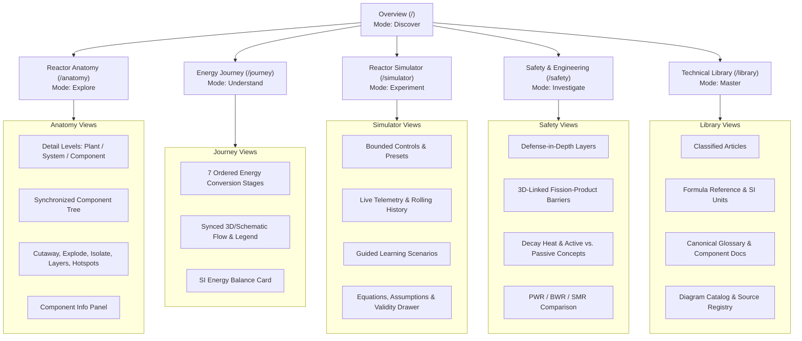
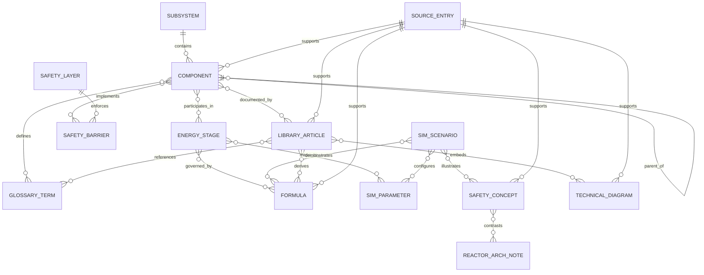

# Information Architecture

| Field | Value |
|---|---|
| Doc ID | HAK-DOC-IA |
| Status | Draft |
| Owner stage | 1 |
| Depends on | HAK-DOC-VISION, HAK-DOC-SCOPE, HAK-DOC-PRD, HAK-DOC-FR |
| Requirements | HAK-FR-101, HAK-FR-102, HAK-FR-103, HAK-PRD-002, HAK-PRD-013, HAK-PRD-014, HAK-PRD-024, HAK-PRD-025, HAK-PRD-026, HAK-FR-053, HAK-FR-054, HAK-FR-055, HAK-FR-056, HAK-FR-057, HAK-FR-058 |

## 1. Purpose and Scope

This document defines the complete **Information Architecture (IA)** for **HAKUREN — Nuclear Energy & Reactor Engineering Explorer** (`HAK-DOC-VISION`). It establishes the canonical site map across the six standalone product modules, the structured content model and entity relationships, controlled taxonomies and facets, claim-class and provenance classification rules, and cross-module linking contracts connecting 3D geometry, thermodynamic storytelling, simulation parameters, safety barriers, and Technical Library references (`HAK-PRD-013`, `HAK-PRD-014`, `HAK-PRD-024`).

All entities modeled by this architecture are grounded on the generic **HAKUREN Reference PWR** as primary baseline (`HAK-CON-010`), with explicit architectural comparison facets for Boiling Water Reactors (**BWR**) and the Small Modular Reactor (**SMR**) family (`HAK-PRD-025`, `HAK-SRC-034`), strictly within civilian non-operational scope (`HAK-CON-011`, `HAK-CON-012`).

## 2. Canonical Site Map and Module Hierarchy

HAKUREN uses a **flat-hub-with-cross-links** topology: all six canonical modules sit at top-level routes (`HAK-PRD-002`), operate standalone upon direct entry (`HAK-PRD-014`), and expose structured internal views addressable via deep links (specified in [Navigation Specification](navigation-specification.md)).

### 2.1 Module-to-Content Ownership Matrix

| Canonical Module | Route | Primary Learning Mode | Owned Content Entities | Consumed Cross-Module Entities |
|---|---|---|---|---|
| **Overview** | `/` | Discover | Landing hero, Reference PWR summary, system energy summary, concept primers, nominal status KPIs | Module summaries, plant-level 3D preview (`Anatomy`), summary flow (`Energy Journey`), `Reference`/`Illustrative` KPIs (`Library`) |
| **Reactor Anatomy** | `/anatomy` | Explore | 3D scene hierarchy (`Plant`, `System`, `Component`), camera presets, hotspots, cutaway/explode axes | Component metadata (`Component`), glossary definitions, linked `Journey` stage, `Simulator` parameters, `Safety` barriers |
| **Energy Journey** | `/journey` | Understand | Seven energy-conversion stage narratives, boundary legend definitions, stage flow keyframes | Referenced `Component` IDs, stage SI metrics, governing formulas (`Formula`), simulator handoff presets |
| **Reactor Simulator** | `/simulator` | Experiment | Simulation parameters, operating presets, guided learning scenarios, live telemetry/state machine | Governing formulas, validity/assumption disclosures, glossary tooltips, `Safety` concept links |
| **Safety & Engineering** | `/safety` | Investigate | Defense-in-depth layer profiles, barrier definitions, active vs. passive cards, PWR/BWR/SMR safety comparison | Linked 3D meshes (`Component`), decay-heat formulas (`Library`), verified regulatory sources (`Source`) |
| **Technical Library** | `/library` | Master | Technical articles, glossary terms, formula entries, component datasheets, technical diagrams, `HAK-SRC` attribution view | Deep-link anchors into `Anatomy`, `Journey`, `Simulator`, and `Safety` |

## 3. Core Content Model and Entity Relationships

Every educational artifact in HAKUREN is stored as structured static data validated at build time (`HAK-NFR-037`, `HAK-NFR-039`, `HAK-CON-002`). The data model uses stable string slugs and canonical identifiers so cross-module links never break across UI refactors.

### 3.1 Canonical Entity Definitions

| Entity Type | Primary Identifier Pattern | Primary Owning Module | Mandatory Core Fields |
|---|---|---|---|
| **Subsystem** | `sub-<slug>` (maps to `HAK-SUB` specs) | Reactor Anatomy / Library | `id`, `name`, `level` (`Plant` \| `System`), `circuit` (`Primary` \| `Secondary` \| `Tertiary` \| `Containment` \| `Auxiliary`), `description`, `sourceIds` |
| **3D Component** | `cmp-<slug>` (maps to `HAK-CMP` specs) | Reactor Anatomy | `id`, `name`, `canonicalAcronym`, `level` (`Plant` \| `System` \| `Component`), `parentId`, `meshNodeKey`, `role`, `operatingPrinciple`, `circuitContext`, `barrierRole`, `parameters` (with SI units & claim tags), `archNotes` (PWR/BWR/SMR), `crossLinks`, `sourceIds` |
| **Energy Stage** | `stage-1` .. `stage-7` | Energy Journey | `stageNumber`, `title`, `subsystemIds`, `componentIds`, `energyIn`, `energyOut`, `mechanism`, `radiologicalContext`, `metrics` (SI + provenance), `simulatorLink`, `formulaIds`, `sourceIds` |
| **Simulation Parameter** | `par-<slug>` (maps to `HAK-PAR` specs) | Reactor Simulator | `id`, `symbol`, `name`, `direction` (`input` \| `output`), `unitSI`, `minBound`, `maxBound`, `nominalValue`, `stepSize`, `claimClass` (`ASM` \| `SIMP` \| `REP`), `uiBadge` (`Simulated` \| `Reference`), `formulaIds`, `glossaryId` |
| **Simulation Scenario** | `scn-<slug>` (maps to `HAK-SCN` specs) | Reactor Simulator | `id`, `title`, `difficulty` (`Beginner` \| `Intermediate` \| `Advanced`), `learningGoals`, `initialPreset`, `steps`, `expectedOutcomes`, `postSimExplanation`, `misconceptionNote`, `linkedLibraryIds` |
| **Safety Layer / Barrier** | `saf-layer-<n>` / `bar-<slug>` | Safety & Engineering | `id`, `kind` (`DefenseInDepth` \| `PhysicalBarrier` \| `CoolingConcept` \| `ProtectionConcept`), `title`, `purpose`, `physicalPrinciple`, `linkedComponentIds`, `pwrVsBwrVsSmrNote`, `boundaryChecked`, `sourceIds` |
| **Library Article** | `art-<slug>` | Technical Library | `id`, `slug`, `title`, `domainCategory`, `difficulty`, `reactorScope`, `summary`, `sections`, `claimTags`, `relatedComponentIds`, `relatedScenarioIds`, `diagramIds`, `glossaryIds`, `sourceIds` |
| **Formula Entry** | `frm-<slug>` | Technical Library | `id`, `name`, `latex`, `plainTextAlt`, `variables` (`symbol`, `meaning`, `unitSI`), `validityBounds`, `claimClass`, `usedInModules`, `sourceIds` |
| **Glossary Term** | `gls-<slug>` | Technical Library | `id`, `term`, `acronym`, `canonicalDefinition`, `plainSummary`, `relatedComponentIds`, `relatedFormulaIds`, `sourceIds` |
| **Technical Diagram** | `dia-<slug>` | Technical Library | `id`, `title`, `diagramKind`, `caption`, `textAlternative`, `legendEntries`, `claimClass`, `sourceIds` |
| **Source Entry** | `HAK-SRC-nnn` | Technical Library | `id`, `title`, `issuer`, `date`, `identifier`, `url`, `section`, `accessed`, `category`, `claimsSupported`, `limitations`, `verified` |

## 4. Controlled Taxonomies and Facets

Client-side discovery in `/library` (`HAK-FR-057`) and contextual filtering across modules rely on four orthogonal, controlled facets. Every content item must declare at least one valid value from each applicable facet.

| Facet Name | Controlled Values | Scope & Usage |
|---|---|---|
| **Domain Topic** | `nuclear-physics`, `reactor-architectures`, `thermal-hydraulics`, `energy-conversion`, `safety-engineering`, `simulation-methods`, `units-and-standards` | Primary subject classification for Library articles, formulas, diagrams, and cross-module tags (`HAK-FR-053`). |
| **Reactor Architecture Scope** | `reference-pwr`, `bwr-comparison`, `smr-family`, `general-lwr` | Enforces `HAK-CON-010` and `HAK-FR-060`: prevents generic PWR values from being confused with BWR direct-cycle or SMR-family concepts (`HAK-SRC-034`). |
| **Pedagogical Difficulty Layer** | `beginner`, `intermediate`, `advanced` | Maps to learner scaffolding in [Learning Experience](learning-experience.md): conceptual mental models (`beginner`), undergraduate thermodynamics/systems (`intermediate`), governing math and numerical assumptions (`advanced`). |
| **Learning Mode** | `discover`, `explore`, `understand`, `experiment`, `investigate`, `master` | Ties any entity back to its primary pedagogical stage without gating access (`HAK-PRD-033`). |

### 4.1 Canonical Component & Circuit Taxonomy

Consistent with `HAK-DOC-CONTRACT` Section 1 and U.S. DOE/NRC public light-water reactor architecture (`HAK-SRC-034`), 3D and library entities are organized under five top-level plant circuits/enclosures:

1. **Containment & Nuclear Island Enclosure:** Containment structure (`HAK-SRC-018`), reactor cavity, shield boundaries.
2. **Primary Circuit — Reactor Coolant System (`RCS`):** Reactor Pressure Vessel (`RPV`), core barrel, fuel assemblies & fuel rods (`UO2` pellets + cladding), control rods & Control Rod Drive Mechanisms (`CRDM`), hot legs, cold legs, Reactor Coolant Pumps (`RCP`), Pressurizer (`PZR`), Steam Generator (`SG`) primary U-tubes (`HAK-SRC-011`, `HAK-SRC-020`).
3. **Secondary Circuit — Power Conversion (Rankine Loop):** `SG` shell side and moisture separators, main steam lines, high/low-pressure steam turbine-generator, main condenser, condensate and feedwater pumps (`HAK-SRC-011`).
4. **Tertiary Heat Sink:** Circulating cooling water loop and condenser heat-rejection interface (cooling tower or external water body representation).
5. **Conceptual Safety & Instrumentation Boundaries:** Physical fission-product barriers (fuel matrix, cladding, `RCS` boundary, containment), decay-heat removal pathways, conceptual protection/sensing points (`HAK-SAFE-020`).

## 5. Claim Classification and UI Provenance Mapping

To uphold `HAK-CON-007`, `HAK-PRD-026`, and `HAK-FR-058`, every engineering statement and quantitative value is classified at two synchronized layers: the **authoring epistemic tag** (in Phase 0 specs and source data) and the **user-facing provenance badge** (rendered beside every displayed metric in the UI).

| Authoring Epistemic Tag | Definition | Source Citation Required? | Mapped UI Provenance Badge | Required UI Disclosure |
|---|---|---|---|---|
| `FACT` | Established physical law or verifiable domain fact | Yes (`HAK-SRC-nnn`) | `Reference` | Tooltip shows cited `HAK-SRC` title, issuer, and verification status |
| `REF` | Published engineering parameter or standard specification | Yes (`HAK-SRC-nnn`) | `Reference` | Tooltip cites `HAK-SRC` entry, units, and applicability scope |
| `REP` | Representative educational parameter for generic HAKUREN Reference PWR | Yes (`HAK-SRC-nnn`) | `Reference` | Tooltip notes generic representative status (not a specific plant) |
| `DER` | Algebraically or numerically derived from `REF`/`REP`/`ASM` inputs | Derived from cited inputs | `Computed` | Tooltip shows formula link in `/library` and governing inputs |
| `ASM` | Explicit modeling assumption bounding simplified physics | Disclosed in assumption record | `Simulated` | Tooltip links to Simulator Assumptions & Validity drawer (`HAK-FR-045`) |
| `SIMP` | Intentional educational simplification (e.g., lumped-parameter core) | Disclosed in assumption record | `Simulated` | Tooltip explains omitted phenomena and validity limits |
| `ILL` | Qualitative or schematic illustrative value for visual scale/flow | Never presented as measured data | `Illustrative` | Tooltip warns value is schematic/educational only |
| `UNV` | Unverified claim pending source inspection (blocked from `Complete` specs) | Logged as gap if kept in Draft | Hidden or flagged `Unverified` in dev | Blocked from Tier 1 production bundle by `HAK-NFR-039` CI check |

### 5.1 Module-by-Module Claim Distribution

| Module | Dominant Claim Classes | UI Provenance Badges Rendered | Mandatory Boundary Notice |
|---|---|---|---|
| **Overview (`/`)** | `FACT`, `REF`, `REP`, `ILL` | `Reference`, `Illustrative` | Generic HAKUREN Reference PWR framing (`HAK-FR-020`) |
| **Reactor Anatomy (`/anatomy`)** | `FACT`, `REF`, `REP`, `ILL` | `Reference`, `Illustrative` | Generic PWR vs. labeled vendor examples; schematic vs. physical scale note |
| **Energy Journey (`/journey`)** | `FACT`, `REF`, `REP`, `DER`, `SIMP` | `Reference`, `Computed`, `Illustrative` | Representative Rankine balance disclosure (`HAK-PRD-007`) |
| **Reactor Simulator (`/simulator`)** | `ASM`, `SIMP`, `DER`, `REP` | `Simulated`, `Computed`, `Reference` | Persistent non-operational, non-safety-grade banner (`HAK-SAFE-019`) |
| **Safety & Engineering (`/safety`)** | `FACT`, `REF`, `SIMP` | `Reference`, `Illustrative` | Conceptual-only, non-procedural framing notice (`HAK-SAFE-020`) |
| **Technical Library (`/library`)** | `FACT`, `REF`, `REP`, `ASM`, `SIMP`, `DER` | `Reference`, `Computed`, `Simulated`, `Illustrative` | Full `HAK-SRC` verification table and validity notes (`HAK-FR-056`) |

## 6. Cross-Module Linking Architecture

Cross-module links are bidirectional and typed by entity relationship rather than hardcoded URL strings, enabling static validation against JSON schemas (`HAK-NFR-037`).

| Source Context | Target Context | Link Intent | Passed Deep-Link Payload |
|---|---|---|---|
| **Anatomy Component Panel (`cmp-sg`)** | Energy Journey (`/journey`) | See component inside thermal flow | `?stage=4&from=anatomy&cmp=cmp-sg` |
| **Anatomy Component Panel (`cmp-pzr`)** | Technical Library (`/library`) | Read pressurizer theory & glossary | `/library/glossary#gls-pressurizer` |
| **Anatomy Component Panel (`cmp-core`)** | Reactor Simulator (`/simulator`) | Experiment with core power & rods | `?preset=nominal&focus=par-reactivity&from=anatomy` |
| **Anatomy Component Panel (`cmp-containment`)** | Safety & Engineering (`/safety`) | Inspect fission-product barrier role | `?barrier=bar-containment&from=anatomy` |
| **Energy Journey Stage (`stage-4`)** | Reactor Anatomy (`/anatomy`) | Inspect 3D steam generator U-tubes | `?component=cmp-sg&level=system&cut=x` |
| **Simulator Parameter Drawer (`par-thermal-power`)** | Technical Library (`/library`) | Inspect governing equation & assumptions | `/library/formulas#frm-core-heat-balance` |
| **Safety Barrier Card (`bar-cladding`)** | Reactor Anatomy (`/anatomy`) | Isolate 3D fuel cladding mesh | `?component=cmp-fuel-rod&level=component&isolate=true` |
| **Technical Library Source Row (`HAK-SRC-034`)** | All referencing articles | Inspect claims supported by source | Filtered list of citing Library/Component records |

## 7. Information Architecture Requirements

| ID | Name | Requirement | Priority | Rationale | Source | Parent | Verification | Acceptance | Status |
|---|---|---|---|---|---|---|---|---|---|
| HAK-FR-101 | Unified Canonical Entity and Cross-Reference Taxonomy | All static content datasets across the six HAKUREN modules shall use canonical entity IDs (`sub-*`, `cmp-*`, `stage-*`, `par-*`, `scn-*`, `bar-*`, `art-*`, `frm-*`, `gls-*`, `dia-*`, `HAK-SRC-*`) and validate bidirectional cross-links at build time without dangling references. | Must | Prevents broken deep links between 3D components, Energy Journey stages, Simulator formulas, Safety barriers, and Library entries. | Master Prompt s8 | HAK-PRD-024 | Test+Inspection | Build-time link validation against all static JSON/Markdown content bundles reports zero unresolved entity IDs or broken cross-module references. | Draft |
| HAK-FR-102 | Claim-Class and Provenance Metadata Propagation | Every content entity carrying a technical claim or numeric quantity shall store an explicit epistemic claim tag (`FACT`, `REF`, `REP`, `ASM`, `SIMP`, `DER`, `ILL`, `UNV`) and unit metadata that maps deterministically to UI provenance badges (`Reference`, `Computed`, `Simulated`, `Illustrative`). | Must | Ensures scientific integrity metadata defined in Phase 0 specs survives intact into runtime UI rendering (`HAK-CON-007`). | Master Prompt s2 | HAK-PRD-026 | Inspection+Test | Schema and UI integration tests confirm every numeric value rendered across all six modules carries a valid provenance badge derived from its data-contract claim class, with zero `UNV` values shipped in production. | Draft |
| HAK-FR-103 | Reactor Architecture Faceting and SMR Family Framing | Every architectural entity, comparison table, and library filter shall tag content explicitly as `reference-pwr`, `bwr-comparison`, `smr-family`, or `general-lwr`, and shall prohibit presenting any vendor-specific reactor as the generic HAKUREN Reference PWR or collapsing SMRs into one design. | Must | Operationalizes `HAK-CON-010` and `HAK-SRC-003` inside the information architecture and search facets. | HAK-SRC-034 | HAK-PRD-025 | Inspection | Faceted filtering in `/library` and comparison cards in `/`, `/anatomy`, `/journey`, and `/safety` cleanly separate generic PWR, BWR, and multi-concept SMR-family attributes with explicit vendor-example labels where cited. | Draft |

## 8. References

- `HAK-SRC-003`: U.S. DOE Office of Nuclear Energy — *Advanced Small Modular Reactors (SMRs)*.
- `HAK-SRC-011`: U.S. NRC — *Pressurized Water Reactors overview*.
- `HAK-SRC-018`: U.S. NRC — *Containment structure*.
- `HAK-SRC-020`: U.S. NRC — *Reactor coolant system*.
- `HAK-SRC-034`: U.S. DOE Office of Nuclear Energy — *NUCLEAR 101: How Does a Nuclear Reactor Work?*

## 9. Related Documents

- [Product Vision](../00-governance/product-vision.md)
- [Scope and Boundaries](../00-governance/scope-and-boundaries.md)
- [Constraints Register](../00-governance/constraints-register.md)
- [Product Requirements Document](product-requirements-document.md)
- [Functional Requirements](functional-requirements.md)
- [Navigation Specification](navigation-specification.md)
- [Content Strategy](content-strategy.md)
- [Learning Experience](learning-experience.md)
- `docs/11-data-contracts/data-contract-overview.md` (planned Stage 11)

## 10. Change History

Recorded centrally in [Changelog](../CHANGELOG.md).
