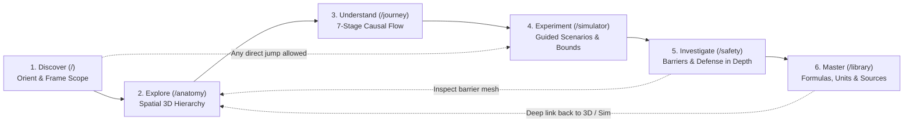
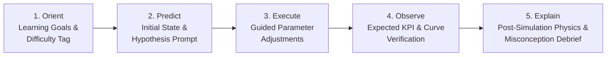

# Learning Experience Specification

| Field | Value |
|---|---|
| Doc ID | HAK-DOC-LEARNING-EXPERIENCE |
| Status | Draft |
| Owner stage | 1 |
| Depends on | HAK-DOC-VISION, HAK-DOC-PERSONAS, HAK-DOC-SCOPE, HAK-DOC-PRD, HAK-DOC-FR |
| Requirements | HAK-FR-104, HAK-FR-105, HAK-FR-106, HAK-PRD-003, HAK-PRD-007, HAK-PRD-011, HAK-PRD-014, HAK-PRD-016, HAK-PRD-032, HAK-PRD-033, HAK-FR-023, HAK-FR-047 |

## 1. Purpose and Scope

This document defines **HAKUREN's Pedagogical & Learning Experience Design**. It specifies how learners build accurate mental models across the six non-linear learning modes (**Discover → Explore → Understand → Experiment → Investigate → Master**), how **Beginner**, **Intermediate**, and **Advanced** difficulty layers adapt explanation depth without locking features, how progressive disclosure manages cognitive load in 3D and quantitative interfaces, how scenario-based inquiry operates in `/simulator`, how common nuclear misconceptions are corrected respectfully, and how optional account-free knowledge checks work (`HAK-CON-018`, `HAK-NFR-035`).

## 2. Pedagogical Foundation and Six-Mode Progression

Nuclear engineering education frequently fails novices by jumping directly to differential equations, and fails advanced students by reducing power plants to cartoon diagrams. HAKUREN bridges both extremes through **Mechanistic Causal Scaffolding** anchored on a single coherent engineering subject—the **HAKUREN Reference PWR** (`HAK-CON-010`, `HAK-SRC-034`):

1. **Concrete Spatial Anchor First:** Learners can *see* the containment, pressure vessel, U-tube steam generators, and turbine hall (`Explore` at `/anatomy`) before memorizing symbols.
2. **Conservation-Driven Causality:** The seven-stage `Understand` flow (`/journey`) links fission kinetic energy in ceramic fuel pellets (`HAK-SRC-034`, `HAK-SRC-035`) continuously to Rankine turbine work and condenser heat rejection (`HAK-PRD-007`).
3. **Hypothesis Testing Within Transparent Bounds:** The `Experiment` sandbox (`/simulator`) lets learners vary reactivity, coolant flow, or steam demand and immediately inspect *both* the live response and the simplified equations (`ASM`/`SIMP`) behind it (`HAK-PRD-010`).
4. **Safety Literacy via Physical Barriers:** `Investigate` (`/safety`) explains *why* nested physical barriers and defense-in-depth layers exist (`HAK-SRC-005`, `HAK-SRC-006`) without ever crossing into operational procedures (`HAK-SAFE-021`).
5. **Rigorous Synthesis:** `Master` (`/library`) anchors intuition in canonical terminology, SI units (`HAK-SRC-010`), rendered formulas, and verifiable primary sources.

Every module remains **100% standalone and un-gated** (`HAK-PRD-033`, `HAK-FR-098`): learners choose whether to follow the suggested arc or jump straight into `/simulator` or `/library`.

## 3. Three-Tier Difficulty Layers (`Beginner`, `Intermediate`, `Advanced`)

Learners can switch the active **Difficulty Layer** anytime via a global or module-local selector (`Beginner` default on first load; persisted only in optional client-local browser storage with reset, `HAK-NFR-035`). Switching layers **never hides modules or locks simulator controls**; it adapts explanatory density, mathematical framing, and visual annotation complexity (`HAK-FR-104`):

| Dimension | `Beginner` (Secondary / Curious Public) | `Intermediate` (Undergraduate STEM / Policy) | `Advanced` (Engineering / Technical Deep Dive) |
|---|---|---|---|
| **Vocabulary & Hover Definitions** | Plain-language analogies paired with canonical terms in parentheses (e.g., *Pressurizer — keeps primary water liquid under high pressure*). | Canonical engineering terminology (`RCS`, `RPV`, `SG`, `PZR`, `CRDM`) with inline glossary links. | Full canonical terminology with subsystem interface notes and architectural caveats (`PWR` vs. `BWR` vs. `SMR` family). |
| **Mathematics & Units** | Conceptual cause-and-effect + headline SI powers (`MWth`, `MWe`, `MPa`, `K` / `°C`) with plain-English takeaways. | Algebraic energy balances ($\dot{Q}_{\text{in}} = P_{\text{elec}} + \dot{Q}_{\text{rejected}}$), Rankine thermal efficiency, and temperature differentials. | Coupled point-kinetics & lumped-parameter ODE summaries, validity ranges, numerical time-step notes, and explicit `ASM`/`SIMP` derivations. |
| **3D Anatomy Defaults (`/anatomy`)** | Opens at *Plant* or *System* level with key hotspots visible and concise 2-sentence Component Info summaries. | Opens with Component Tree expanded to `RCS`/Secondary subsystems and full parameter tables (`Reference`/`Illustrative` badges). | Exposes full Component-level cutaway/exploded detail, fine lattice/CRDM sub-assemblies, and direct cross-links to Library formulas. |
| **Simulator Guidance (`/simulator`)** | Highlights curated presets & `Beginner` guided scenarios with clear physical prompts and gentle control ranges. | Surfaces multi-channel transient plots, load-following scenarios, and inline equation tooltips. | Surfaces full **Model Assumptions & Validity Bounds** drawer, `Single Step` control, and rolling history scrubbing (`HAK-FR-042`, `HAK-FR-043`). |

## 4. Progressive Disclosure Patterns

To avoid overwhelming learners in a high-density engineering interface, every module applies three strict progressive-disclosure rules:

1. **Spatial Zoom Disclosure (`/anatomy`):** *Plant* (site context: containment, turbine hall, heat sink) → *System* (primary `RCS` loops, `SG`, `PZR`, secondary steam/condenser) → *Component* (highest geometric fidelity on `RPV`, fuel assemblies, control rods/`CRDM`, `SG` U-tubes) (`HAK-PRD-004`).
2. **Layered Explanation Cards (`/journey`, `/safety`, `/library`):** Each panel renders a **15-second summary** above the fold, followed by an expandable **"Physical Mechanism & Equations"** block and **"PWR vs. BWR / SMR Note"** (`HAK-FR-035`, `HAK-FR-060`).
3. **On-Demand Mathematical Transparency (`/simulator`):** Live telemetry remains uncluttered at top level, while clicking **"Explain / Formulas"** on any variable opens the exact equation, SI units, and `ASM`/`SIMP` limits in a non-blocking drawer (`HAK-FR-044`, `HAK-FR-045`).

## 5. Scenario-Based Learning Design (`/simulator`)

Guided scenarios (`HAK-FR-047`, `HAK-PRD-032`) turn open-ended parameter sliders into structured scientific inquiry using a **Five-Phase Inquiry Cycle**:

### 5.1 Mandatory Scenario Pedagogy Contract

Every scenario in `docs/06-simulation/scenario-catalog.md` must supply:
- **Learning Goals (`1–3` measurable takeaways):** e.g., *Observe why raising secondary steam demand cools the primary cold leg and induces negative-moderator-temperature-style feedback trends in the educational model.*
- **Preloaded Initial Conditions:** Explicit `Preset` starting point (`Nominal Full Power`, `Part-Load`, or `Hot Zero Power`, `HAK-FR-046`).
- **Pre-Run Prediction Prompt:** A brief non-graded question asking the learner to predict whether thermal power, pressure, or temperature will rise, fall, or lag before pressing **Play**.
- **Step-by-Step Bounded Actions:** Clear instructions using accessible stepper values (e.g., *"Decrease secondary load demand by 10% and observe over 30 simulated seconds"*), strictly educational and never mimicking real plant operating checklists (`HAK-SAFE-021`).
- **Expected Observable Outcomes & Post-Simulation Physical Explanation:** Explains both *what* happened in the chart and *where the simplified model's validity ends* (`HAK-SAFE-024`), linking directly to related `/safety` concepts or `/library` equations.

## 6. Misconception Handling Matrix

Civilian nuclear energy carries widespread public and even undergraduate misconceptions. HAKUREN addresses them calmly with mechanistic clarity—never mocking the learner and never slipping into promotional rhetoric:

| Common Misconception | Scientific Reality (Educational Framing) | Source Basis | Where & How HAKUREN Addresses It |
|---|---|---|---|
| **"A nuclear power plant can explode like a nuclear weapon."** | Civilian power reactors use low-enriched uranium oxide ceramic fuel (`UO2`) and physical geometries/moderators designed for sustained controlled thermal fission—fundamentally distinct from explosive assemblies (`HAK-SRC-034`, `HAK-SRC-035`). | `HAK-SRC-034`, `HAK-SRC-035` | `/`: Concept primer card (`HAK-FR-023`); `/safety`: Physical barriers & inherent stability framing. |
| **"White plumes from cooling towers are radioactive steam from the reactor."** | In a PWR, primary radioactive water stays inside a closed, high-pressure loop (`RCS`) inside containment; steam generators transfer heat across metal U-tube walls to a clean secondary loop, and tertiary cooling towers condense secondary steam using separate water vapor (`HAK-SRC-034`). | `HAK-SRC-034`, `HAK-SRC-011` | `/`: System loop summary (`HAK-FR-022`); `/journey`: Radiological Boundary Legend (`HAK-FR-039`); `/anatomy`: `SG` section cut. |
| **"Inserting control rods immediately stops all heat in the reactor."** | Control rods stop the sustained fission chain reaction (`HAK-SRC-034`), but radioactive fission products continue emitting **decay heat**, which is why post-shutdown core cooling systems are essential (`HAK-FR-050`). | `HAK-SRC-034`, `HAK-SRC-005` | `/safety`: Dedicated Decay Heat & Core Cooling section (`HAK-FR-050`); `/simulator`: Post-trip explanation. |
| **"100% of nuclear fission heat becomes electrical power."** | By the Second Law of Thermodynamics (Rankine cycle), steam condensation rejects roughly two-thirds of thermal energy to the heat sink, yielding typical ~30–35% thermal-to-electric conversion (`[SIMP]`/`[REF]` cycle limit). | `HAK-PRD-007`, `HAK-SRC-010` | `/journey`: Stage 7 Condenser energy balance (`HAK-FR-038`); `/simulator`: `MWth` vs. `MWe` simultaneous KPIs. |
| **"SMR refers to one specific standardized reactor model."** | Small Modular Reactors (`SMR`) are a broad **family** of diverse concepts (integral light-water PWRs, high-temperature gas, liquid-metal, molten-salt designs) sharing smaller modular power ratings and emphasis on factory fabrication and passive safety (`HAK-SRC-003`). | `HAK-SRC-003`, `HAK-CON-010` | `/`, `/safety`, `/library`: Explicit SMR-family framing (`HAK-FR-060`, `HAK-FR-103`). |
| **"Nuclear fusion power plants operate like fission reactors today."** | Commercial nuclear electricity today uses nuclear **fission** (splitting heavy nuclei); **fusion** (combining light nuclei) remains under scientific/engineering development (`HAK-SRC-035`) and is excluded from current plant simulation. | `HAK-SRC-035`, `HAK-DOC-CONTRACT` | `/`: Scope note; `/library`: Fission vs. Fusion clarification article. |

## 7. Optional Knowledge Checks (No Accounts, Zero Tracking)

Consistent with `HAK-CON-018` and `HAK-NFR-035`, HAKUREN implements **zero accounts, zero login gates, zero leaderboards, and zero external analytics**:

- **Format:** Short, optional `1–3` question **Concept Checks** at the end of `/journey` stages, `/simulator` guided scenarios, and `/safety` sections (e.g., *"Which boundary physically separates primary coolant from secondary turbine steam in the HAKUREN Reference PWR?"*).
- **Immediate Formative Feedback:** Selecting an answer reveals a concise physical explanation for *why* the choice is right or wrong, plus a direct link to the relevant 3D component or Library article—never just "Incorrect".
- **Privacy & Storage:** Check completion state exists purely in memory or optional client-only `localStorage` alongside a clear **"Reset Local Progress"** control (`HAK-NFR-035`). Educators may assign modules via direct URL without collecting student PII.

## 8. Learning Experience Requirements

| ID | Name | Requirement | Priority | Rationale | Source | Parent | Verification | Acceptance | Status |
|---|---|---|---|---|---|---|---|---|---|
| HAK-FR-104 | Three-Tier Difficulty Layer Adaptation Without Gating | The platform shall support selectable **Beginner**, **Intermediate**, and **Advanced** explanatory depth layers that adapt copy complexity, equation visibility, and scaffolding density across modules without locking any route, 3D level, or simulator control. | Must | Serves high-school students, university undergraduates, and technical specialists simultaneously without fragmenting the product (`HAK-DOC-PERSONAS`). | Master Prompt s7 | HAK-PRD-033 | Inspection+Demonstration | Switching between `Beginner`, `Intermediate`, and `Advanced` updates explanatory depth and math visibility while keeping all 6 routes and controls accessible. | Draft |
| HAK-FR-105 | Five-Phase Guided Scenario and Misconception Debrief | Every guided scenario in `/simulator` shall present explicit Learning Goals, a Preloaded Initial Preset, a Pre-Run Prediction Prompt, bounded step instructions, Expected Observable Outcomes, and a Post-Simulation Physical Explanation addressing relevant misconceptions. | Must | Converts interactive simulation into structured causal learning rather than unguided slider play (`HAK-PRD-032`). | Master Prompt s8 | HAK-PRD-032 | Inspection+Test | Inspecting and running each scenario in `/simulator` verifies all five inquiry phases render cleanly, match simulated trends, and contain zero real-plant operating procedures. | Draft |
| HAK-FR-106 | Optional Account-Free Formative Knowledge Checks | Optional end-of-module or end-of-scenario Concept Checks shall operate 100% client-side with zero user accounts or outbound tracking, provide immediate explanatory feedback on every option, and offer a one-click local progress reset. | Should | Reinforces active recall and misconception repair while preserving strict zero-PII static architecture (`HAK-CON-018`). | Master Prompt s14 | HAK-PRD-029 | Test+Inspection | Completing a Concept Check displays immediate explanatory feedback, emits zero network requests, and resets cleanly via the local progress reset control. | Draft |

## 9. References

- `HAK-SRC-003`: U.S. DOE Office of Nuclear Energy — *Advanced Small Modular Reactors (SMRs)*.
- `HAK-SRC-005`: U.S. NRC — *Defense in depth*.
- `HAK-SRC-006`: U.S. NRC — *Containment structure*.
- `HAK-SRC-010`: NIST — *Special Publication 330: The International System of Units (SI)*.
- `HAK-SRC-011`: U.S. NRC — *Pressurized Water Reactors overview*.
- `HAK-SRC-034`: U.S. DOE Office of Nuclear Energy — *NUCLEAR 101: How Does a Nuclear Reactor Work?*
- `HAK-SRC-035`: U.S. DOE Office of Nuclear Energy — *Fission and Fusion: What is the Difference?*

## 10. Related Documents

- [Product Vision](../00-governance/product-vision.md)
- [Audience and Personas](../00-governance/audience-and-personas.md)
- [Scope and Boundaries](../00-governance/scope-and-boundaries.md)
- [Product Requirements Document](product-requirements-document.md)
- [Functional Requirements](functional-requirements.md)
- [User Journeys](user-journeys.md)
- [Information Architecture](information-architecture.md)
- [Content Strategy](content-strategy.md)

## 11. Change History

Recorded centrally in [Changelog](../CHANGELOG.md).
