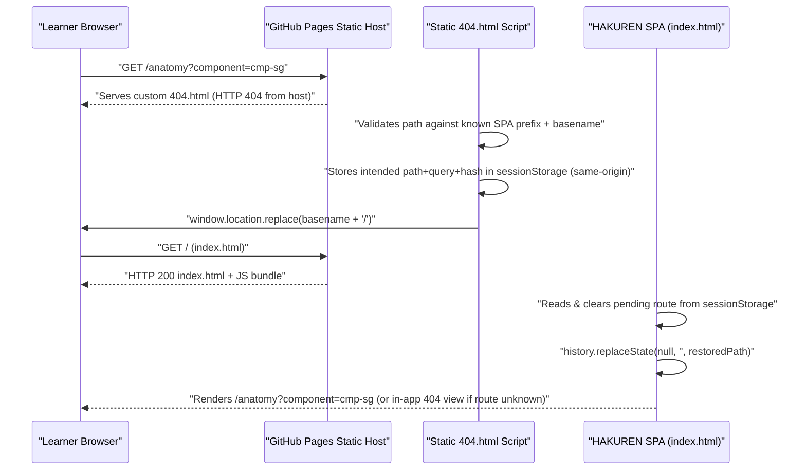

# Navigation Specification

| Field | Value |
|---|---|
| Doc ID | HAK-DOC-NAVIGATION |
| Status | Draft |
| Owner stage | 1 |
| Depends on | HAK-DOC-PRD, HAK-DOC-FR, HAK-DOC-NFR, HAK-DOC-IA |
| Requirements | HAK-FR-089, HAK-FR-090, HAK-FR-091, HAK-FR-092, HAK-FR-093, HAK-FR-094, HAK-FR-095, HAK-FR-096, HAK-FR-097, HAK-PRD-002, HAK-PRD-014, HAK-PRD-029, HAK-PRD-031, HAK-PRD-033, HAK-FR-059 |

## 1. Purpose and Scope

This specification defines the client-side navigation architecture, URL routing contract, sub-route and deep-link conventions, breadcrumb patterns, browser history and state restoration rules, GitHub Pages static-hosting routing behavior, keyboard navigation bindings, and 404 recovery behavior for **HAKUREN**. It operationalizes `HAK-PRD-002`, `HAK-PRD-014`, `HAK-PRD-033`, and `HAK-FR-059` across desktop, tablet, and mobile viewports within the zero-backend static deployment constraint (`HAK-CON-002`, `HAK-SRC-007`).

## 2. Global Navigation Shell and Module Switching

### 2.1 Global Navigation Bar Structure

Every route renders inside a shared, persistent application shell (`<header>` + `<nav aria-label="Primary">` + `<main id="main-content">` + `<footer>`), preceded by a keyboard-focusable **Skip to main content** link (`WCAG 2.2 SC 2.4.1`, `HAK-SRC-026`):

| Region / Slot | Desktop (`>= 1024 px`) | Tablet / Mobile (`< 1024 px`) | Semantic & Visual Rules |
|---|---|---|---|
| **Skip Link** | Visually hidden until focused; top-left overlay | Visually hidden until focused; top-left overlay | Moves focus directly to `#main-content` (`tabindex="-1"`). |
| **Brand Anchor** | `HAKUREN` wordmark + subtle Reference PWR indicator (`<a href="/">`) | Compact `HAKUREN` wordmark (`<a href="/">`) | Clicking returns to `/` (*Overview*) without resetting unrelated browser storage. |
| **Six Module Links** | Horizontal link list in canonical order: `Overview`, `Reactor Anatomy`, `Energy Journey`, `Reactor Simulator`, `Safety & Engineering`, `Technical Library` | Collapsible modal/slide-out navigation drawer triggered by `Menu` button (`>= 44x44` CSS px target) | Active link carries `aria-current="page"` (`HAK-FR-059`), ice-blue/cyan active underline, and subtle learning-mode subtitle (`Discover` .. `Master`). |
| **Utility Actions** | Reduced-Motion toggle, Quick Search (`/library` jump), Difficulty Layer indicator | Inside navigation header or drawer top bar | Non-blocking; never obscures focused elements (`SC 2.4.11`, `HAK-SRC-026`). |

### 2.2 Non-Linear Module Switching Semantics

- **Zero Gating:** Any of the six modules may be opened first or revisited in any order (`HAK-PRD-033`).
- **Session Continuity vs. Clean Entry:** Switching away from `/simulator` while a simulation is `Running` automatically transitions the solver to `Paused` in client state (preserving the session buffer if the learner returns within the same tab session, unless they trigger **Reset**), while leaving `/anatomy` preserves the last active camera preset or clears cleanly on explicit URL query override.
- **Return Context Banner:** When a learner arrives at a target module via a contextual cross-module deep link (e.g., `/anatomy` -> `/library/glossary#gls-pressurizer` via `?from=anatomy&cmp=cmp-pzr`), a non-intrusive inline chip (`Return to Reactor Anatomy: Pressurizer`) lets them step back without losing orientation.

## 3. Canonical Routes and Sub-Route / Query Conventions

### 3.1 Top-Level Canonical Routes

| Canonical Route | Module Title | Learning Mode | Document `<title>` Template |
|---|---|---|---|
| `/` | Overview | Discover | `HAKUREN — Nuclear Energy & Reactor Engineering Explorer` |
| `/anatomy` | Reactor Anatomy | Explore | `Reactor Anatomy — HAKUREN` |
| `/journey` | Energy Journey | Understand | `Energy Journey — HAKUREN` |
| `/simulator` | Reactor Simulator | Experiment | `Reactor Simulator — HAKUREN` |
| `/safety` | Safety & Engineering | Investigate | `Safety & Engineering — HAKUREN` |
| `/library` | Technical Library | Master | `Technical Library — HAKUREN` |

### 3.2 Sub-Route and Query Parameter Conventions

Interactive state deep links use **query parameters** on stateful canvas/simulator routes (`/anatomy`, `/journey`, `/simulator`, `/safety`) and **semantic sub-paths plus fragment anchors** on document-centric `/library` routes:

| Target Module | Route / Sub-Route Pattern | Supported Query / Hash Parameters | Example Deep Link | Fallback if Parameter Unknown |
|---|---|---|---|---|
| **Reactor Anatomy** | `/anatomy` | `level` (`plant`\|`system`\|`component`), `component` (`cmp-*`), `preset` (`cam-*`), `isolate` (`true`\|`false`), `explode` (`0`..`100`), `cut` (`none`\|`x`\|`y`\|`z`), `layers` (comma-separated layer keys) | `/anatomy?level=component&component=cmp-sg-utubes&cut=x` | Show non-blocking notice ("Component not found — showing Plant Overview") and load default Plant view. |
| **Energy Journey** | `/journey` | `stage` (`1`..`7`), `compare` (`pwr`\|`bwr`), `flow` (`play`\|`pause`) | `/journey?stage=4&compare=bwr` | Clamp/default to Stage 1 with inline warning banner if `stage` is out of `1..7`. |
| **Reactor Simulator** | `/simulator` | `scenario` (`scn-*`), `preset` (`nominal`\|`part-load`\|`hzp`), `focus` (`par-*`), `panel` (`formulas`\|`assumptions`) | `/simulator?scenario=scn-reactivity-step&panel=formulas` | Load `nominal` preset with notice if `scenario` or `preset` slug is invalid. |
| **Safety & Engineering** | `/safety` | `section` (`defense`\|`barriers`\|`cooling`\|`passive-active`\|`protection`), `layer` (`1`..`5`), `barrier` (`bar-*`), `compare` (`pwr`\|`bwr`\|`smr`) | `/safety?section=barriers&barrier=bar-rcs-boundary` | Open requested section default or Defense-in-Depth overview if unknown. |
| **Technical Library (Hub)** | `/library` | `q` (search string), `topic` (taxonomy slug), `type` (`article`\|`formula`\|`glossary`\|`component`\|`diagram`\|`source`), `arch` (`reference-pwr`\|`bwr-comparison`\|`smr-family`) | `/library?topic=thermal-hydraulics&arch=reference-pwr` | Render all entries matching valid facets; empty query shows curated hub. |
| **Technical Library (Sub-Routes)** | `/library/articles/:slug` `/library/glossary` `/library/formulas` `/library/components/:cmpId` `/library/diagrams/:diaId` `/library/sources` | Fragment `#<entity-id>` (e.g., `#gls-pressurizer`, `#frm-rankine-efficiency`, `#HAK-SRC-034`) | `/library/articles/pwr-primary-secondary-loops` `/library/sources#HAK-SRC-034` | Unknown `:slug` or `:id` renders an inline Library Not Found card with search pre-populated from slug tokens. |

**Design Rationale (Path vs. Query Separation):** Using query parameters on `/anatomy`, `/journey`, `/simulator`, and `/safety` keeps multi-axis 3D and simulation state combinatorially composable without proliferating hundreds of path patterns, while semantic sub-paths under `/library/*` give articles and reference sections clean, bookmarkable document URLs.

## 4. Breadcrumbs Specification

Sub-views inside `/library/*` and hierarchical inspection states inside `/anatomy`, `/journey`, and `/safety` display a secondary breadcrumb bar directly above the primary workspace heading, implemented per the W3C WAI-ARIA Authoring Practices Breadcrumb Pattern (`HAK-SRC-029`):

- **Markup:** `<nav aria-label="Breadcrumb">` containing an `<ol>` list. All ancestor crumbs are `<a>` links; the terminal active node uses `aria-current="page"` (`HAK-SRC-029`).
- **Hierarchy Mapping:**
  - `/anatomy?level=component&component=cmp-fuel-rod`: `Overview` / `Reactor Anatomy` / `System: Reactor Core` / `Fuel Rod (Active)`
  - `/library/articles/pwr-primary-secondary-loops`: `Overview` / `Technical Library` / `Articles` / `PWR Primary & Secondary Loops`
  - `/simulator?scenario=scn-load-follow`: `Overview` / `Reactor Simulator` / `Scenarios` / `Load-Follow Response`
- **Mobile Reflow:** On viewports `< 640 px`, intermediate ancestor crumbs may collapse into a single back-link (`< Back to Technical Library`) to preserve vertical fold space and `>= 24x24` CSS px touch targets (`SC 2.5.8`, `HAK-SRC-026`).

## 5. Browser History Stack and State Restoration

Client-side routing uses the browser History API (`history.pushState`, `history.replaceState`, and the `window` `popstate` event, `HAK-SRC-031`) on the main UI thread:

| User Action | History Method | URL & State Effect | Restoration Behavior on Browser Back / Forward (`popstate`) |
|---|---|---|---|
| Click module link or Library sub-route | `pushState` | Pushes new route entry and updates `document.title`. | Mounts previous/next route, restores focus to `<main>` or `<h1>`, restores associated query params. |
| Select discrete 3D component, camera preset, journey stage, safety barrier, or simulator scenario | `pushState` | Updates query params (`?component=...`, `?stage=...`, `?scenario=...`). | `popstate` restores the exact selected component/stage/barrier or scenario initial state. |
| Drag continuous sliders (`explode`, `sectionCut`, `transparency`, simulator reactivity slider) or type live search filter | `replaceState` (debounced `>= 300 ms`) or in-memory state only | Avoids polluting browser Back history with dozens of intermediate slider ticks. | Browser Back exits cleanly to the previous discrete selection or module rather than stepping backward 1% per tick. |
| Invalid or unknown query param values on reload | `replaceState` | Normalizes URL to safe fallback state while keeping base route intact. | Reloading or sharing the cleaned URL yields deterministic behavior. |

## 6. GitHub Pages Client-Side Routing Architecture

Because **HAKUREN** deploys as static files on GitHub Pages (`HAK-PRD-029`, `HAK-CON-001`, `HAK-CON-002`) without a server-side rewrite engine (such as Nginx `try_files`), direct browser navigation or refresh on a non-root route like `/anatomy` or `/library/articles/pwr-primary-secondary-loops` causes GitHub Pages to look for a physical file at that path, fail to find one, and serve the repository's `404.html` (`HAK-SRC-030`).

### 6.1 Base-Path & Sub-Path Portability

- All routes and asset fetches must respect Vite's configurable `BASE_URL` (supporting both custom-domain root `/` and project-site subpath `/<repo-name>/`).
- Internal navigation links must be constructed relative to the router's configured `basename` so links work identically in local preview, root custom domains, and GitHub Pages project repositories.

### 6.2 Custom `404.html` SPA Redirect Protocol

To preserve clean, bookmarkable path URLs (avoiding `#/` hash URLs where possible) while supporting direct deep links on GitHub Pages (`HAK-SRC-030`):

**Security & Edge Constraints for `404.html` Redirect:**
1. The redirect script in `404.html` must validate that the stored redirect target is strictly a relative same-origin path starting with the configured `basename` (preventing open-redirect manipulation).
2. `sessionStorage` is ephemeral per browser tab and stores zero PII (`HAK-CON-018`); if `sessionStorage` is unavailable, `404.html` falls back to passing the relative path safely via query string or displays direct links to the six modules.
3. Because GitHub Pages still returns an HTTP `404` status code on the initial non-root fetch before `404.html` runs, SEO/static pre-rendering of critical metadata (`index.html` + optional static route stubs for the 6 canonical top-level paths `/anatomy/index.html`, `/journey/index.html`, etc., generated at build time) is recommended so the 6 canonical module routes return HTTP `200` directly (`HAK-PRD-002`) while arbitrary deep sub-routes (e.g., `/library/articles/*`) are seamlessly handled by `404.html`.

## 7. In-App 404 Behavior

Once the SPA boots at an unrecognized path (e.g., `/nonexistent-page` or `/library/articles/does-not-exist`), the router renders a dedicated **Not Found (`404`) Recovery View** inside the standard global navigation shell:

- **Clear Messaging:** Explains calmly that the requested HAKUREN page or article does not exist or may have moved (`<h1>Page Not Found</h1>`, updating `document.title` and focus).
- **Zero Dead Ends:** Provides direct recovery cards to all six canonical modules (`/`, `/anatomy`, `/journey`, `/simulator`, `/safety`, `/library`) plus an embedded quick-search link to `/library?q=<extracted-slug-keywords>`.
- **No Infinite Redirects:** Never loops back through `404.html`; `sessionStorage` redirect keys are always cleared immediately on read.

## 8. Keyboard Navigation Across Routes and Modules

Aligned with W3C WAI-ARIA APG keyboard practices (`HAK-SRC-027`, `HAK-SRC-028`) and WCAG 2.2 (`HAK-SRC-026`):

| Scope | Keys | Required Behavior |
|---|---|---|
| **Global Shell** | `Tab` / `Shift+Tab` | Moves sequentially: Skip Link -> Brand Link -> 6 Module Links -> Global Controls -> Breadcrumb -> Main Workspace. |
| **Skip Link** | `Enter` / `Space` | Jumps focus immediately to `#main-content` heading (`<h1>`), bypassing repeated navigation (`SC 2.4.1`). |
| **Mobile Nav Drawer** | `Enter` / `Space`, `Escape` | Opens/closes drawer; `Escape` closes and returns focus to the Menu trigger button; Tab cycles within open modal drawer. |
| **Route Transitions** | Automatic on navigation | Moves focus deterministically to the target view's primary `<h1>` (or announced landmark) and updates an `aria-live="polite"` route-change status announcement (e.g., *"Navigated to Reactor Simulator"*). |
| **Anatomy Component Tree** | `Up`/`Down`, `Right`/`Left`, `Enter`/`Space` | Standard APG Tree View pattern (`HAK-SRC-027`): expands/collapses subsystems and selects components in 3D + Info Panel. |
| **3D Viewport Controls** | `Arrow` keys, `+`/`-`, `0` or `R` (when canvas focused) | Orbits/zooms camera within bounds; `Escape` or `Tab` exits canvas cleanly with zero keyboard trap (`SC 2.1.2`). |
| **Simulator / Journey Tabs & Steps** | `Left`/`Right` Arrows, `Enter`/`Space` | Navigates Energy Journey stages (`1`–`7`) and Simulator tabs per APG Tabs/Disclosure patterns. |

## 9. Navigation and Routing Requirements

| ID | Name | Requirement | Priority | Rationale | Source | Parent | Verification | Acceptance | Status |
|---|---|---|---|---|---|---|---|---|---|
| HAK-FR-089 | Global Navigation Bar and Active Mode Indication | The shared application shell shall render a persistent, responsive global navigation landmark linking all six canonical modules (`Overview`, `Reactor Anatomy`, `Energy Journey`, `Reactor Simulator`, `Safety & Engineering`, `Technical Library`) with `aria-current="page"` and active learning-mode indication. | Must | Keeps all six standalone modules discoverable from any page without restricting navigation order. | HAK-SRC-026 | HAK-FR-059 | Test+Inspection | Inspecting any of the six routes on desktop and mobile shows all 6 module links accessible, with `aria-current="page"` applied exclusively to the active route. | Draft |
| HAK-FR-090 | Canonical Six-Module Routing and Build-Time Route Stubs | The router shall resolve `/`, `/anatomy`, `/journey`, `/simulator`, `/safety`, and `/library` with base-path portability, and the static build shall emit entry stubs or valid fallback routing so direct HTTP requests to all six canonical module routes resolve cleanly on GitHub Pages. | Must | Ensures educators and learners can open any canonical module URL directly with zero broken entry (`HAK-PRD-002`). | HAK-SRC-030 | HAK-PRD-002 | Test | Static production preview tests requesting `/`, `/anatomy`, `/journey`, `/simulator`, `/safety`, and `/library` directly resolve each module without console or routing errors. | Draft |
| HAK-FR-091 | Standardized Deep-Link Query and Sub-Route Resolution | The router shall parse documented deep-link query parameters on `/anatomy`, `/journey`, `/simulator`, and `/safety` and semantic sub-routes/fragments under `/library/*`, restoring the target component, stage, scenario, barrier, or reference entry deterministically or applying a documented graceful fallback if unknown. | Must | Enables bidirectional cross-module links and shareable educator lesson URLs (`HAK-PRD-014`). | Master Prompt s8 | HAK-PRD-014 | Test+Demonstration | Loading documented deep-link URLs opens the exact target component, stage, scenario, barrier, or library section; supplying an unknown ID renders a non-blocking fallback notice without crashing. | Draft |
| HAK-FR-092 | Accessible Breadcrumb Trail on Sub-Views | Sub-routes and hierarchical inspection views shall render a `<nav aria-label="Breadcrumb">` trail reflecting module and entity hierarchy with `aria-current="page"` on the current item and direct ancestor links. | Should | Preserves spatial and conceptual orientation inside deep component trees and Library articles (`HAK-SRC-029`). | HAK-SRC-029 | HAK-PRD-014 | Inspection+Test | Breadcrumbs appear on `/library/*` sub-routes and hierarchical module views, use valid `<nav>`/`<ol>`/`aria-current="page"` markup, and navigate cleanly to parent views. | Draft |
| HAK-FR-093 | Browser History Stack and State Restoration | Discrete route transitions and entity selections shall push entries via `history.pushState` while continuous slider/filter updates use `replaceState` or local state, and `popstate` events shall restore the exact prior module and selection state without page reload. | Must | Makes browser Back and Forward buttons behave predictably without trapping learners in slider micro-ticks (`HAK-SRC-031`). | HAK-SRC-031 | HAK-PRD-014 | Test+Demonstration | Navigating across modules and clicking discrete components/stages, then pressing browser Back/Forward, restores exact URL parameters and UI selections cleanly. | Draft |
| HAK-FR-094 | GitHub Pages Custom `404.html` SPA Redirect Handling | The static build shall provide a `404.html` entrypoint (`HAK-SRC-030`) that validates same-origin relative paths under the configured `BASE_URL`, stores the intended subpath safely in `sessionStorage`, redirects to the SPA root, and restores the exact client URL via `history.replaceState` without open-redirect exposure. | Must | Solves GitHub Pages lack of server-side SPA URL rewriting (`HAK-CON-002`) for deep sub-routes such as `/library/articles/*`. | HAK-SRC-030 | HAK-PRD-029 | Test+Inspection | Requesting a deep sub-route against a static server that serves `404.html` for missing files redirects cleanly and renders the exact target sub-route while rejecting external URL payloads. | Draft |
| HAK-FR-095 | In-App 404 Not Found Recovery View | When a client-side route or `/library/*` slug does not match any valid route or content item, the application shall render an accessible in-app 404 recovery view inside the standard shell with links to all six modules and a Library search suggestion. | Must | Prevents dead ends or blank white screens on mistyped URLs or stale bookmarks. | Master Prompt s8 | HAK-PRD-002 | Test+Demonstration | Navigating to `/unknown-route` renders the recovery heading, moves focus appropriately, and provides working links to all six canonical modules and `/library`. | Draft |
| HAK-FR-096 | Keyboard Route Navigation and Focus Transfer | Every global navigation link, mobile drawer control, skip link, and breadcrumb link shall be keyboard-operable, and completing a route change shall transfer focus to the target view's primary heading or main region while announcing the new page to assistive technologies. | Must | Ensures screen-reader and keyboard-only learners know immediately when client-side SPA navigation completes (`HAK-SRC-026`, `HAK-SRC-028`). | HAK-SRC-026 | HAK-PRD-031 | Test+Demonstration | Navigating between all six routes via keyboard alone places focus on `#main-content`/`<h1>` on each transition and triggers a polite live-region route announcement. | Draft |
| HAK-FR-097 | Cross-Module Contextual Handoff and Return Context | When a learner navigates via an inline cross-module link (carrying optional `from` provenance context), the destination view shall surface a non-intrusive return link back to the originating module and entity state. | Should | Encourages exploratory jumping between 3D geometry, equations, and glossary definitions without losing one's place (`HAK-PRD-033`). | Master Prompt s7 | HAK-PRD-033 | Demonstration+Test | Following a component-to-library or journey-to-simulator link displays a working return chip that navigates back to the originating module state. | Draft |

## 10. References

- `HAK-SRC-007`: GitHub Docs — *GitHub Pages limits*.
- `HAK-SRC-026`: W3C — *Web Content Accessibility Guidelines (WCAG) 2.2*.
- `HAK-SRC-027`: W3C WAI — *ARIA Authoring Practices Guide (APG): Tree View Pattern*.
- `HAK-SRC-028`: W3C WAI — *ARIA Authoring Practices Guide (APG): Developing a Keyboard Interface*.
- `HAK-SRC-029`: W3C WAI — *ARIA Authoring Practices Guide (APG): Breadcrumb Pattern*.
- `HAK-SRC-030`: GitHub Docs — *Creating a custom 404 page for your GitHub Pages site*.
- `HAK-SRC-031`: MDN Web Docs — *History API*.

## 11. Related Documents

- [Product Requirements Document](product-requirements-document.md)
- [Functional Requirements](functional-requirements.md)
- [Non-Functional Requirements](non-functional-requirements.md)
- [Information Architecture](information-architecture.md)
- [User Journeys](user-journeys.md)
- [Accessibility Requirements](accessibility-requirements.md)
- `docs/10-software-architecture/github-pages-deployment.md` (planned Stage 10)

## 12. Change History

Recorded centrally in [Changelog](../CHANGELOG.md).
