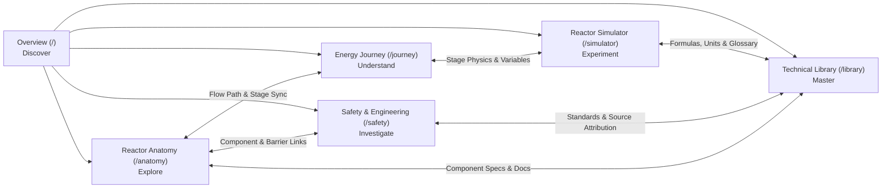

# Product Requirements Document (PRD)

| Field | Value |
|---|---|
| Doc ID | HAK-DOC-PRD |
| Status | Draft |
| Owner stage | 1 |
| Depends on | HAK-DOC-CONTRACT, HAK-DOC-STANDARD |
| Requirements | HAK-PRD-019, HAK-PRD-020, HAK-PRD-021, HAK-PRD-022, HAK-PRD-023, HAK-PRD-024, HAK-PRD-025, HAK-PRD-026, HAK-PRD-027, HAK-PRD-028, HAK-PRD-029, HAK-PRD-030, HAK-PRD-031, HAK-PRD-032, HAK-PRD-033, HAK-PRD-034, HAK-SAFE-019, HAK-SAFE-020, HAK-SAFE-021, HAK-SAFE-022, HAK-SAFE-023, HAK-SAFE-024 |

## 1. Purpose and Scope

This Product Requirements Document (PRD) defines the product scope, pedagogical architecture, module-level capabilities, top-level product requirements (`HAK-PRD` entries), and product-level safety and content boundary requirements (`HAK-SAFE` entries) for **HAKUREN — Nuclear Energy & Reactor Engineering Explorer** (*"Understand the Atom. Explore the Energy."*). It serves as the authoritative product baseline connecting Phase 0 governance rules to detailed functional requirements ([functional-requirements.md](functional-requirements.md)), non-functional requirements ([non-functional-requirements.md](non-functional-requirements.md)), and release scoping ([feature-catalog.md](feature-catalog.md)).

### 1.1 Product Definition

HAKUREN is a static, browser-based interactive civilian nuclear energy and reactor engineering exploration platform. It combines three-dimensional (3D) spatial inspection, thermodynamic energy-conversion storytelling, a bounded quantitative educational simulator, conceptual nuclear safety education, and a verified technical reference library into a cohesive web application.

- **Primary Reference Architecture:** **HAKUREN Reference PWR** — a generic, representative educational Pressurized Water Reactor (PWR) modeled on publicly documented commercial dual-loop PWR principles (`HAK-SRC-011`, `HAK-SRC-015`). It does not represent any specific licensed commercial unit; vendor-specific designs may appear only as explicitly labelled educational examples.
- **Comparison Architectures:** **Boiling Water Reactor (BWR)** (single-loop direct-cycle steam generation inside the reactor vessel, `HAK-SRC-012`, `HAK-SRC-015`) and **Small Modular Reactors (SMR)** (treated strictly as an advanced reactor *family* of compact, scalable designs incorporating passive safety and diverse coolants, never as one canonical unit, `HAK-SRC-013`, `HAK-SRC-014`).
- **Explicit Exclusions:** Nuclear fusion is deferred to future post-MVP expansion. Military nuclear applications, nuclear explosive devices, fissile-material enrichment or chemical separation workflows, real plant operational or control-room procedures, safety-grade or licensing-grade simulation claims, and protection-circumvention guidance are permanently out of scope.

### 1.2 Target Audience and Pedagogical Model

HAKUREN serves university STEM students, engineering learners, physics educators, and technically curious members of the public seeking mechanistic clarity rather than superficial infographics or opaque control-panel games.

The platform implements a **non-linear six-mode learning path**: **Discover**, **Explore**, **Understand**, **Experiment**, **Investigate**, and **Master**. Every module is standalone and directly accessible via its canonical route without forced sequential unlocking, while contextual cross-links guide learners fluidly between visual anatomy, physical causality, quantitative behavior, safety principles, and reference theory.

### 1.3 Visual and Engineering Clarity Direction

HAKUREN pairs an industrial engineering aesthetic inspired by Siemens operational clarity with high-contrast cinematic 3D presentation inspired by NVIDIA Omniverse:
- **Surface Palette:** Dark graphite and midnight navy backgrounds (`<15%` luminance surfaces) with crisp neutral grey/white typography.
- **Semantic Accents:** Cool cyan and ice blue for structural highlights, UI focus, and nominal primary/secondary visual separation; controlled amber strictly for thermal quantities and energy intensity cues; red reserved exclusively for true warning, trip, or out-of-bounds states.
- **Typography and Readability:** Tabular numerals for live telemetry, explicit SI units beside every physical quantity, and non-decorative technical iconography.

## 2. High-Level Module Capabilities

HAKUREN is organized into six canonical modules mapped to fixed client-side routes:

| Module | Canonical Route | Learning Mode | Core Product Capability |
|---|---|---|---|
| Overview | `/` | Discover | Introduces HAKUREN Reference PWR, provides a plant-level 3D overview, summarizes primary-to-secondary energy flow, highlights core nuclear concepts, visualizes high-level reference plant state, and offers non-linear entry points to all modules. |
| Reactor Anatomy | `/anatomy` | Explore | Delivers interactive 3D exploration across three hierarchical levels (**Plant**, **System**, **Component**) with highest geometric and semantic detail on the reactor; supports orbit/zoom/pan, selection, highlight, isolation, exploded view, section cut, adjustable transparency, layer toggles, synchronized component tree, camera presets, reset view, hotspots, and structured engineering inspection panels. |
| Energy Journey | `/journey` | Understand | Guides learners through seven ordered stages of energy conversion from nuclear fission in ceramic fuel to condenser cooling and feedwater return (`HAK-SRC-011`, `HAK-SRC-016`), pairing animated 3D/schematic fluid and thermal flows with clear primary-versus-secondary radiological isolation legends. |
| Reactor Simulator | `/simulator` | Experiment | Executes a bounded educational reactor-and-cycle simulation with interactive control inputs, live telemetry dashboard and historical trend charts, parameter definitions, transparent simplified equations, explicit model assumptions/validity bounds, presets, reset, and guided scenario-based learning modules. |
| Safety & Engineering | `/safety` | Investigate | Presents conceptual civilian nuclear safety engineering—defense in depth (`HAK-SRC-017`), physical fission-product barriers (`HAK-SRC-018`, `HAK-SRC-019`), decay-heat removal (`HAK-SRC-020`), active vs. passive safety (`HAK-SRC-013`, `HAK-SRC-014`), redundancy and diversity, instrumentation, and protection concepts—linked interactively to 3D plant barriers. |
| Technical Library | `/library` | Master | Provides a searchable, classified repository of technical articles, rendered mathematical formula references, canonical engineering glossary, component documentation, technical diagram catalog, source attribution (`HAK-SRC` entries), and bidirectional deep links into Anatomy, Journey, Simulator, and Safety. |

## 3. Top-Level Product Requirements

Every top-level product capability and cross-cutting constraint is defined below using `HAK-PRD` identifiers. Each requirement traces downward to detailed `HAK-FR`, `HAK-NFR`, and `HAK-SAFE` specifications.

| ID | Name | Requirement | Priority | Rationale | Source | Parent | Verification | Acceptance | Status |
|---|---|---|---|---|---|---|---|---|---|
| HAK-PRD-019 | Overview Module Capability | The platform shall provide an Overview module at route `/` introducing the HAKUREN Reference PWR, a plant-level 3D overview, system-level energy flow summary, key nuclear concepts, high-level reference status visualization, and direct navigation entry points to all six modules. | Must | Establishes immediate orientation and serves both first-time learners and returning users as an uncluttered hub. | Master Prompt s8 | - | Inspection+Demonstration | Navigating to `/` renders the plant introduction, interactive plant-level 3D overview, system-level energy flow summary, concept cards, reference status display, and working links to `/anatomy`, `/journey`, `/simulator`, `/safety`, and `/library`. | Draft |
| HAK-PRD-020 | Reactor Anatomy 3D Exploration | The platform shall provide a Reactor Anatomy module at route `/anatomy` enabling interactive 3D inspection across Plant, System, and Component levels with camera controls, selection, isolation, exploded view, section cut, transparency, layer visibility, synchronized component tree, presets, hotspots, and structured component metadata. | Must | Spatial understanding of reactor vessel internals, primary loop isolation, and balance-of-plant coupling is central to engineering comprehension. | Master Prompt s8 | - | Test+Demonstration | At `/anatomy`, users can switch across Plant, System, and Component levels, manipulate camera and inspection tools (explode, section cut, isolate, transparency, layers, presets, reset), and view complete component metadata with contextual links. | Draft |
| HAK-PRD-021 | Energy Journey Seven-Stage Flow | The platform shall provide an Energy Journey module at route `/journey` presenting the seven-stage conversion from nuclear fission in fuel through primary heat transfer, steam generation, turbine expansion, and electrical generation to condensation and feedwater return with animated flow and boundary legends. | Must | Connects microscopic fission events (`HAK-SRC-016`) to macroscopic Rankine power generation and PWR primary/secondary separation (`HAK-SRC-011`). | HAK-SRC-011 | - | Inspection+Demonstration | At `/journey`, all seven stages are navigable in sequence or directly, display synchronized animated flow (with reduced-motion alternative), and show explicit thermal/radiological boundary legends. | Draft |
| HAK-PRD-022 | Reactor Simulator Quantitative Learning | The platform shall provide a Reactor Simulator module at route `/simulator` running a bounded client-side educational simulation with interactive inputs, live multi-channel telemetry charts, historical trend buffers, formula and assumption transparency, execution state controls, presets, and guided scenarios. | Must | Lets learners test cause-and-effect relationships across reactivity, coolant flow, steam demand, and thermal output safely within disclosed bounds. | Master Prompt s8 | - | Test+Analysis | At `/simulator`, adjusting bounded inputs updates live numerical outputs and historical trend charts deterministically, displays governing simplified formulas and assumptions, and supports Play/Pause/Step/Reset and preset loading. | Draft |
| HAK-PRD-023 | Safety and Engineering Conceptual Explorer | The platform shall provide a Safety & Engineering module at route `/safety` enabling conceptual exploration of defense in depth, physical fission-product barriers linked to the 3D model, heat removal, active versus passive safety, redundancy and diversity, instrumentation, and protection concepts. | Must | Teaches how civilian plants contain fission products and remove decay heat (`HAK-SRC-017`, `HAK-SRC-018`) without exposing operational procedures. | HAK-SRC-017 | - | Inspection+Demonstration | At `/safety`, learners can inspect defense-in-depth layers, highlight physical barriers on the linked 3D view, compare active and passive cooling concepts, and read conceptual protection principles with zero procedural operator instructions. | Draft |
| HAK-PRD-024 | Technical Library Reference Hub | The platform shall provide a Technical Library module at route `/library` hosting classified technical articles, formula references, a canonical glossary, component documentation, technical diagrams, source attribution, search, and cross-links to interactive modules. | Must | Grounding visual and simulation modules in verifiable engineering definitions, units, and primary references ensures academic rigor. | Master Prompt s8 | - | Test+Inspection | At `/library`, users can search and filter articles, formulas, glossary terms, component docs, diagrams, and source entries, and follow cross-links directly to corresponding Anatomy, Journey, Simulator, or Safety views. | Draft |
| HAK-PRD-025 | Reference PWR and Comparison Scope | The platform shall center all architecture, 3D geometry, and baseline simulation parameters on the generic HAKUREN Reference PWR while providing structured architectural and safety comparisons against BWR systems and the SMR reactor family. | Must | Focusing on a generic PWR yields coherent depth while BWR (`HAK-SRC-012`) and SMR (`HAK-SRC-013`, `HAK-SRC-014`) comparisons prevent single-design misconceptions. | HAK-SRC-011 | - | Inspection | Every module clearly identifies when data pertains to the generic HAKUREN Reference PWR, labels any vendor design strictly as an example, and presents SMRs as a multi-concept family rather than a single reactor. | Draft |
| HAK-PRD-026 | Scientific Integrity and Value Provenance Labelling | The platform shall explicitly classify and visually label every displayed engineering or simulation value as `Computed`, `Reference`, `Illustrative`, or `Simulated`, accompanied by canonical SI units and source citations where applicable. | Must | Prevents learners from mistaking illustrative visuals or simplified model outputs for measured or certified plant data. | Master Prompt s2 | - | Inspection+Test | Auditing every numeric UI display across all six modules confirms an explicit provenance badge (`Computed`, `Reference`, `Illustrative`, or `Simulated`), explicit SI unit, and linked source or assumption disclosure. | Draft |
| HAK-PRD-027 | Civilian Educational Scope Boundary | The platform shall restrict all content, simulation behaviors, 3D annotations, and library entries strictly to peaceful civilian nuclear power education and exclude weapons, enrichment, reprocessing, and real-world operational control guidance. | Must | Enforces legal, ethical, and safety boundaries across all educational materials. | Master Prompt s6 | - | Inspection | Automated keyword screening and manual content review confirm zero prohibited civilian-boundary violations across all modules, schemas, and copy. | Draft |
| HAK-PRD-028 | Educational-Only Non-Operational Disclaimers | The platform shall display clear, persistent educational-only disclaimers stating that HAKUREN models and safety descriptions are non-operational, non-certified, and unsuitable for plant operation, licensing, or safety-grade engineering analysis. | Must | Eliminates ambiguity regarding model fidelity and regulatory applicability. | Master Prompt s6 | - | Inspection+Demonstration | Visiting `/simulator` or `/safety` displays a persistent, visible disclaimer banner/notice that remains accessible without obscuring primary controls. | Draft |
| HAK-PRD-029 | Static Client-Side Deployment | The platform shall operate as a 100% static client-side web application deployable to GitHub Pages with no mandatory backend server, database, or user-account infrastructure. | Must | Guarantees zero-cost static hosting, deterministic delivery, and frictionless public educational access. | Master Prompt s14 | - | Test+Inspection | Production build artifacts consist solely of static HTML, CSS, JS, JSON, and 3D assets that function completely when served from a static file host over HTTPS without backend API calls. | Draft |
| HAK-PRD-030 | Responsive Multi-Device Support | The platform shall adapt layouts, navigation, 3D viewports, and simulator controls cleanly across desktop, tablet, and mobile viewport sizes without horizontal page overflow or inaccessible controls. | Must | Ensures university and self-directed learners can study on laptops, tablets, and phones alike. | Master Prompt s8 | - | Test+Demonstration | Testing across representative desktop (`1440x900`), tablet (`768x1024`), and mobile (`390x844` and `320px` reflow) viewports shows zero clipped controls, zero unintended horizontal scrolling, and usable 3D/touch interactions. | Draft |
| HAK-PRD-031 | Accessibility and Inclusive Experience | The platform shall target WCAG 2.2 Level AA conformance across UI controls, typography, contrast, keyboard navigation, assistive technology semantics, and reduced-motion preferences (`prefers-reduced-motion`). | Must | Makes technical nuclear education accessible to keyboard-only, screen-reader, low-vision, and motion-sensitive learners (`HAK-SRC-021`, `HAK-SRC-024`). | HAK-SRC-021 | - | Test+Inspection | Automated accessibility checks and manual keyboard/screen-reader walkthroughs verify WCAG 2.2 AA compliance on all UI chrome and accessible textual alternatives for 3D and animated content. | Draft |
| HAK-PRD-032 | Scenario-Based Guided Learning | The platform shall support structured interactive learning scenarios in the Reactor Simulator containing learning goals, preconfigured initial parameters, step-by-step instructions, expected observable outcomes, and post-simulation physical explanations. | Must | Transforms open-ended parameter sliders into structured inquiry exercises that build physical intuition. | Master Prompt s8 | - | Test+Demonstration | Selecting any curated scenario loads defined initial parameters, displays goals and instructions, runs cleanly, and unlocks a post-simulation physical explanation aligned with observed trends. | Draft |
| HAK-PRD-033 | Non-Linear Learning Path | The platform shall allow learners to enter, revisit, and jump directly to any of the six modules in any order while surfacing optional progression cues aligned to the six learning modes (Discover, Explore, Understand, Experiment, Investigate, Master). | Must | Respects diverse learner backgrounds (e.g., physics students jumping straight to `/simulator` or `/library`) while still offering a coherent suggested path. | Master Prompt s7 | - | Demonstration+Test | Deep-linking directly to any of the six canonical routes loads the module immediately with full functionality, zero prerequisite locks, and working contextual cross-links to peer modules. | Draft |
| HAK-PRD-034 | Visual and Industrial Clarity System | The platform shall enforce a dark graphite/midnight navy visual theme with cool cyan/ice blue structural accents, controlled amber reserved for thermal quantities, and red reserved strictly for true warning or trip indicators. | Must | Ensures visual consistency, legible telemetry hierarchy, and clear separation between aesthetic lighting and safety-meaningful color signals. | Master Prompt s15 | - | Inspection | Visual design audit confirms all six modules adhere to defined surface, text, cyan/ice-blue, thermal-amber, and warning-red token rules without decorative red alerts or unlabelled neon styling. | Draft |

## 4. Product-Level Safety and Content Boundary Requirements

Because HAKUREN presents nuclear reactor engineering, thermodynamics, and safety concepts publicly on the web, product-level safety and content boundary requirements (`HAK-SAFE`) establish hard guardrails implemented across copy, 3D annotations, simulation physics, and QA gates.

| ID | Name | Requirement | Priority | Rationale | Source | Parent | Verification | Acceptance | Status |
|---|---|---|---|---|---|---|---|---|---|
| HAK-SAFE-019 | Persistent Simulator Educational Disclaimer | The Reactor Simulator (`/simulator`) shall display a persistent, non-dismissible educational-scope badge or banner stating that outputs come from a simplified educational model and are not operational, predictive, or safety-grade. | Must | Prevents misinterpretation of educational simulation charts as real plant behavior or licensing evidence. | Master Prompt s6 | HAK-PRD-028 | Inspection+Demonstration | Opening `/simulator` in desktop and mobile viewports displays the educational-only notice above the fold or persistently in the simulator header/footer without blocking controls. | Draft |
| HAK-SAFE-020 | Safety Module Conceptual-Only Framing | The Safety & Engineering module (`/safety`) shall describe engineered safety features, barriers, and protection concepts solely by engineering purpose, physical principle, and architectural redundancy, with an explicit conceptual-education notice. | Must | Satisfies civilian safety education goals while preventing misuse as operational or tactical plant guidance (`HAK-SRC-017`). | HAK-SRC-017 | HAK-PRD-028 | Inspection | Content audit of `/safety` confirms every barrier and protection description focuses on physical principles and architectural purpose, accompanied by a visible conceptual-only notice. | Draft |
| HAK-SAFE-021 | Exclusion of Real Operating Procedures | HAKUREN shall not present real reactor operating procedures, step-by-step control-room checklists, emergency operating procedure (EOP) action sequences, or actionable plant setpoints as operating guidance. | Must | Keeps the platform strictly within conceptual education and avoids simulating or teaching real plant manipulation protocols. | Master Prompt s6 | HAK-PRD-027 | Inspection | Audit of all scenario instructions, simulator labels, and library articles confirms zero step-by-step real-plant operating checklists or regulatory setpoint tables framed as operating guidance. | Draft |
| HAK-SAFE-022 | Exclusion of Protection-Circumvention Guidance | HAKUREN shall not describe, simulate, or provide instructions, scenarios, or vulnerability analyses for disabling, overriding, or circumventing reactor protection systems, interlocks, or engineered containment barriers. | Must | Prevents generation or presentation of adversarial failure-exploitation content. | Master Prompt s6 | HAK-PRD-027 | Inspection+Test | Inspection of simulator controls, scenario catalog, and safety text confirms no user input or narrative allows disabling automatic educational trip limits or explains how to defeat plant protection systems. | Draft |
| HAK-SAFE-023 | Exclusion of Military and Fuel-Cycle Restricted Topics | HAKUREN shall exclude all content, diagrams, parameters, and formulas related to nuclear explosive devices, military propulsion/applications, isotopic enrichment cascades, or spent-fuel chemical separation workflows. | Must | Enforces strict civilian nuclear power-generation scope across every module and Technical Library entry. | Master Prompt s6 | HAK-PRD-027 | Inspection | Automated text screening and editorial review across all static JSON/Markdown content detect zero references to prohibited military or restricted fuel-cycle processes. | Draft |
| HAK-SAFE-024 | Model Validity Range and Non-Safety-Grade Attribution | Every mathematical model, parameter bound, and simulation result exposed in the UI or Technical Library shall disclose its educational simplifications (`ASM`, `SIMP`) and validity bounds, and shall never be labelled certified, qualified, or safety-grade. | Must | Maintains scientific honesty (`FACT`/`REF` vs. `ASM`/`SIMP`) and protects learners from extrapolating lumped-parameter equations outside validity limits. | Master Prompt s2 | HAK-PRD-026 | Inspection+Analysis | Inspecting the simulator assumptions panel and library formula reference confirms every equation states its assumptions, valid operating domain, and explicit non-safety-grade limitation. | Draft |

## 5. System Boundaries and External Dependencies

- **Client-Only Execution Boundary:** All 3D scene rendering (WebGL via Three.js / React Three Fiber), numerical integration (TypeScript / Web Workers), search indexing, and UI state execute inside the user's browser. No server-side computation or live external telemetry feeds exist.
- **Static Data Boundary:** Engineering reference data, component catalogs, scenarios, and library articles are compiled or loaded as validated static JSON/Markdown assets governed by Phase 0 data contracts (`docs/11-data-contracts/`).
- **Upstream Governance Alignment:** Canonical naming (`HAKUREN Reference PWR`, `RCS`, `RPV`, `SG`, `PZR`, `RCP`, `CRDM`), claim classification tags, and source registry conventions adhere strictly to [documentation-authoring-contract.md](../00-governance/documentation-authoring-contract.md) and [DOCUMENTATION_STANDARD.md](../DOCUMENTATION_STANDARD.md).

## 6. Acceptance Criteria for the Product Baseline

The Phase 0 product requirements baseline is ready for downstream engineering (`02-domain` through `13-project-management`) when:
1. Every `HAK-PRD` requirement traces cleanly to one or more `HAK-FR`, `HAK-NFR`, or `HAK-SAFE` requirements in [functional-requirements.md](functional-requirements.md) and [non-functional-requirements.md](non-functional-requirements.md).
2. All 42 functional requirements appear in [feature-catalog.md](feature-catalog.md) mapped to modules and release tiers without duplicate ID definitions.
3. Automated documentation audits (`links`, `ids`, `metadata`, `sources`, `mermaid`, `status`, `safety`) pass with zero errors in `docs/01-product/`.

## 7. References

- `HAK-SRC-011` — NRC Pressurized Water Reactors overview
- `HAK-SRC-012` — NRC Boiling Water Reactors overview
- `HAK-SRC-013` — NRC Advanced Reactors / Small Modular Reactors overview
- `HAK-SRC-014` — DOE Advanced Small Modular Reactors (SMRs)
- `HAK-SRC-015` — DOE Nuclear 101: How Does a Nuclear Reactor Work?
- `HAK-SRC-016` — DOE Fission and Fusion: What is the Difference?
- `HAK-SRC-017` — NRC Glossary: Defense in depth
- `HAK-SRC-018` — NRC Glossary: Containment structure
- `HAK-SRC-019` — NRC Glossary: Cladding
- `HAK-SRC-020` — NRC Glossary: Reactor coolant system
- `HAK-SRC-021` — W3C Web Content Accessibility Guidelines (WCAG) 2.2
- `HAK-SRC-024` — MDN Web Docs: `prefers-reduced-motion`

## 8. Related Documents

- [Documentation Authoring Contract](../00-governance/documentation-authoring-contract.md)
- [Documentation Standard](../DOCUMENTATION_STANDARD.md)
- [Functional Requirements](functional-requirements.md)
- [Non-Functional Requirements](non-functional-requirements.md)
- [Feature Catalog](feature-catalog.md)
- [Source Registry](../08-technical-library/source-registry.md)
- `docs/07-safety/safety-content-boundaries.md` (planned Stage 7)
- `docs/14-traceability/requirement-traceability-matrix.md` (generated Stage 11)
