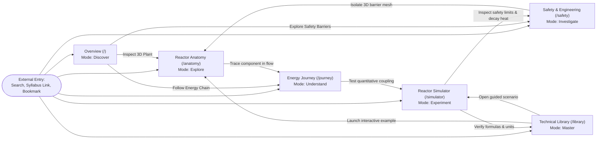
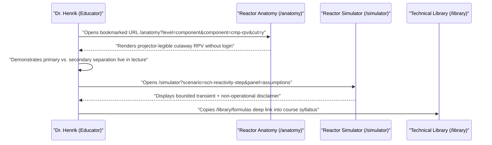
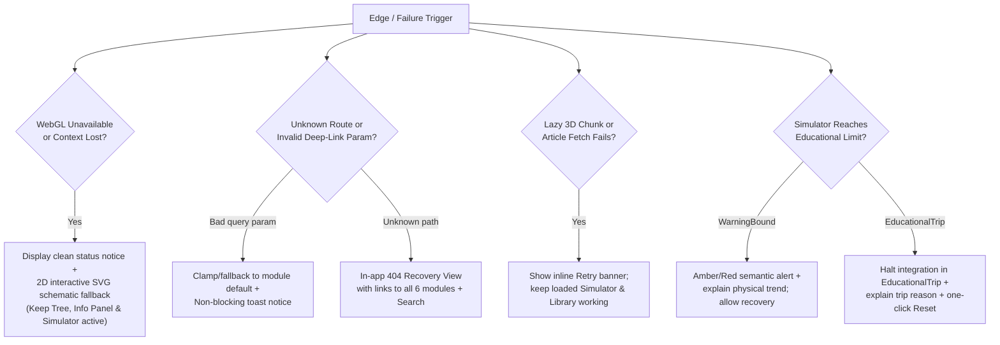

# User Journeys

| Field | Value |
|---|---|
| Doc ID | HAK-DOC-USER-JOURNEYS |
| Status | Draft |
| Owner stage | 1 |
| Depends on | HAK-DOC-PERSONAS, HAK-DOC-VISION, HAK-DOC-PRD, HAK-DOC-FR, HAK-DOC-NAVIGATION |
| Requirements | HAK-FR-098, HAK-FR-099, HAK-FR-100, HAK-PRD-003, HAK-PRD-014, HAK-PRD-030, HAK-PRD-031, HAK-PRD-032, HAK-PRD-033, HAK-FR-089, HAK-FR-091, HAK-FR-095, HAK-FR-097 |

## 1. Purpose and Scope

This document specifies end-to-end **User Journeys** across **HAKUREN** for all seven target personas defined in [Audience and Personas](../00-governance/audience-and-personas.md). It models how learners progress along the six-mode pedagogical arc (**Discover → Explore → Understand → Experiment → Investigate → Master**) while guaranteeing that every canonical module (`/`, `/anatomy`, `/journey`, `/simulator`, `/safety`, `/library`) operates standalone from direct entry (`HAK-PRD-014`, `HAK-PRD-033`). It also specifies entry/exit points, cross-module deep links, and recovery flows for edge and failure paths.

## 2. Macro Non-Linear Journey Topology

Learners are never forced through sequential locks. A high-school student may follow the canonical discovery arc starting at `/`, whereas a lecturer or engineering student may bookmark `/anatomy` or `/simulator` directly (`HAK-FR-090`, `HAK-FR-091`).

## 3. Standalone Module Entry and Exit Contract

Every module establishes self-contained orientation upon arrival so deep-linked visitors never encounter orphaned terminology or missing context (`HAK-FR-098`):

| Module | Entry Context (Direct URL or Link) | First-Fold Orientation Provided | Primary Outbound Deep Links (Exit Points) |
|---|---|---|---|
| **Overview (`/`)** | Direct landing or brand-logo return | HAKUREN Reference PWR scope framing, Plant 3D preview, system loop summary, 6 module cards (`HAK-FR-019`–`HAK-FR-025`) | `/anatomy?level=plant`, `/journey?stage=1`, `/simulator?preset=nominal`, `/safety`, `/library` |
| **Reactor Anatomy (`/anatomy`)** | Direct URL or `?level=&component=&cut=` | Active level pill (`Plant`/`System`/`Component`), synchronized ARIA Component Tree, Camera Presets, Info Panel (`HAK-FR-026`–`HAK-FR-035`) | `/journey?stage=<n>&from=anatomy`, `/simulator?focus=<par>&from=anatomy`, `/safety?barrier=<bar>&from=anatomy`, `/library/components/<cmpId>` |
| **Energy Journey (`/journey`)** | Direct URL or `?stage=1..7` | Stage progress bar (`1`–`7`), active loop boundary legend, animated/reduced-motion flow view (`HAK-FR-036`–`HAK-FR-039`) | `/anatomy?component=<cmp>&from=journey`, `/simulator?preset=nominal&from=journey`, `/library/formulas#<frmId>` |
| **Reactor Simulator (`/simulator`)** | Direct URL or `?scenario=&preset=` | Persistent educational-only banner (`HAK-SAFE-019`), state machine badge (`Ready`), presets & guided scenarios (`HAK-FR-040`–`HAK-FR-047`) | `/library/formulas#<frmId>`, `/safety?section=cooling&from=simulator`, `/journey?stage=3&from=simulator` |
| **Safety & Engineering (`/safety`)** | Direct URL or `?section=&barrier=` | Conceptual-only safety notice (`HAK-SAFE-020`), 5 Defense-in-Depth tabs, 3D-linked barrier view (`HAK-FR-048`–`HAK-FR-052`) | `/anatomy?component=<cmp>&isolate=true&from=safety`, `/library/sources#<srcId>`, `/simulator?scenario=scn-power-reduction` |
| **Technical Library (`/library`)** | Direct URL, `?q=&topic=`, or `/library/articles/:slug` | Instant search bar, domain/architecture/difficulty facets, source verification status (`HAK-FR-053`–`HAK-FR-057`) | Deep links to `/anatomy`, `/journey`, `/simulator`, `/safety` embedded in every article, formula, and component profile |

## 4. Persona-Specific User Journeys

Each persona journey below traces realistic entry triggers, module transitions, deep-link handoffs, and concrete educational outcomes grounded in [Audience and Personas](../00-governance/audience-and-personas.md).

### 4.1 Journey 1: Maya Lin (Secondary / AP Physics Student) — *Discover → Explore → Understand → Experiment*

- **Trigger & Entry:** Arrives at `/` from a science club link wanting to know how a nuclear plant generates electricity without behaving like a weapon (`HAK-SRC-034`, `HAK-SRC-035`).
- **Step-by-Step Flow:**
  1. **Overview (`/`):** Reads the civilian scope framing and Reference PWR introduction (`HAK-FR-020`), rotates the Plant 3D preview (`HAK-FR-021`), and clicks **Start Energy Journey** (`/journey?stage=1`).
  2. **Energy Journey (`/journey`):** Steps through Stages `1`–`7` (`HAK-FR-036`), observing via the Radiological Boundary Legend (`HAK-FR-039`) that radioactive primary water stays inside the containment loop and never enters the turbine or cooling sink.
  3. **Reactor Anatomy (`/anatomy?level=system&component=cmp-sg`):** Clicks "Inspect Steam Generator in 3D" from Stage 4; uses the **Section Cut** slider (`HAK-FR-032`) to see primary U-tubes separated from secondary water.
  4. **Reactor Simulator (`/simulator?preset=nominal`):** Adjusts control-rod reactivity slightly within `Beginner` mode (`HAK-FR-104`) to watch thermal power settle smoothly without hitting an `EducationalTrip`.
  5. **Safety & Engineering (`/safety?section=barriers`):** Briefly checks the four nested fission-product barriers to dispel weapon/explosion misconceptions (`HAK-PRD-011`).
- **Exit Outcome:** Can articulate why PWRs use two closed water loops (`HAK-SRC-034`), distinguishes fission power from weapons, and returns anytime without an account.

### 4.2 Journey 2: Daniel Okafor (Undergraduate Mech/Nuclear Student) — *Explore → Understand → Experiment → Master*

- **Trigger & Entry:** Enters directly at `/anatomy?level=component&component=cmp-pzr` via a thermodynamics lab handout (`HAK-PRD-014`).
- **Step-by-Step Flow:**
  1. **Reactor Anatomy (`/anatomy`):** Switches from `System` to `Component` level (`HAK-FR-026`), applies **Exploded View** (`60%`, `HAK-FR-031`) on the Reactor Pressure Vessel (`RPV`) and fuel assemblies, and checks representative SI pressures/temperatures (`Reference` provenance badges, `HAK-FR-058`).
  2. **Energy Journey (`/journey?stage=7`):** Jumps to Stage 7 to verify why roughly two-thirds of thermal power is rejected at the condenser (`HAK-PRD-007`).
  3. **Reactor Simulator (`/simulator?scenario=scn-coolant-flow-change`):** Runs a guided load/flow scenario (`HAK-FR-047`), inspects `Simulated` core outlet temperature curves (`HAK-FR-041`), and opens the **Formulas & Assumptions** drawer (`HAK-FR-044`, `HAK-FR-045`).
  4. **Technical Library (`/library/formulas#frm-rankine-efficiency`):** Follows the deep link to verify SI unit conversions and cites `HAK-SRC-034` in his lab report.
- **Exit Outcome:** Links 3D spatial geometry to Rankine energy balance and inspects model assumptions rather than treating curves as black-box truth.

### 4.3 Journey 3: Sora Takahashi (Electrical & Power Systems Learner) — *Understand → Experiment → Investigate*

- **Trigger & Entry:** Enters directly at `/journey?stage=5` searching for how nuclear thermal output couples to synchronous AC grid generation.
- **Step-by-Step Flow:**
  1. **Energy Journey (`/journey?stage=5` → `stage=6`):** Traces steam expansion (`Stage 5`) into synchronous electrical generation (`Stage 6`), noting `MWth` vs. `MWe` metrics (`HAK-FR-038`).
  2. **Reactor Anatomy (`/anatomy?level=plant&component=cmp-turbine-gen`):** Inspects the turbine building relative to containment and primary Reactor Coolant Pumps (`RCP`), clarifying plant auxiliary electrical load.
  3. **Reactor Simulator (`/simulator?preset=part-load`):** Varies secondary steam load demand (`HAK-FR-040`) and observes thermal inertia lag compared to fast power electronics.
  4. **Safety & Engineering (`/safety?section=passive-active`):** Reviews why onsite/backup electrical power matters for active pumps versus passive gravity/convection cooling (`HAK-FR-051`).
- **Exit Outcome:** Understands thermal-mechanical-electrical coupling and why loss-of-offsite-power resilience shapes safety architecture.

### 4.4 Journey 4: Elena Novak (Energy Systems & Policy Learner) — *Discover → Investigate → Master*

- **Trigger & Entry:** Lands on `/` to evaluate PWR, BWR, and SMR concepts objectively for a clean-energy policy brief (`HAK-PRD-016`).
- **Step-by-Step Flow:**
  1. **Overview (`/`):** Notes the generic **HAKUREN Reference PWR** framing and clicks **Safety & Engineering** (`/safety`).
  2. **Safety & Engineering (`/safety?section=defense&compare=smr`):** Explores all five Defense-in-Depth layers (`HAK-FR-048`), toggles the PWR vs. BWR vs. SMR comparison matrix (`HAK-FR-060`), and confirms SMRs are presented as a diverse family rather than one design (`HAK-SRC-003`).
  3. **Energy Journey (`/journey?stage=4&compare=bwr`):** Uses the optional BWR single-loop overlay note (`HAK-FR-039`) to see how BWRs boil directly inside the vessel without steam generators (`HAK-SRC-034`).
  4. **Technical Library (`/library/sources`):** Reviews primary regulatory/government citations and `Verified` vs. `Partially verified` flags (`HAK-FR-056`).
- **Exit Outcome:** Leaves with accurate, source-verified PWR/BWR/SMR terminology free of vendor marketing claims.

### 4.5 Journey 5: Dr. Henrik Lindqvist (University Educator) — *Direct Deep-Link Classroom Workflow*

- **Trigger & Entry:** Bookmarks deep-link URLs directly for live lecture projection and pre-lab assignments (`HAK-PRD-014`).
- **Critical Needs Met:** Zero login friction (`HAK-CON-018`), high-contrast midnight-navy projector readability (`HAK-PRD-034`), explicit validity bounds (`HAK-SAFE-019`), and deterministic `popstate` Back navigation (`HAK-FR-093`).

### 4.6 Journey 6: Kenji Watanabe (Technical Enthusiast & Graphics/Sim Engineer) — *Explore → Experiment → Master*

- **Trigger & Entry:** Enters `/anatomy?level=component` to inspect reactor core WebGL detail (`HAK-PRD-004`).
- **Step-by-Step Flow:**
  1. **Reactor Anatomy (`/anatomy`):** Tests `Component` level isolation (`HAK-FR-030`), enclosure transparency (`HAK-FR-032`), and core lattice details.
  2. **Reactor Simulator (`/simulator?panel=formulas`):** Switches to `Advanced` difficulty layer (`HAK-FR-104`), triggers `Single Step` execution (`HAK-FR-043`), scrubs the rolling history buffer (`HAK-FR-042`), and inspects `ASM`/`SIMP` numerical assumptions (`HAK-FR-045`).
  3. **Technical Library (`/library/articles/simulation-foundations`):** Reads the point-kinetics and lumped-parameter trade-offs (`HAK-FR-053`).
- **Exit Outcome:** Validates both rendering craft and transparent numerical honesty.

### 4.7 Journey 7: Amina Al-Mansoor (Accessibility-Focused Self-Learner) — *Keyboard & Screen-Reader Parity Journey*

- **Trigger & Entry:** Navigates to `/` using keyboard and screen reader with OS `prefers-reduced-motion: reduce` enabled and `200%` browser zoom (`HAK-PRD-031`).
- **Step-by-Step Flow:**
  1. **Overview (`/`):** Uses the Skip Link (`HAK-FR-088`) to bypass header chrome; reads semantic headings and high-contrast cards (`HAK-FR-080`).
  2. **Reactor Anatomy (`/anatomy`):** Never touches a mouse: tabs into the synchronized **Component Tree** (`HAK-FR-033`), uses arrow keys per APG Tree View (`HAK-SRC-027`) to select `Steam Generator`, hears an `aria-live` selection announcement (`HAK-FR-087`), activates a keyboard Camera Preset button (`HAK-FR-078`), and reads the structured Component Info Panel (`HAK-FR-035`).
  3. **Energy Journey (`/journey`):** Sees static directional flow arrows instead of moving particles (`HAK-FR-081`, `HAK-SRC-032`) and reads the tabular energy-balance metrics (`HAK-FR-082`).
  4. **Reactor Simulator (`/simulator`):** Uses keyboard stepper buttons rather than dragging sliders (`HAK-FR-084`, `WCAG 2.2 SC 2.5.7`), hears `aria-live` state announcements on `WarningBound` (`HAK-FR-087`), and reads tabular KPIs alongside charts (`HAK-FR-082`).
- **Exit Outcome:** Achieves full learning parity across all six modules without visual/motion barriers or pointer-only traps.

## 5. Failure, Error, and Edge-Case Journeys

A robust specification defines what happens when hardware, network, URLs, or learner inputs hit boundaries (`HAK-FR-100`):

| Edge / Failure Condition | Affected Modules | Expected System Behavior & Learner Recovery Path | Governing Requirements |
|---|---|---|---|
| **WebGL Unavailable or GPU Context Lost** | `/`, `/anatomy`, `/journey`, `/safety` | Automatically fall back to an interactive 2D SVG/canvas schematic (`HAK-NFR-026`) while keeping the Component Tree, Info Panel, Stage Metrics, and Barrier Explorer 100% functional; show a non-intrusive status banner with **Retry 3D** when context recovers. | `HAK-NFR-026`, `HAK-FR-100` |
| **Invalid or Stale Deep-Link Query Parameter** | `/anatomy`, `/journey`, `/simulator`, `/safety` | Normalize out-of-range or unknown IDs via `history.replaceState` to safe defaults (e.g., `Plant Overview`, Stage `1`, `Nominal` preset) and display an inline dismissible notice explaining the fallback. | `HAK-FR-091`, `HAK-FR-100` |
| **Unknown Sub-Route / Typo URL** | All routes (`/*`) | Render the in-app `404` Recovery View inside the standard global nav shell with direct links to all six modules and pre-filled Library search (`HAK-FR-095`). | `HAK-FR-094`, `HAK-FR-095` |
| **Offline / Network Drop on Lazy Chunk Fetch** | `/anatomy`, `/library` | Catch chunk/asset fetch failure cleanly, display an inline **Retry** action (`HAK-NFR-034`), and preserve interactive Simulator and already-cached views. | `HAK-NFR-034`, `HAK-FR-100` |
| **Simulator `WarningBound` or `EducationalTrip`** | `/simulator` | Transition visibly to `WarningBound` or `EducationalTrip` (`HAK-FR-043`), announce via `aria-live` (`HAK-FR-087`), display a calm educational explanation of *why* the bounded envelope was exceeded, and offer **Reset** or **Load Preset** (`HAK-FR-046`). | `HAK-FR-043`, `HAK-FR-046`, `HAK-FR-100` |
| **Narrow Viewport (`320 px`) or `200%` Zoom** | All routes | Stack side panels cleanly below/above viewports (`HAK-PRD-030`, `HAK-FR-086`), collapse top navigation into the accessible mobile drawer (`HAK-FR-089`), and wrap wide tables in local scroll containers without page-level horizontal overflow. | `HAK-PRD-030`, `HAK-FR-086` |

## 6. User Journey Requirements

| ID | Name | Requirement | Priority | Rationale | Source | Parent | Verification | Acceptance | Status |
|---|---|---|---|---|---|---|---|---|---|
| HAK-FR-098 | Standalone First-Fold Module Orientation | Every canonical module (`/`, `/anatomy`, `/journey`, `/simulator`, `/safety`, `/library`) shall render self-contained educational framing, active mode context, and primary workspace controls upon direct entry without requiring prior visits to `/`. | Must | Supports educators deep-linking directly to specific modules (`HAK-PRD-014`) and diverse persona entry points. | Master Prompt s7 | HAK-PRD-033 | Test+Demonstration | Opening each of the six canonical routes in a fresh browser session with cleared storage renders complete orientation, working module controls, and cross-links without prerequisite prompts. | Draft |
| HAK-FR-099 | Cross-Module Journey Context Handoff | Cross-module links between Anatomy, Energy Journey, Reactor Simulator, Safety & Engineering, and Technical Library shall pass typed deep-link parameters so learners arrive directly at the corresponding component, stage, parameter, barrier, or reference entry. | Must | Preserves causal continuity across the six learning modes without forcing manual re-navigation. | Master Prompt s8 | HAK-PRD-014 | Test+Demonstration | Activating contextual cross-links from each module opens the destination module pre-focused on the matching entity (e.g., Stage 4 linking to `cmp-sg` in `/anatomy`). | Draft |
| HAK-FR-100 | Graceful Edge-Path and Failure Journey Recovery | Across WebGL unavailability/context loss, failed lazy asset fetches, invalid deep-link parameters, and simulator `EducationalTrip` events, the application shall preserve non-3D learning controls, explain the condition in plain language, and provide a one-action recovery path (`Retry`, `Reset`, or `Default View`). | Must | Prevents classroom or self-learner sessions from terminating in dead ends or blank screens (`HAK-NFR-026`, `HAK-NFR-034`). | Master Prompt s8 | HAK-PRD-030 | Test+Demonstration | Simulating WebGL failure, asset 404, invalid query param, and simulator trip each produce a clear recovery banner/action while keeping surrounding navigation and text panels operable. | Draft |

## 7. References

- `HAK-SRC-003`: U.S. DOE Office of Nuclear Energy — *Advanced Small Modular Reactors (SMRs)*.
- `HAK-SRC-027`: W3C WAI — *ARIA Authoring Practices Guide (APG): Tree View Pattern*.
- `HAK-SRC-032`: MDN Web Docs — *prefers-reduced-motion CSS media feature*.
- `HAK-SRC-034`: U.S. DOE Office of Nuclear Energy — *NUCLEAR 101: How Does a Nuclear Reactor Work?*
- `HAK-SRC-035`: U.S. DOE Office of Nuclear Energy — *Fission and Fusion: What is the Difference?*

## 8. Related Documents

- [Audience and Personas](../00-governance/audience-and-personas.md)
- [Product Vision](../00-governance/product-vision.md)
- [Product Requirements Document](product-requirements-document.md)
- [Functional Requirements](functional-requirements.md)
- [Non-Functional Requirements](non-functional-requirements.md)
- [Navigation Specification](navigation-specification.md)
- [Learning Experience](learning-experience.md)
- [Accessibility Requirements](accessibility-requirements.md)

## 9. Change History

Recorded centrally in [Changelog](../CHANGELOG.md).
